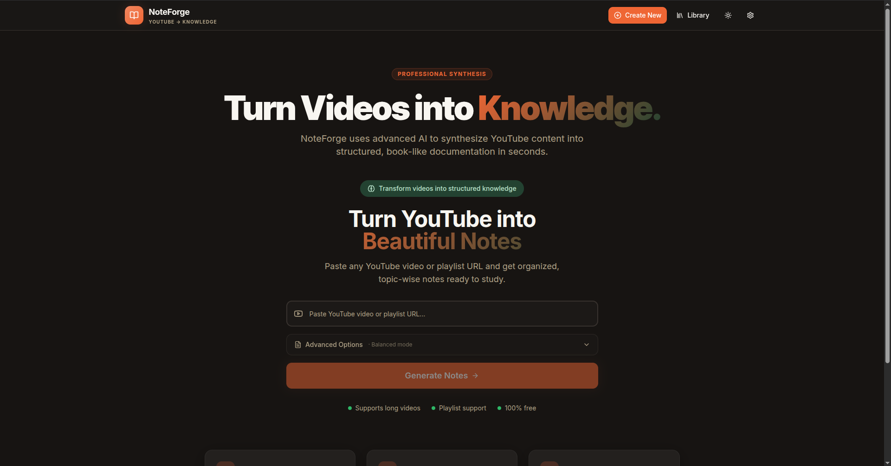
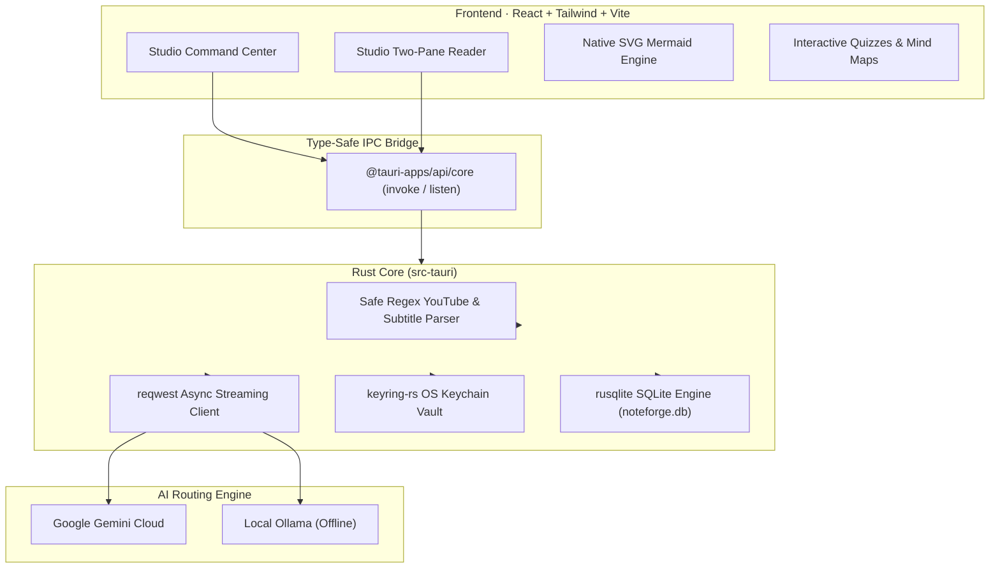

# NoteForge AI 🧠🎥

<div align="center">

**A high-performance, autonomous knowledge pipeline that transforms YouTube videos and playlists into deep study guides, interactive architecture diagrams, quizzes, and mind maps. Built as a lightweight native desktop application powered by Tauri v2 (Rust) and an un-slopped React UI.**

[](https://tauri.app/)
[](https://www.rust-lang.org/)
[](https://reactjs.org/)
[](https://www.sqlite.org/)
[](https://ollama.ai/)
[](https://deepmind.google/technologies/gemini/)

</div>

<div align="center">
  
</div>

---

## 🌟 Key Highlights & Modern Capabilities

### 1. 📺 Interactive Studio Two-Pane Mode
Study lectures side-by-side. The left pane docks the embedded YouTube video player, while the right pane presents long-form, deeply explanatory study notes.
- **Click-to-Seek Timestamps**: Every timestamp citation in the notes (e.g. `[04:15]`, `[12:30]`) is rendered as an interactive badge. Clicking any timestamp automatically seeks the video player to that exact second.
- **Focus & Studio Toggle**: Easily switch between **Studio View** (synced video + notes) and **Reader View** (distraction-free textbook mode).

### 2. ⚡ Lightweight Native Desktop App (Tauri v2 + Rust)
Replaced the bloated Electron/Node architecture with a blazing-fast native **Tauri v2** shell:
- **Tiny Memory Footprint**: Uses only **~35 MB RAM** (vs ~300 MB in Electron).
- **Fast Startup**: Launches in under 0.5 seconds using your operating system's native webview.
- **Single Native Binary**: Packaged cleanly as `.deb`, `.AppImage`, or standalone executable.

### 3. 🔐 Zero-Knowledge BYOK & OS Keychain Vault
No plaintext API keys stored on disk or leaked over network endpoints:
- Uses the `keyring-rs` Rust crate to persist user API keys directly into the **OS Keychain** (Linux Secret Service, Windows Credential Manager, macOS Keychain).
- Zero remote key storage liability.

### 4. 📊 Native Dynamic SVG Mermaid Diagrams
Notes automatically detect Mermaid code blocks and render interactive vector SVG diagrams directly in the reader:
- Pan, zoom in/out, and reset zoom controls.
- 1-click **Copy SVG** button for exporting diagrams into Obsidian, Notion, or presentations.
- Strict CSP security isolation preventing inline script injection.

### 5. 💾 Crash-Proof SQLite Persistence (`rusqlite`)
All generation jobs, video metadata, transcripts, and finalized study notebooks are persisted in an embedded local SQLite database (`noteforge.db`). If your computer reboots or goes to sleep, your entire library and active jobs remain 100% safe.

### 6. 🧠 Hybrid Cloud & Offline LLM Engine
- **Cloud Synthesis (Gemini 2.5 Flash / Groq)**: Processes full multi-hour lecture transcripts in a single shot using large context windows with free-tier auto-rotation.
- **100% Offline Privacy (Ollama / Local LLM)**: Connects directly to local Ollama models (`llama3.2`, `qwen2.5-coder`) with zero cloud data transmission.

---

## 🏗 System Architecture



---

## 📁 Repository Structure

```
NoteForge-AI/
├── src-tauri/                 # 🦀 Native Rust Core (Tauri v2)
│   ├── src/
│   │   ├── commands.rs        # Type-safe Tauri IPC commands
│   │   ├── db.rs              # Local SQLite database (rusqlite)
│   │   ├── keychain.rs        # OS Keychain BYOK vault (keyring-rs)
│   │   ├── llm.rs             # Direct reqwest streaming client
│   │   ├── youtube.rs         # Strict regex YouTube parser
│   │   ├── lib.rs             # Tauri application setup & builder
│   │   └── main.rs            # Desktop entry point
│   ├── Cargo.toml             # Rust dependencies
│   └── tauri.conf.json        # Tauri v2 window & security config
│
├── src/                       # ⚛️ React 18 Frontend
│   ├── components/
│   │   ├── notebook/
│   │   │   ├── MermaidDiagram.tsx     # Native SVG diagram renderer with zoom/pan
│   │   │   ├── NotebookShell.tsx      # Studio Two-Pane & Reader workspace
│   │   │   ├── RunningNotesViewer.tsx # Markdown reader with clickable timestamps
│   │   │   ├── QuizTab.tsx            # Self-grading interactive quiz
│   │   │   └── MindMapTab.tsx         # Interactive React Flow mind maps
│   │   ├── UrlInput.tsx               # Un-slopped URL Command bar
│   │   └── Header.tsx                 # Navigation & provider status
│   ├── pages/
│   │   ├── Create.tsx                 # Studio home & recent notebooks
│   │   ├── Library.tsx                # Saved study guides & jobs
│   │   ├── NotebookView.tsx           # Full notebook viewer
│   │   └── Process.tsx                # Live generation stepper & logs
│   ├── services/
│   │   ├── tauri.ts                   # Desktop IPC client adapter
│   │   └── api.ts                     # Hybrid API layer (Tauri + HTTP fallback)
│   └── types/                         # TypeScript interfaces
│
└── package.json               # Frontend dependencies & scripts
```

---

## 🚀 Quick Start

### Prerequisites
- **Node.js**: v18 or higher (`node -v`)
- **Rust & Cargo**: Latest stable (`rustc --version`, `cargo --version`)
- **Ollama** *(Optional, for 100% offline generation)*: `ollama run qwen2.5-coder:7b`

### 1. Install Dependencies
```bash
git clone https://github.com/Sameer-Bagul/ytvideo2notes.git
cd ytvideo2notes
git checkout feat/tauri-v2-rust-desktop

# Install frontend dependencies
npm install
```

### 2. Run in Native Desktop Mode (Recommended)
Launch the lightweight Tauri v2 desktop application:
```bash
npm run tauri dev
```
*The app will automatically compile the Rust backend, start the Vite dev server, and open in a native window with OS Keychain and SQLite integration.*

### 3. Build Desktop Installers (.deb, .AppImage, .exe, .dmg)
```bash
npm run tauri build
```
The compiled, standalone native binary will be generated in `src-tauri/target/release/bundle/`.

---

## 🛡️ Security Hardening & Best Practices

NoteForge AI adheres to strict application security standards:
- **No Remote Plaintext Key Storage**: Removed all unauthenticated `/settings/full` endpoints. Secrets never touch disk in plaintext.
- **Isolated Headless PDF Rendering**: Removed `--no-sandbox` flags and enforced `MarkdownIt({ html: false })` to eliminate remote code execution and SSRF vectors.
- **Strict Content Security Policy (CSP)**: Locked Mermaid diagrams to `securityLevel: 'strict'` to prevent XSS.
- **SSRF Prevention**: Strict regex whitelisting on all incoming YouTube URLs before parsing.

---

<div align="center">
<b>Transforming lectures into living knowledge.</b>
</div>
