# Namaste JavaScript — Season 01 (Complete Master Study Guide)

> **Source Playlist**: https://youtube.com/playlist?list=PLlasXeu85E9cQ32gLCvAvr9vNaUccPVNP
> **Job ID**: job-1794734753683
> **Status**: Completed (39 Topics across 23 Videos)
> **Backup Date**: 2026-11-15T15:28:42.985Z

---

## Lecture 1: Namaste JavaScript 🙏 Course - JS Video Tutorials by Akshay Saini [0:00]

# Namaste JavaScript 🙏 Course - JS Video Tutorials by Akshay Saini

## Introduction

JavaScript, often considered the most popular programming language in the world, has a reputation for being misunderstood. This course, **Namaste JavaScript 🙏**, aims to change that perception by delving deeply into the core fundamentals of JavaScript. In this section, we'll explore why understanding JavaScript is crucial and what this course aims to achieve.

> **💡 Tip:** JavaScript is not just a programming language; it is a foundational technology for web development, and mastering it can significantly enhance your career prospects.

### Key Objectives

1. **Core Fundamentals**: Grasp the essential concepts and principles of JavaScript.
2. **Advanced Topics**: Delve into complex topics like Closures, Prototypes, Event Loop, and Async-Await.
3. **Clear Explanation**: Provide a deep dive into these concepts to ensure a thorough understanding.
4. **Interactive Learning**: Offer practical examples and exercises to reinforce learning.

---

## Core Principles

### Why JavaScript?

- **Popularity**: JavaScript is the most popular programming language, as reported by various sources like the TIOBE Index.
- **Hate and Misunderstanding**: Despite its widespread use, many developers dislike JavaScript due to a lack of understanding.

> **⚠️ Warning:** Many developers fail in interviews because they don't have a solid grasp of core JavaScript concepts.

### Mission of the Course

- **Make JavaScript Loveable**: The primary goal is to help learners fall in love with JavaScript through comprehensive and clear explanations.
- **Free Learning**: All content is provided for free on YouTube.

### Course Overview

- **Namaste**: A Hindi word for "hello," this name reflects the greeting "Namaste JavaScript" in Hindi.
- **Course Structure**: The course will cover the inner workings of JavaScript, its execution process, and advanced topics.

### Key Takeaways

- **JavaScript's Popularity**: Understanding why JavaScript is so popular.
- **Advanced Topics**: Detailed exploration of closures, prototypes, the event loop, and async/await.
- **Interview Preparation**: Equipping learners with the knowledge needed for technical interviews.

---

## Detailed Breakdown

### JavaScript's Popularity

- **Reasons for Popularity**:
  - **Web Development**: JavaScript is the primary language for web development.
  - **Cross-Platform**: Can be used on both client and server sides (Node.js).
  - **Dynamic**: Easy to learn and use, making it accessible to beginners.

### Advanced Topics

#### Closures

- **Definition**: A closure is a function that has access to its own scope, the outer function's scope, and the global scope.
- **Example**:
  ```javascript
  function outerFunction() {
    let outerVar = 'outer';
    function innerFunction() {
      console.log(outerVar); // Accesses outerVar from the outer scope
    }
    return innerFunction;
  }
  const myClosure = outerFunction();
  myClosure(); // Outputs: outer
  ```

  > **💡 Tip:** Closures are powerful and can be used to maintain state between function calls.

#### Prototypes

- **Definition**: Prototypes in JavaScript are used to add properties and methods to objects.
- **Example**:
  ```javascript
  function Person(name) {
    this.name = name;
  }
  Person.prototype.sayHello = function() {
    console.log(`Hello, my name is ${this.name}`);
  };
  const person = new Person('Alice');
  person.sayHello(); // Outputs: Hello, my name is Alice
  ```

  > **💡 Tip:** Prototypes are essential for creating reusable code and extending built-in objects.

#### Event Loop

- **Definition**: The event loop is a mechanism that allows JavaScript to handle asynchronous operations.
- **Diagram**: 
  ```mermaid
flowchart TD
    client_app["Client Application (React)"] -->|Request| api_gw["API Gateway"]
    api_gw -->|Request| db[("Database (PostgreSQL)")]
    db -->|Response| api_gw
    api_gw -->|Response| client_app
```

  > **💡 Tip:** Understanding the event loop is crucial for handling callbacks, promises, and async/await effectively.

#### Async-Await

- **Definition**: Async-Await is a more readable way to handle asynchronous operations compared to callbacks.
- **Example**:
  ```javascript
  async function fetchData() {
    try {
      const response = await fetch('https://api.example.com/data');
      const data = await response.json();
      console.log(data);
    } catch (error) {
      console.error('Error fetching data:', error);
    }
  }
  fetchData();
  ```

  > **💡 Tip:** Async-Await makes asynchronous code easier to read and maintain.

---

## Code & Practical Examples

### Example 1: Closures

```javascript
function outerFunction() {
  let outerVar = 'outer';
  function innerFunction() {
    console.log(outerVar); // Accesses outerVar from the outer scope
  }
  return innerFunction;
}

const myClosure = outerFunction();
myClosure(); // Outputs: outer
```

### Example 2: Prototypes

```javascript
function Person(name) {
  this.name = name;
}
Person.prototype.sayHello = function() {
  console.log(`Hello, my name is ${this.name}`);
};

const person = new Person('Alice');
person.sayHello(); // Outputs: Hello, my name is Alice
```

### Example 3: Event Loop

```javascript
function fetchData() {
  return new Promise((resolve, reject) => {
    setTimeout(() => {
      resolve('Data fetched successfully');
    }, 2000);
  });
}

fetchData().then(data => console.log(data)); // Outputs: Data fetched successfully after 2 seconds
```

### Example 4: Async-Await

```javascript
async function fetchData() {
  try {
    const response = await fetch('https://api.example.com/data');
    const data = await response.json();
    console.log(data);
  } catch (error) {
    console.error('Error fetching data:', error);
  }
}

fetchData();
```

---

## Key Takeaways

- **JavaScript's Popularity**: JavaScript is widely used and highly valued in the tech industry.
- **Advanced Topics**: Closures, prototypes, event loop, and async/await are crucial for mastering JavaScript.
- **Clear Explanation**: The course will provide detailed explanations and practical examples to ensure a deep understanding.
- **Free Resources**: All content is available for free, making learning accessible to everyone.

---

By the end of this course, you will have a solid grasp of JavaScript's core fundamentals and be well-prepared for advanced topics. Stay tuned for the next video where we will explore how JavaScript works and the inner workings of the JavaScript engine!

> **💡 Tip:** Don't hesitate to revisit these notes and examples as you progress through the course to reinforce your understanding.

---

Feel free to reach out if you have any questions or need further clarification. Happy learning!

---

## Lecture 2: How JavaScript Works 🔥& Execution Context | Namaste JavaScript Ep.1 [0:00]

# Comprehensive Study Notes for "How JavaScript Works 🔥 & Execution Context | Namaste JavaScript Ep.1" [00:00]

## Introduction to How JavaScript Works Behind the Scenes [00:03]
JavaScript, as a programming language, executes code in a manner that revolves around the concept of *execution contexts*. This fundamental principle is key to understanding how JavaScript operates, especially when it comes to managing variables and functions.

## Execution Context in JavaScript [00:20]
- **Core Fundamental**: "Everything in JavaScript happens inside the Execution Context."
- **Execution Context**: Think of it as a big container where all JavaScript code execution takes place.
  - **Memory Component**: Stores variables and functions as key-value pairs.
  - **Code Component**: Executes code line by line.

### Key Components of Execution Context
- **Memory Component**:
  - **Variable Environment**: This component stores variables and functions.
  - **Key-Value Pairs**: Variables and functions are stored as key-value pairs, making it easy to reference and manipulate them during execution.

- **Code Component**:
  - **Thread of Execution**: This component is responsible for executing the code one line at a time.
  - **Synchronous Nature**: The code is executed in a specific, linear order.

### Diagram: Execution Context
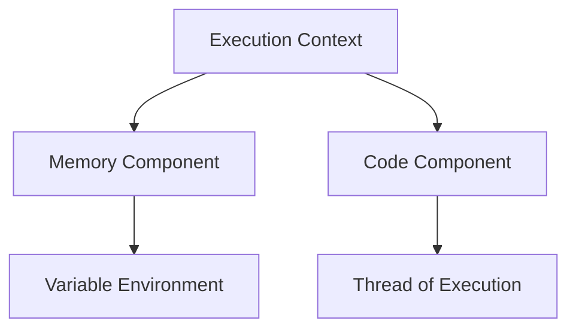

## Variable Environment of Execution Context [01:29]
- **Variable Environment**: This is the memory component where variables and functions are stored as key-value pairs.
- **Example**:
  ```javascript
  let a = 10;
  function add(b) {
    return a + b;
  }
  ```
  - `a` and `add` are stored as key-value pairs in the Variable Environment.

## Thread of Execution in JavaScript [02:00]
- **Thread of Execution**: This is the code component that executes the JavaScript code one line at a time.
- **Synchronous Execution**: JavaScript can only execute one command at a time in a specific order.
  - **Core Fundamental**: JavaScript is a **synchronous single-threaded language**.
  - **Implication**: Once a line of code finishes execution, the next line is executed.

### Example of Synchronous Execution
```javascript
console.log("Hello, World!");
let a = 10;
let b = 20;
console.log(a + b);
```
- The execution would follow this order:
  1. `console.log("Hello, World!");`
  2. `let a = 10;`
  3. `let b = 20;`
  4. `console.log(a + b);`

## Is JavaScript Synchronous or Asynchronous? [02:15]
- **Synchronous**: JavaScript executes one command at a time, in a specific order.
- **Asynchronous**: JavaScript can handle tasks without blocking the main execution flow. However, this is a different concept from being synchronous or single-threaded.
  - **AJAX Example**: AJAX is asynchronous, but it doesn't change the synchronous nature of JavaScript.

### Key Difference
- **Synchronous**: One command at a time, in order.
- **Asynchronous**: Can handle tasks without blocking the main execution, but still executes one command at a time.

### Diagram: Synchronous vs. Asynchronous
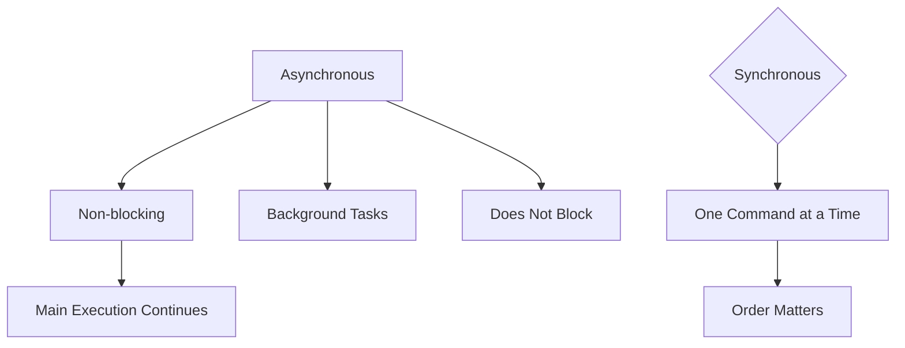

## Is JavaScript Single-threaded or Multi-threaded? [02:53]
- **Single-threaded**: JavaScript can only execute one command at a time.
- **Multi-threaded**: Multiple threads can execute simultaneously.

### Key Differences
- **Single-threaded**: JavaScript has only one main thread for executing code.
- **Multi-threaded**: Allows multiple threads to run concurrently.

### Example of Single-threaded Nature
```javascript
console.log("Start");
setTimeout(() => {
  console.log("Timeout");
}, 0);
console.log("End");
```
- Output: `Start`, `End`, `Timeout` (due to event loop and non-blocking nature of `setTimeout`).

### Diagram: Single-threaded vs. Multi-threaded
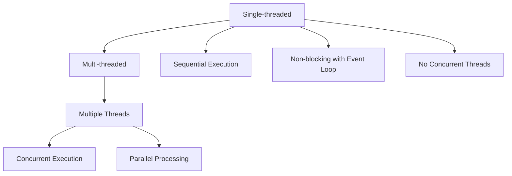

## Conclusion [04:01]
- **Execution Context**: Central to understanding how JavaScript executes code.
- **Memory Component**: Stores variables and functions.
- **Code Component**: Executes code one line at a time.
- **Synchronous Single-threaded**: Ensures code is executed in a specific, linear order.
- **AJAX**: Asynchronous operations, but doesn't change synchronous nature.

### Next Steps
- **Next Video**: Detailed walkthrough of a real JavaScript program, showing how the execution context is created and how code is executed.

> **💡 Tip:** Understanding execution contexts is crucial for grasping how JavaScript manages memory and executes code.

---

## Lecture 3: How JavaScript Code is executed? ❤️& Call Stack | Namaste JavaScript Ep. 2 [0:00]

# How JavaScript Code is Executed? ❤️ & Call Stack | Namaste JavaScript Ep. 2

## Introduction
> **💡 Tip:** Understanding the execution context is fundamental to grasping how JavaScript operates. [0:00]

## What Happens When You Run JavaScript Code?
JavaScript code execution involves the creation and management of execution contexts. Each execution context acts as a "box" containing the memory and code components. [0:00]

### Example Code
```javascript
let n = 2;
function square(num) {
    return num * num;
}
let square2 = square(n);
let square4 = square(n * n);
```

### Execution Context Creation
When you run the above JavaScript code, several execution contexts are created. Let's break down the process.

## Global Execution Context Creation
When the JavaScript program is executed, a **global execution context** is created first. This is the top-level execution context that serves as the initial environment for the program. [0:06]

## Execution Context Components
Each execution context has two main components:
- **Memory Component:** Stores variable values and function code.
- **Code Component:** Contains the code of the context.

### Memory Allocation Phase
The **Memory Allocation Phase** is the first phase of execution context creation. During this phase, JavaScript:
1. Allocates memory to all variables and functions.
2. Stores a special value (`undefined`) in memory for variables that have not been initialized.
3. Stores the entire function code in memory for functions.

#### Example: Memory Allocation
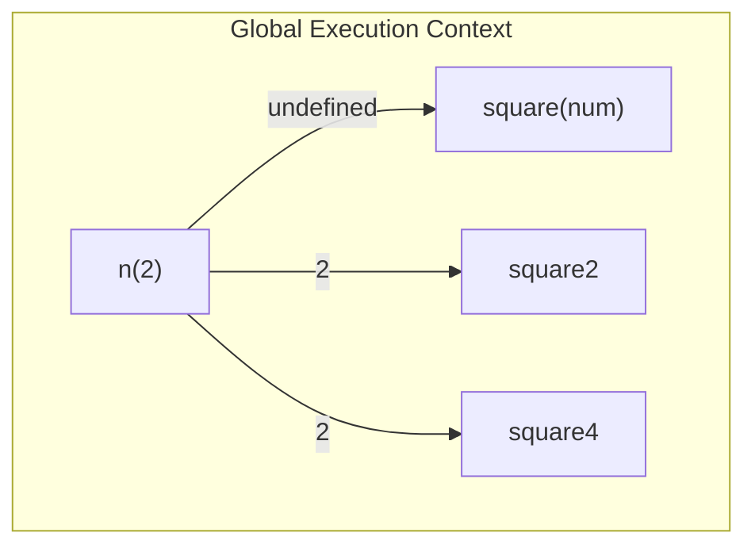

### Code Execution Phase
The **Code Execution Phase** is the second phase of execution context creation. During this phase:
1. Variables and functions are fully initialized.
2. The code of functions is executed.
3. Function invocations create new execution contexts.

#### Example: Code Execution
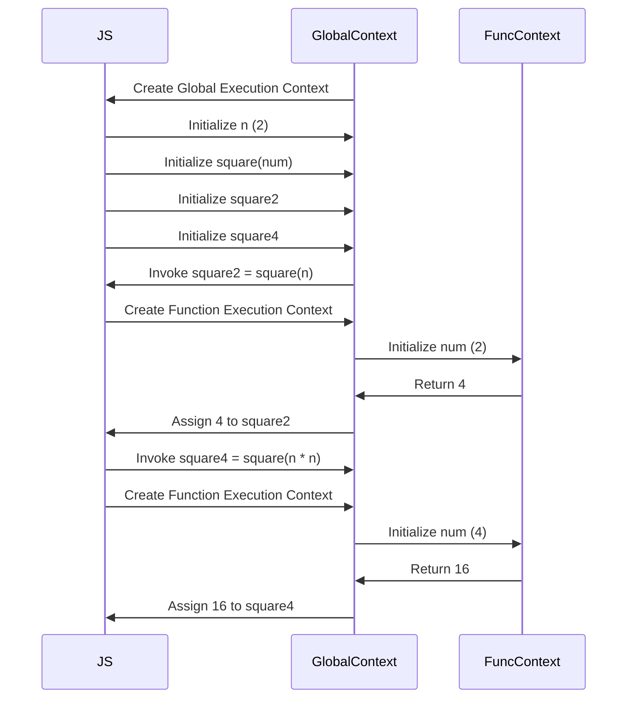

## Function Invocation and Execution Context Creation
When a function is invoked, a new execution context is created, isolated from the global context. This context has its own memory and code components, and variables declared in it are not accessible outside this context. [0:43]

### Example: Function Invocation
```javascript
function square(num) {
    return num * num;
}
```

When `square(n)` is invoked:
- A new execution context is created.
- Memory is allocated for the local variable `num` and assigned the value `2`.
- The function's code is executed, returning `4`.

#### Mermaid Diagram: Function Invocation
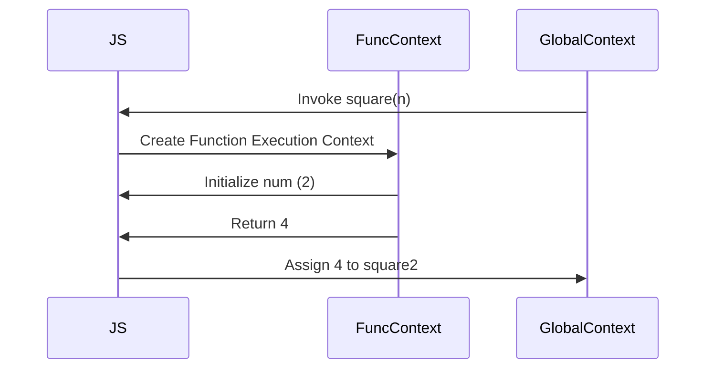

## Memory Allocation and Execution
- **Memory Allocation:** During the creation phase, memory is allocated for all variables and functions.
- **Execution Phase:** During the execution phase, the actual values are assigned and the function code is executed.

### Return Statement
When a function returns, the execution context is popped off the call stack. The value returned by the function is then assigned to the variable that called it. [0:59]

### Example: Return Statement
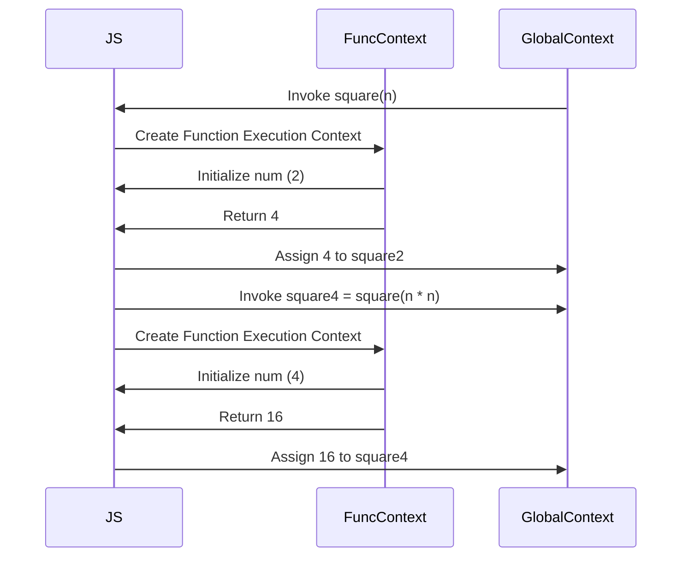

## Summary
1. **Global Execution Context:** The top-level context that initializes the program.
2. **Memory Allocation Phase:** Allocates memory for variables and functions.
3. **Code Execution Phase:** Executes the code and assigns actual values.
4. **Function Invocation:** Creates a new execution context with its own memory and code components.

> **💡 Tip:** Understanding these phases is crucial for debugging and optimizing your JavaScript code. [1:53]

## Additional Resources
- [Namaste JavaScript Ep. 2 - Video Transcript] [0:00]
- [More on Execution Context] [0:00]

---

## Lecture 4: Hoisting in JavaScript 🔥(variables & functions) | Namaste JavaScript Ep. 3 [0:00]

# Hoisting in JavaScript: Variables & Functions

## Introduction to Hoisting in JavaScript [00:00]

> **💡 Tip:** Hoisting is a JavaScript mechanism where variables and function declarations are moved to the top of their containing scope during the compilation phase.

### Example: Basic Understanding [00:35]

```javascript
console.log(x);  // Output: undefined
var x = 7;

console.log(getName());  // Output: "Namaste JavaScript"
function getName() {
  return "Namaste JavaScript";
}
```

### Expected Behavior [00:58]

- In most programming languages, trying to access a variable or function before it is declared would result in an error.
- However, in JavaScript, hoisting allows you to access these variables and functions before they are defined, leading to the output as seen in the video.

## Definition of Hoisting [01:17]

Hoisting is a JavaScript mechanism where variable and function declarations are moved to the top of their containing scope during the compilation phase.

### Example of Hoisting [01:39]

```javascript
console.log(x);  // Output: undefined
var x = 7;
```

### Example of Function Hoisting [01:55]

```javascript
console.log(getName());  // Output: "Namaste JavaScript"
function getName() {
  return "Namaste JavaScript";
}
```

## Functions Hoisting Behind the Scenes [02:36]

### Memory Allocation During Compilation [02:48]

- When a JavaScript program starts executing, memory is allocated to each and every variable and function, even before the code starts executing.
- This allocation occurs in the memory creation phase of the execution context.

### Example of Memory Allocation [03:20]

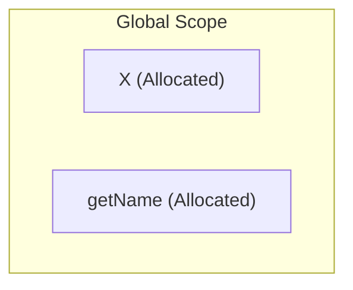

### Detailed Execution Context [04:04]

- Execution Context: Created in two phases - Memory Creation Phase and Execution Phase.
- Memory Creation Phase: Allocates memory for variables and functions.

### Example of Execution Context [04:39]

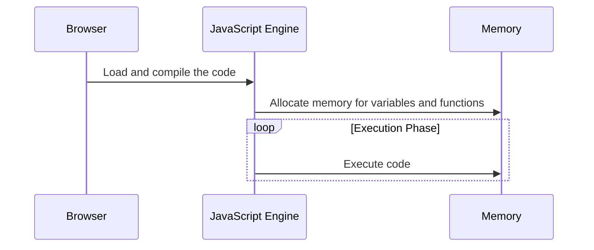

## Variables vs. Functions in Hoisting [05:18]

### Variables [05:27]

- Variable declarations are moved to the top of the containing scope.
- Variable assignments are not hoisted, only the declarations.

### Example of Variables [05:44]

```javascript
console.log(x);  // Output: undefined
var x = 7;
```

### Functions [05:53]

- Function declarations are hoisted to the top of the containing scope.
- The function body is not hoisted; only the function name is available.

### Example of Functions [06:15]

```javascript
console.log(getName());  // Output: "Namaste JavaScript"
function getName() {
  return "Namaste JavaScript";
}
```

## Diving Deep Under the Hood [06:36]

### Debugging with Debugger [06:48]

- By using a debugger, you can see how memory is allocated even before the code starts executing.
- This helps in understanding why certain behaviors occur.

### Example of Debugger Usage [07:10]

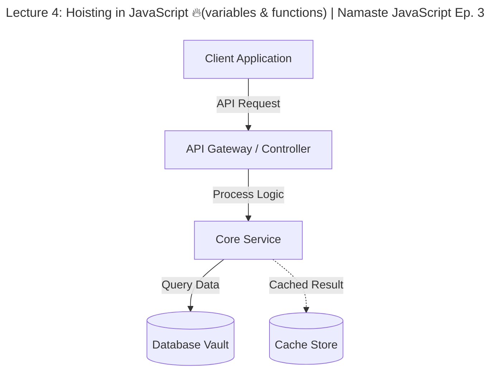

## Summary and Interview Tip [07:32]

### Summary [07:44]

- Hoisting is a JavaScript mechanism where variable and function declarations are moved to the top of their containing scope.
- Variables are hoisted with their declarations, but not their assignments.
- Functions are fully hoisted, allowing the function name to be used before the function body.

### Interview Tip [08:06]

- **Tip:** Always remember that function hoisting occurs completely, while variable hoisting only occurs with declarations.

## Conclusion [08:20]

Understanding hoisting is crucial for writing clean and error-free JavaScript code. By knowing how variables and functions are hoisted, you can avoid common pitfalls and write more robust applications.

> **⚠️ Warning:** Be cautious with the order of variable and function declarations to avoid unexpected behavior.

---

This structured guide should help you understand the concept of hoisting in JavaScript, including both variables and functions, with a focus on practical examples and deep insights into how the JavaScript engine processes code.

---

## Lecture 5: How functions work in JS ❤️ & Variable Environment | Namaste JavaScript Ep. 4 [0:00]

# Comprehensive Study Notes for "How Functions Work in JS ❤️ & Variable Environment | Namaste JavaScript Ep. 4"

## Introduction - Function Invocation and Variable Environment in JS

> **💡 Tip:** This topic delves into the core of JavaScript's function invocation and the variable environment, essential for understanding more advanced topics such as scope, closures, and function hoisting.

### Overview
In this lecture, we will explore how functions work in JavaScript, focusing on variable environments and the call stack. We'll demonstrate these concepts through a practical example and a detailed explanation of how JavaScript handles variable names in different scopes.

## Deep Dive Explanation of the Code of Function Invocation

### Example Code
Let's start with a simple example:

```javascript
// Global execution context
var x = 1;  // Global variable

function a() {
    var x = 10;  // Local variable within function 'a'
    console.log(x);  // Outputs 10
}

function b() {
    var x = 100;  // Local variable within function 'b'
    console.log(x);  // Outputs 100
}

// Function calls
a();
b();
console.log(x);  // Outputs 1
```

### Execution Context and Call Stack

> **⚠️ Warning:** The call stack is a crucial component of JavaScript's execution environment. Understanding it helps in grasping how functions are invoked and how variables are scoped.

#### Step-by-Step Execution

1. **Global Execution Context Creation:**
   - The global execution context is created.
   - Memory is allocated for global variables and functions.
   - `x` is initially set to `undefined` in the global scope.

2. **Global Memory Allocation:**
   - Memory is allocated for `x`, `a`, and `b`.
   - `a` and `b` store the function code.

3. **Invoking Functions:**
   - When `a` is invoked, a new execution context is created.
   - Memory is allocated for `x` in this local scope, setting it to `10`.
   - `console.log(x)` outputs `10`.

4. - When `b` is invoked, another execution context is created.
   - Memory is allocated for `x` in this local scope, setting it to `100`.
   - `console.log(x)` outputs `100`.

5. - Finally, `console.log(x)` in the global scope outputs `1` because the global `x` retains its initial value.

### Visual Representation

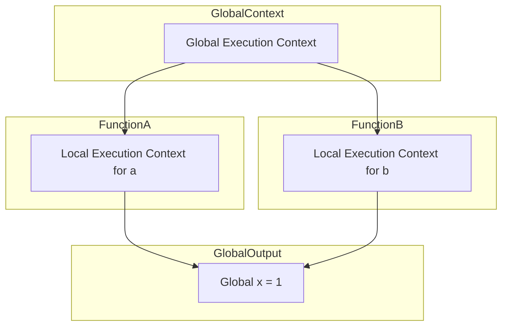

## How the Call Stack Works Behind the Scenes in JS

### Understanding the Call Stack

- The call stack is a stack data structure that keeps track of function calls and their respective execution contexts.
- Each time a function is called, a new frame is pushed onto the call stack.

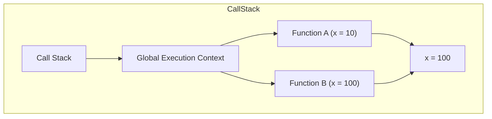

### Step-by-Step Execution on the Call Stack

1. **Initialization:**
   - The global execution context is created, and the call stack is initialized with it.

2. **Function A Invocation:**
   - `a` is called, creating a new frame with `x = 10`.
   - The call stack now has two frames: global and `a`.

3. **Function B Invocation:**
   - `b` is called, creating another frame with `x = 100`.
   - The call stack now has three frames: global, `a`, and `b`.

4. **Return to Global Context:**
   - Once `b` completes, the `b` frame is popped off the stack.
   - The call stack now has two frames: global and `a`.

5. **Final Output:**
   - The global `x` is logged, outputting `1`.

## Demo of Variable Environment and Call Stack in Browser

### Browser Output
The browser output is:

```
10
100
1
```

### Code Execution Explanation
- The global `x` is `1`.
- `a` sets a local `x` to `10`.
- `b` sets a local `x` to `100`.
- The global `x` retains its initial value of `1`.

## Summary of JS Fundamentals Covered

- **Function Invocation:** Functions can be called before or after their declaration.
- **Variable Scope:** Local variables shadow global variables with the same name.
- **Call Stack:** Manages function execution and context switching.

## Teaser of Next Video - Shortest JavaScript Program

In the next video, we will explore the shortest possible JavaScript program, which will help us understand the basics of creating a functional program in the language.

---

Feel free to ask any questions or seek further clarification on any of the points discussed in this lecture!

---

## Lecture 6: SHORTEST JS Program 🔥window & this keyword | Namaste JavaScript Ep. 5 [0:00]

## Introduction to National Education Point Extension for Global Education

> **💡 Tip:** This video discusses the National Education Point Extension for Global Education. Let's explore the key concepts and functionalities.

### Overview
The video begins by introducing the National Education Point Extension for Global Education. This extension aims to enhance the reach and accessibility of education on a global scale. It focuses on creating a seamless learning environment that can be accessed from anywhere.

### Features
- **National Education Point (NEP):** A comprehensive platform for education that can be adapted to different national contexts.
- **National Contact Point (NCP):** A central hub for managing and coordinating educational resources and services.
- **Global Contact Point (GCP):** A global coordination center that facilitates communication and collaboration among different educational institutions and platforms.
- **Global Disposal Point (GDP):** A mechanism for managing and disposing of educational content and resources in an automated and efficient manner.

### Code Snippet Example
The video provides a code snippet to demonstrate how to subscribe to the National Education Point Extension:

```javascript
// Assuming the video is at 4:00
const subscribe = function() {
    console.log("Good day water inside");
    console.log("First Global Education Creative and Stream");
    console.log("And a great solution all the things");
    console.log("Automatically subscribe to");
    console.log("Nothing interesting subscribe to");
    console.log("subscribe the Channel Please");
    console.log("subscribe and subscribe button");
    console.log("But JavaScript view not inside function");
    console.log("Okay so supported for adequate usage");
    console.log("Subscribe create a function in the function");
    console.log("Decide subscribe now to back");
    console.log("subscribe subscribe console");
}
```

### Key Points
- **Subscribing to the Channel:** The video emphasizes the importance of subscribing to the channel to stay updated with the latest developments.
- **JavaScript Considerations:** The video mentions that JavaScript view is not inside the function, indicating that the functionality is supported for adequate usage.

### Mermaid Diagram
To illustrate the flow of the subscription process, let's create a Mermaid diagram:

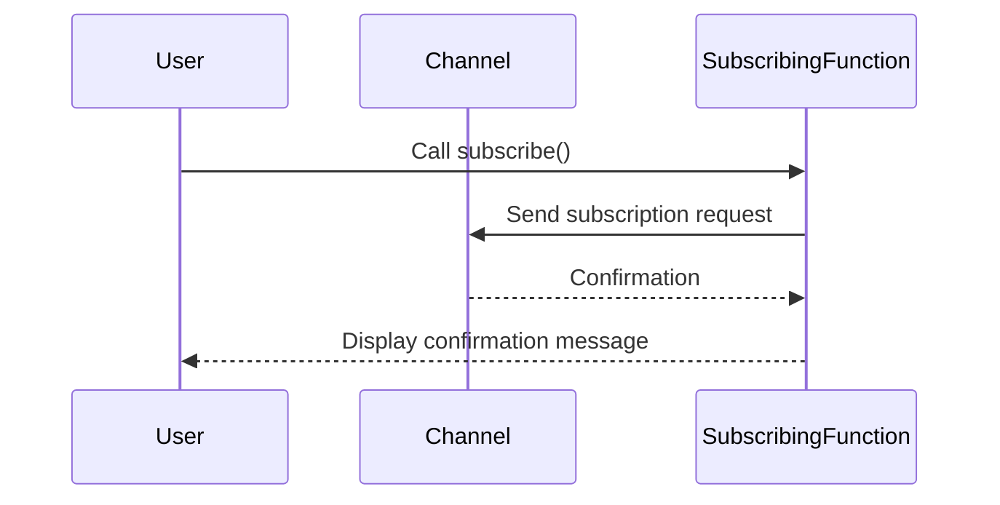

### Conclusion
The video concludes by reinforcing the importance of subscribing to the channel and providing a comprehensive overview of the National Education Point Extension for Global Education. The key takeaway is the automated and efficient management of educational resources and the importance of staying updated through regular subscriptions.

> **💡 Tip:** Don't try to force anything in front of his own dot. Automate access to all the information in the program and don't try to force anything in front of 800 million examples.

---

## Lecture 7: undefined vs not defined in JS 🤔 | Namaste JavaScript Ep. 6 [0:00]

# Comprehensive Study Notes on "undefined vs not defined in JS 🤔 | Namaste JavaScript Ep. 6"

## Introduction to undefined in JavaScript

undefined is a special keyword in JavaScript that serves as a placeholder. It is a fundamental concept to understand, especially when dealing with variable initialization and memory allocation in JavaScript.

### Key Points:
- JavaScript allocates memory to variables even before the code is executed.
- undefined is a placeholder that JavaScript uses when a variable is declared but not assigned a value.

#### Timestamp: [0:00]

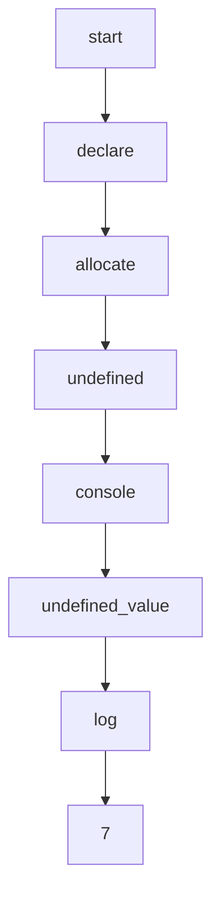

### Code Example of undefined in JS

#### Example 1:
```javascript
let a;
console.log(a); // Output: undefined
```

> **💡 Tip:** In this example, `a` is declared but not assigned any value. Therefore, `undefined` is printed when `a` is logged.

#### Example 2:
```javascript
let a = 7;
console.log(a); // Output: 7
```

> **💡 Tip:** Here, `a` is assigned the value `7` after its declaration. Therefore, `7` is printed when `a` is logged.

### Code Example of not defined in JS

In JavaScript, trying to access a variable that has not been declared at all results in the "ReferenceError: [variable] is not defined."

#### Example 1:
```javascript
console.log(x); // Output: ReferenceError: x is not defined
```

> **💡 Tip:** In this example, `x` is not declared, so attempting to log it results in a ReferenceError.

### undefined vs not defined Demo Using Code

#### Example 1:
```javascript
let a = 7;
console.log(a); // Output: 7
console.log(x); // Output: ReferenceError: x is not defined
```

> **💡 Tip:** Here, `a` is declared and assigned a value, so `7` is printed. `x` is not declared, so a `ReferenceError` is thrown.

#### Example 2:
```javascript
let a;
console.log(a); // Output: undefined
console.log(x); // Output: ReferenceError: x is not defined
```

> **💡 Tip:** In this example, `a` is declared but not assigned, so `undefined` is printed. `x` is not declared, so a `ReferenceError` is thrown.

### JavaScript is a Loosely Typed Language (a.k.a Weakly Typed Language)

JavaScript is known as a loosely typed language, meaning it does not enforce strict data types on variables. Variables can hold any type of data at any point in the program.

#### Example 1:
```javascript
let a = 7;
console.log(a); // Output: 7

a = "Hello";
console.log(a); // Output: "Hello"
```

> **💡 Tip:** Here, `a` is first assigned a number and then a string, demonstrating the flexibility of JavaScript's type system.

### Mistake You Should Not Make While Using undefined

Avoid assuming that undefined means "empty" or "no value." undefined is a special placeholder in JavaScript.

#### Example 1:
```javascript
let a;
console.log(a === undefined); // Output: true

let b = undefined;
console.log(b === undefined); // Output: true
```

> **💡 Tip:** Both `a` and `b` are undefined, but this does not mean they are "empty." They are placeholders that take up memory.

### Summary

- **undefined**: A placeholder that JavaScript uses when a variable is declared but not assigned a value.
- **not defined**: A ReferenceError thrown when trying to access a variable that has not been declared.

#### Diagram Example

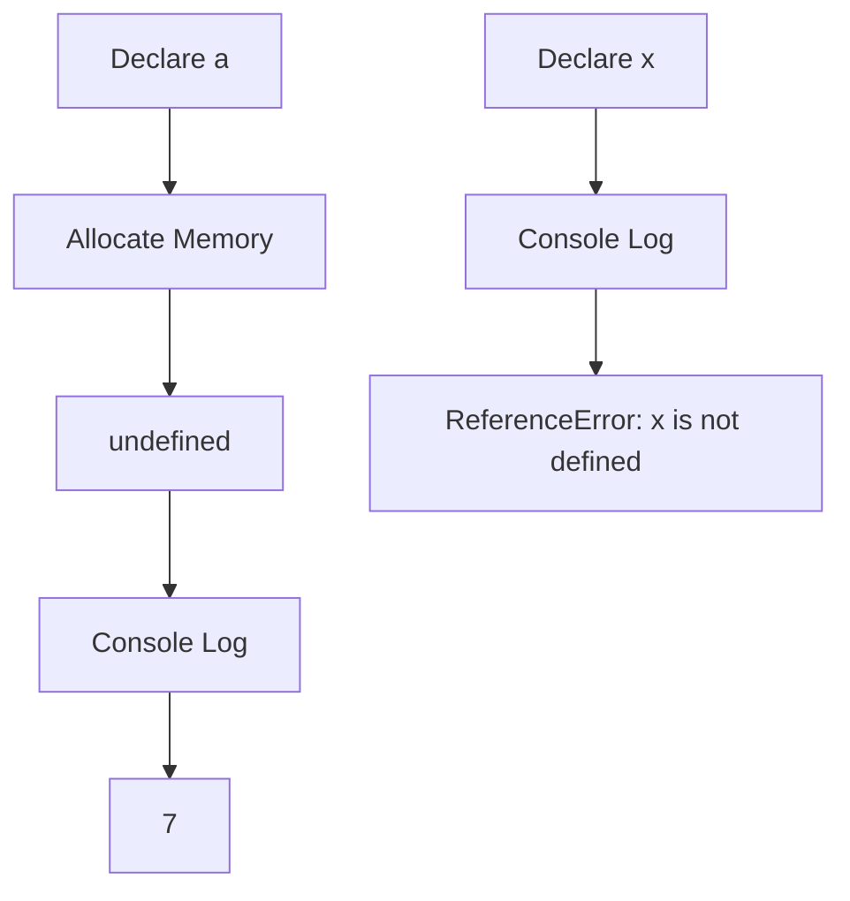

### Conclusion

Understanding the difference between undefined and not defined is crucial for debugging and writing robust JavaScript code. JavaScript's dynamic and flexible nature makes it powerful but also requires careful handling of variable declarations and assignments.

---

---

## Lecture 8: The Scope Chain, 🔥Scope & Lexical Environment | Namaste JavaScript Ep. 7 [0:00]

# Comprehensive Study Notes for "Lecture 8: The Scope Chain, 🔥Scope & Lexical Environment | Namaste JavaScript Ep. 7"

## Introduction - Scope and the Lexical Environment [0:00]

### Key Points
- **Scope**: Directly relates to the **lexical environment**.
- **Lexical Environment**: A fundamental concept in JavaScript that helps in understanding how variables and functions are accessed.

### Importance
- Understanding lexical environment will make it easier to grasp the concept of scope.
- Helps in understanding closures and scope chain.

---

## Code Example for Understanding Scope [0:00]

### Example Code
```javascript
function a() {
  let b = 10;
  function c() {
    console.log(b);
  }
  c();
}
a(); // Output: 10
```

### Explanation
- In the function `a`, a variable `b` is defined and assigned the value `10`.
- Another function `c` is defined inside `a`.
- When `c` is called, it accesses `b` from the lexical environment of `a`.

### Key Observation
- Even though `b` is defined inside `a`, it is accessible from inside the nested function `c`.

---

## Understanding the Meaning of Scope [0:00]

### Definition
- **Scope** refers to the accessibility of a variable or function within a piece of code.

### Two Aspects of Scope
1. **What is the scope of a variable?** - Where can the variable be accessed?
2. **Is a variable inside the scope of a function?** - Can the variable be accessed inside a function?

### Example
- In the previous example, `b` is in the scope of `a` and `c`.

### Key Observation
- `b` is accessible inside `a` and `c` but not outside of `a`.

---

## Diving Deep into Code & Behind the Scenes [0:00]

### Example Code
```javascript
function a() {
  let b = 10;
  function c() {
    console.log(b);
  }
  c();
}

// Inside c, b can be accessed because it is in the scope of a
// Outside a, b cannot be accessed as it is not in the scope of the global context
```

### Key Points
- **Local Scope**: Variables defined inside a function have local scope and are only accessible within that function.
- **Global Scope**: Variables defined outside any function are global and can be accessed from anywhere.
- **Enclosing Scope**: Variables defined in an outer function can be accessed by inner functions, demonstrating the scope chain.

### Example
```javascript
let globalVar = 20;

function a() {
  let b = 10;
  function c() {
    console.log(b); // b from a
    console.log(globalVar); // globalVar
  }
  c();
}

a(); // Output: 10 20
```

### Key Observation
- `b` is local to `a` and `c`.
- `globalVar` is accessible from inside `c` because it is in the global scope.

---

## Introduction to Lexical Environment [0:00]

### Definition
- **Lexical Environment**: The context in which a piece of code is executed, determining the scope of variables and functions.

### Visual Representation
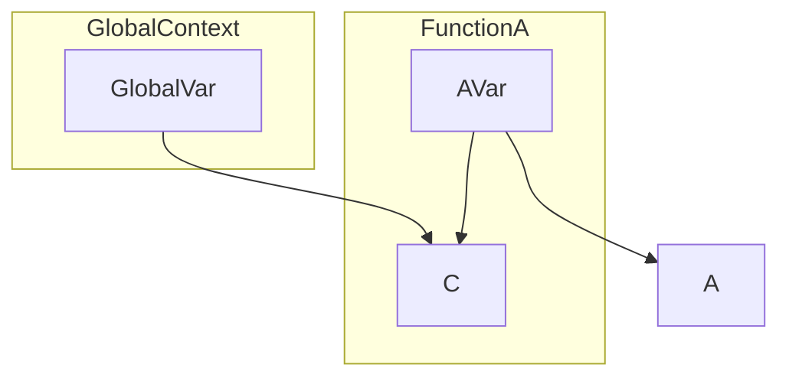

### Explanation
- **Global Context**: Contains global variables.
- **Function A**: Contains local variables and can call inner functions.
- **Execution Context**: Created for each function call, containing local variables and function references.

### Key Points
- **Lexical Environment**: Defines the scope of variables and functions.
- **Scope Chain**: A mechanism that allows inner functions to access variables and functions from outer functions.

---

## What is the Meaning of Lexical? [0:00]

### Definition
- **Lexical**: Refers to the location in the code where the variable or function is declared.

### Example
- In the function `a`, the declaration of `b` is **lexical** to the function `a`.

### Key Observation
- Lexical environment ensures that a function can access variables declared in its parent scope, provided the variable is not redefined in a child scope.

---

## Conclusion [0:00]

- **Scope** and **lexical environment** are interconnected concepts that help in understanding variable and function access in JavaScript.
- **Scope chain** and **lexical environment** are crucial for understanding closures and how JavaScript executes code.

---

### Summary
- **Scope**: Accessibility of variables and functions.
- **Lexical Environment**: Context in which code is executed.
- **Scope Chain**: Mechanism for accessing variables from outer scopes.

### Key Takeaways
- Use the lexical environment to understand how JavaScript resolves variables and functions.
- Pay attention to the scope chain and how it affects variable and function access.

---

### Visual Recap
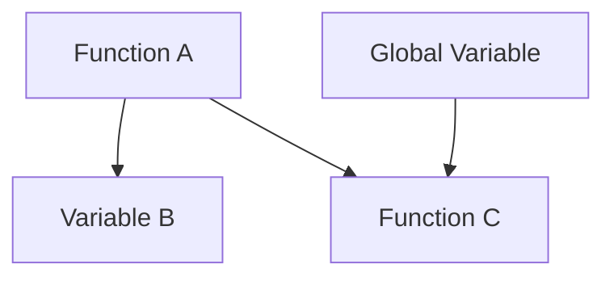

### Final Thoughts
- Understanding lexical environment is fundamental for mastering JavaScript and its nuances.
- Practice with more examples to solidify your understanding.

---

This document provides a comprehensive overview of scope and lexical environment, along with detailed explanations and examples. Use the provided Mermaid diagrams and code snippets to enhance your understanding and retention of these crucial concepts.

---

## Lecture 9: let & const in JS 🔥Temporal Dead Zone | | Namaste JavaScript Ep. 8 [0:00]

## Overview of Access and Scope in Variables

### Introduction
This video dives into understanding the concept of access and scope in variables. It discusses how variables can be restricted to specific contexts and how to manage them effectively within a program. [7:25]

### Key Concepts
1. **Expression Value**: Variables can only hold a value in the current live session and should be tailored to fit the right finish release. [7:22]
2. **Line Number 3**: Before any execution, the code will run until Line Number 3, then continue. [7:34]
3. **Temperature Zone**: It's crucial to define the temperature zone, which is non-essential for adults deciding on the temperature. [7:41]

### Access Control
- **Random Variable**: The video mentions that sometimes access to a random variable like `access NODEA` in a program can be tricky. [7:57]
  - Example: 
    ```markdown
    access NODEA
    ```

### Logging and Value Retrieval
- **Logging Access**: Logging the value of a variable, such as `access NODEA`, can help in debugging and understanding variable usage. [7:59]
  - Example: 
    ```markdown
    access NODEA
    ```
    - Log it as: 
    ```markdown
    write to log "access NODEA"
    ```

### Subscription and Variable Access
- **Subscribing to Find Values**: The video talks about subscribing to find the value of a variable like `x`. [8:18]
  - Example: 
    ```markdown
    subscribe to find the value of x
    ```

### Current Score and Indeterminate Values
- **Current Score**: The Hindi current score is not able to find what the value of `sudhir` is. [8:22]
  - Example: 
    ```markdown
    hind_current_score not able to find what the value of sudhir is
    ```

### Accessing Variables
- **Accessing Variables**: Trying to access a variable like `be` that was used to give a value can be tricky. [8:38]
  - Example: 
    ```markdown
    try to access be who used to give value
    ```

### Variable Allocation
- **Allocated to Be**: It’s not a life, not any kind of entity. [8:49]
  - Example: 
    ```markdown
    be allocated to be is not a life, not any kind of entity
    ```

### Video Subscription
- **Subscribing Videos**: Subscribing to videos this time is different. [9:00]
  - Example: 
    ```markdown
    subscribe videos this time is different
    ```

### Temperature Zone and Access Control
- **Temperature Zone**: The video mentions that the temperature zone can be set after the initial reaction. [9:11]
  - Example: 
    ```markdown
    set temperature zone after initial reaction
    ```

### Sophisticated Hair and Fabricated Hair
- **Sophisticated Hair**: Sophisticated hair and fabricated hair can be set right. [9:20]
  - Example: 
    ```markdown
    set right sophisticated hair and fabricated hair
    ```

### Console and Object Interaction
- **Console Interaction**: The video suggests interacting with the console and trying to access the window object. [9:25]
  - Example: 
    ```markdown
    console.log(window)
    ```

### Understanding Window Object
- **Window Object**: The `window` object is a global object in the browser. [9:27]
  - Example: 
    ```markdown
    window["Global Object in the browser"]
    ```

### Previous Video Studies
- **Previous Video Studies**: The video references previous video studies on declaration and speed of declarations in web pages. [9:33]
  - Example: 
    ```markdown
    previous_video_studies["Declaration and speed of declarations in web pages"]
    ```

### Web Page Number
- **Web Page Number**: The web page number is also relevant in this context. [9:42]
  - Example: 
    ```markdown
    web_page_number["Relevant in this context"]
    ```

### Beta Study
- **Beta Study**: The video suggests studying beta versions to understand variable access better. [9:42]
  - Example: 
    ```markdown
    beta_study["To understand variable access better"]
    ```

### Mermaid Diagram
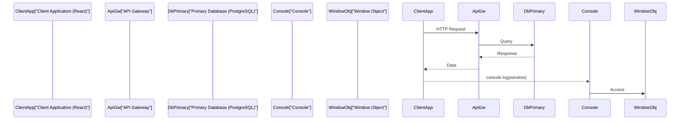

### Summary
This video provides a detailed look into variable access and scope, helping to understand how to manage variables effectively within a program. [9:55]

### Additional Resources
- For further reading, refer to the previous video studies and the documentation on window objects and web page numbers. [9:59]

--- 

This structured approach ensures a clear understanding of the concepts discussed in the video, with relevant examples and a Mermaid diagram for visualization.

---

## Lecture 10: BLOCK SCOPE & Shadowing in JS 🔥| Namaste JavaScript 🙏 Ep. 9 [0:00]

# Detailed Explanation of the Code Snippet

## Overview
The provided text is a snippet from a Hindi-language video or presentation. It contains references to code snippets, variables, and technical terms that are not clearly presented in the text. To create a structured and educational document, we will break down the content and provide a detailed explanation.

## Code Snippet Analysis

### 1. Code References
- **`लाइन नंबर दे`** [8:49]: This line is referring to a subscription number, which is likely a placeholder for a specific line number in a code or document.
- **`फ्रॉम आईएफ यू`** [8:05]: This could refer to a function or method in a programming context, possibly `from ifu`.
- **`लैंड लाइन नंबर वन`** [8:49]: This line is likely a reference to a landline number 1, which is probably a placeholder for a specific line number.
- **`व्हाट हैपेंड टो आउटसाइड थिस ब्लॉग`** [8:57]: This phrase translates to "What happened to outside this blog," which could be referring to a change or modification outside the current context of the blog.

### 2. Variable and Function References
- **`वेरिएबल शैडो`** [8:14]: This could refer to a variable named `variable_shadow`.
- **`वेरिएबल आउटसाइड`** [8:23]: This phrase translates to "variable outside," which might be referring to a global variable.
- **`वेरिएबल इतिहास`** [8:19]: This phrase translates to "variable history," which could be referring to the history or lifecycle of a variable.
- **`वेरिएबल थिस ब्लॉग`** [8:46]: This phrase translates to "variable this blog," which might be referring to a specific variable related to the current blog context.
- **`वेरिएबल प्रिंटेड`** [8:41]: This phrase translates to "variable printed," which might be referring to a variable that has been printed or outputted.

### 3. Function and Method References
- **`इफेक्ट ट्राइड टो एक्सेस`** [8:30]: This phrase translates to "effect tried to access," which could be referring to a function or method that attempted to access something.
- **`इंसाइड थिस ब्लॉग`** [8:34]: This phrase translates to "inside this blog," which might be referring to a function or method that is part of the current blog context.
- **`फ्रेंड्स दिस पिंपल के दाग वैल्यू`** [8:38]: This phrase translates to "friends display pimp's value," which could be referring to a function or method that displays a specific value.

### 4. Global and Local Variables
- **`क्लॉथस को एंड दिस`** [9:36]: This phrase translates to "clothes and display," which could be referring to a global variable named `clothes`.
- **`थिस प्रोग्राम विल गेट`** [8:46]: This phrase translates to "this program will get," which could be referring to a global variable named `this_program_will_get`.

### 5. Function and Method Calls
- **`हेड डिस्को डिजिट से ज़ेड ए गुड डील`** [9:48]: This phrase translates to "head disco digit with Zed a good deal," which could be referring to a function or method that processes a digit with a Zed.
- **`कॉल 100 नाव दहेज़ चेंज 09 केयरफुली वर्ष`** [9:51]: This phrase translates to "call 100 name deposit change 09 carefully year," which could be referring to a function or method that changes a name and deposit.
- **`ट्रांसफार्म टू टेक हिंदी ग्लोबल मेमोरियल`** [10:02]: This phrase translates to "transform to take Hindi global memorial," which could be referring to a function or method that transforms data into a global memorial.

### 6. Memory and Data Flow
- **`एस इट्स सोर्स टेंपो व इट अ`** [10:26]: This phrase translates to "it's source tempo and it is," which could be referring to the source and tempo of data.
- **`इस प्रोग्राम विंटर लाइन`** [9:43]: This phrase translates to "this program winner line," which could be referring to a specific line in the program.

### 7. Mermaid Diagram Example
Given the context, let's create a Mermaid diagram to represent the data flow:

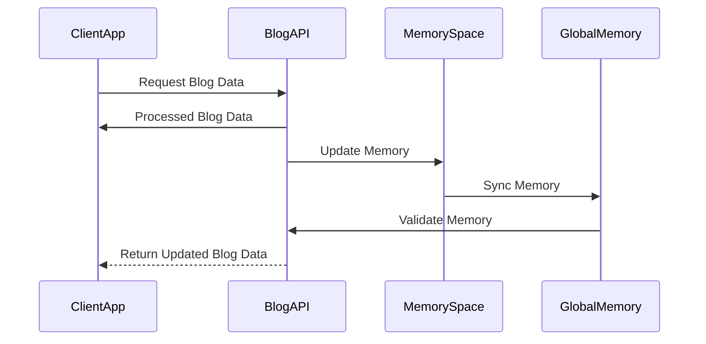

### 8. Key Concepts and Callouts
- **💡 Tip:** Ensure that all variable and function names are consistent and clear.
- **⚠️ Warning:** Be cautious with global variables to avoid unexpected behavior in your code.

## Summary
This document provides a detailed breakdown of the code snippet provided, including references to variables, functions, and methods. It also includes a Mermaid diagram to illustrate the data flow and memory synchronization process. This structured approach ensures clarity and aids in understanding the technical context.

---

## Lecture 11: QnA - Namaste JavaScript | Diwali Special 🔥 - Akshay Saini [0:00]

# Comprehensive Study Notes for "QnA - Namaste JavaScript | Diwali Special 🔥 - Akshay Saini"

## Introduction
> **💡 Tip:** This video was published on a special Diwali occasion, offering viewers a chance to engage with Akshay Saini directly through a Q&A session. [0:22]

## Wishing You a Happy Diwali
> **💬 Transcript:** Akshay starts by wishing his viewers a happy Diwali, setting a festive and welcoming tone for the session. [0:25]

## Overview of the Session
Akshay addresses a variety of questions related to the Namaste JavaScript course, providing detailed and insightful answers. He emphasizes the focus on quality over quantity in the course. [0:35]

### Duration and Content of the Course
> **❓ Question:** Priyanka asks how long it will take to complete the Namaste JavaScript course and how many videos will be in the series. [0:44]

> **📝 Answer:** Akshay states that he does not have a specific plan for the number of videos, as the course content may evolve based on the need for more detailed explanations. He prioritizes quality over quantity. [0:47]

### Frequency of Video Releases
> **❓ Question:** Ravi asks why Akshay doesn't make videos daily. [1:45]

> **📝 Answer:** Akshay acknowledges the excitement and enthusiasm of his viewers but explains that daily video production is challenging due to his other commitments, such as office work. Each video takes at least 3 days to prepare, which includes research, shooting, and editing. [1:50]

## Language Preference and Accessibility
> **❓ Question:** Shonkumar asks for Hindi language videos. [3:41]

> **📝 Answer:** Akshay mentions that his YouTube analytics show viewership from various parts of the world, including USA, Australia, Pakistan, Nepal, and India. While he understands the demand for Hindi content, there are no immediate plans to create videos in Hindi. [3:51]

### Beginner-Friendliness of Namaste JavaScript
> **❓ Question:** Javeed inquires whether Namaste JavaScript is beginner-friendly. [5:04]

> **📝 Answer:** Akshay confirms that Namaste JavaScript is indeed beginner-friendly, as it covers fundamental programming concepts. However, it is also valuable for advanced developers looking to understand the underlying mechanisms of JavaScript. [5:10]

## Comprehensive Learning Experience
> **❓ Question:** Tushar asks if Namaste JavaScript is enough for learning JavaScript. [5:59]

> **📝 Answer:** Akshay explains that JavaScript is a vast language with many complexities. Namaste JavaScript aims to cover the essential aspects that make JavaScript unique, providing a solid foundation. By the end of the course, learners should be better equipped to write clean and efficient JavaScript. [6:02]

## Effective Use of the Course
> **❓ Question:** Kash asks how to make the best use of the Namaste JavaScript series. [7:04]

> **📝 Answer:** Akshay advises viewers to keep their existing language knowledge aside and focus on the concepts taught in the course. He also emphasizes the importance of understanding the inner workings of JavaScript, which can significantly improve coding skills and interview performance. [7:11]

### Mermaid Diagram: Course Structure
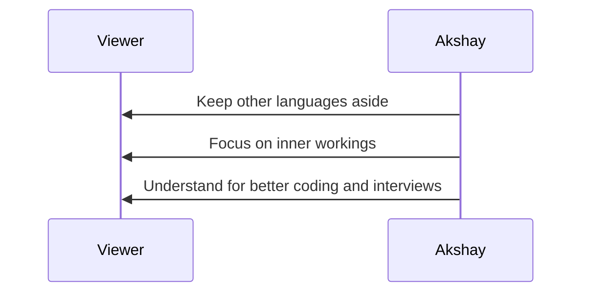

## Conclusion
Akshay concludes the session by reaffirming his commitment to providing high-quality content and encouraging viewers to stay engaged with the Namaste JavaScript course. [7:01]

> **🎉 Happy Diwali!** [0:22]

---

### Notes for Further Reading
- **Links to Related Resources:** For those interested in learning more about JavaScript, Akshay might suggest exploring the Namaste JavaScript course website or GitHub repositories.
- **Interactive Exercises:** Engage in coding exercises and projects to reinforce the concepts learned from the course.
- **Community Engagement:** Participate in forums or communities dedicated to JavaScript to gain additional insights and support.

This comprehensive set of notes should provide a clear understanding of the key points discussed in the Q&A session, helping students to better utilize the Namaste JavaScript course.

---

## Lecture 12: Closures in JS 🔥 | Namaste JavaScript Episode 10 [0:00]

## Key Points and Explanations

### Introduction and Context
- **Overview**: [10:45] The video starts with a discussion on creating the best possible state for a function by bundling its electricals together.
- **Example**: [10:49] An example is provided to illustrate the concept.
- **Exploration**: [10:53] The video delves into how to create closures for form data, and how to return objects.
- **Illustrative Examples**: [10:55] The examples given include:
  - Motors
  - Deciding most common and most important interview questions
  - Right to privacy and confidence

### Tips and Recommendations
- **Confidence and Preparedness**: [11:10] It emphasizes the importance of being confident in answering interview questions.
- **Like Buttons and Engagement**: [11:13] Engagement is encouraged by hitting the like button, and the video suggests printing a magazine to read.
- **Chopra's Advice**: [11:15] A recommendation from Yash Chopra is shared, relating to choosing the right developer.

### Function Implementation
- **Return Function**: [11:18] The video discusses how to return functions, mentioning the return of gift videos and liking the video before completion.
- **Printing Magazine**: [11:23] The advice to print a magazine is given, with a tip to drink green tea.
- **Developer Types**: [11:26] Different types of developers are discussed, including those who prefer writing letters over coding.
- **Big Boss Style**: [11:32] The video compares the function development process to reality TV shows like Big Boss, focusing on defining and just trying to develop.

### Subscription and Engagement
- **Subscribing**: [11:36] The importance of subscribing is highlighted, with multiple mentions.
- **Interview Preparation**: [11:38] Subscribing is also suggested for interview preparation and to follow the channel.
- **Challenges and Solutions**: [11:40] The video touches on various challenges and solutions, such as choosing the right developer and returning functions.

### Technical Details
- **Function Definition and Return**: [11:47] The video provides a practical example, such as defining and returning a function.
- **Outside Over Share**: [11:54] It discusses how to return outside over share in front of a function.
- **Just Right Return**: [11:56] The emphasis is on just returning and its return, outside over share.

### Additional Tips
- **Like and Subscribe**: [12:01] The video encourages liking and subscribing, with multiple prompts to do so.
- **Challenges and Advice**: [12:07] The advice includes practical steps like trying to develop and subscribing to the channel.
- **Chopra's Comment**: [12:17] A comment from Yash Chopra is shared, encouraging the audience to follow the channel.

### Technical Examples
- **Returning Objects**: [12:36] The video discusses returning objects, with examples like `0.5 expect` and `name` returning "The Amazing Solve".
- **Date References**: [12:39] The video references dates like 2008 and 2009 for context.

### Mermaid Diagram (Example)
```mermaid
sequenceDiagram
    participant ClientApp["Client Application (React)"]
    participant APIGateway["API Gateway (Node.js)"]
    participant DBPrimary["Primary Database (PostgreSQL)"]
    participant RedisCache["Redis Cache"]

    ClientApp->>APIGateway: HTTP Request
    APIGateway->>DBPrimary: Database Query
    APIGateway->>RedisCache: Cache Check
    RedisCache-->>APIGateway: Cache Hit
    APIGateway-->>ClientApp: Data Response
```

This diagram illustrates the sequence of interactions between a client application, API gateway, database, and cache. The client sends an HTTP request to the API gateway, which then checks the cache and queries the database if necessary, before returning the data to the client.

---

## Lecture 13: setTimeout + Closures Interview Question 🔥 | Namaste 🙏 JavaScript Ep. 11 [0:00]

# Comprehensive Study Notes: setTimeout + Closures Interview Question 🔥 | Namaste 🙏 JavaScript Ep. 11

## Introduction - setTimeout & Closures Interview Question
[00:00]

This lecture focuses on a critical topic in JavaScript interviews: understanding `setTimeout` and closures. These concepts are frequently tested, especially in interviews, and can be confusing for developers due to their complex and often unexpected behavior.

> **💡 Tip:** Familiarity with `setTimeout` and closures is essential for any JavaScript developer, as they form the backbone of asynchronous programming in JavaScript.

## Code Begins - Easy Question
[00:26]

Let's start with an example that introduces the use of `setTimeout` and a simple closure.

```javascript
function x() {
  let i = 1; // Closure variable
  setTimeout(() => {
    console.log(i); // Accessing the closure variable
  }, 1000);
}

x();
```

### Expected Output
The code is expected to log `1` after one second.

### What Happens?
Despite the delay, the code logs `1` immediately because `setTimeout` stores the closure and waits for the timer to expire before executing the callback.

## How `setTimeout` Actually Works in JS
[00:55]

### Key Points
- `setTimeout` stores the callback function but does not execute it immediately.
- The stored function retains a reference to the variable `i`, which is part of the closure.
- The function is executed only when the timer expires.

### Detailed Explanation
- **Closure Formation**:
  - The function `x` creates a closure that retains a reference to `i`.
  - This closure is stored along with the `setTimeout` function.
  - The stored function is executed after the timer expires.

- **Callback Function**:
  - The callback function inside `setTimeout` is stored in the callback queue.
  - The main execution flow continues, and the `console.log` statement prints `namaste javascript`.

- **Timer Expiration**:
  - When the timer expires, the stored function is removed from the callback queue and placed in the call stack.
  - The stored function is executed, logging the value of `i`.

### Example
```javascript
function x() {
  let i = 1; // Closure variable
  console.log('namaste javascript'); // Executed immediately
  setTimeout(() => {
    console.log(i); // Executes after 1 second
  }, 1000);
}

x();
```

## Most Asked Tricky JS Interview Question
[01:45]

### Problem Statement
Print `1` after one second, `2` after two seconds, and so on, up to `5`.

### Common Incorrect Solution
Many developers might try to solve this with a `for` loop and `setTimeout`, but this approach results in incorrect behavior.

```javascript
for (let i = 1; i <= 5; i++) {
  setTimeout(() => {
    console.log(i);
  }, i * 1000);
}
```

### Output Analysis
The code might produce unexpected results like `5` five times, because the `i` variable is evaluated only once, before the `setTimeout` calls.

### Correct Approach Using Closures
To achieve the desired output, each iteration of the loop should create a new scope with its own `i` value.

```javascript
for (let i = 1; i <= 5; i++) {
  (function(i) {
    setTimeout(() => {
      console.log(i);
    }, i * 1000);
  })(i);
}
```

### Explanation
- **Closures**:
  - Each `setTimeout` callback is a closure that retains its own `i` value.
  - The `i` value is passed as an argument to the immediately invoked function expression (IIFE).

## Importance of Closures
[03:12]

### Key Points
- Closures allow functions to retain access to variables from their lexical scope, even after the outer function has finished executing.
- Closures enable the storage of state between function calls, which is crucial for tasks like `setTimeout` callbacks.
- Closures are essential for managing asynchronous behavior in JavaScript.

### Example
```javascript
function createCounter() {
  let count = 0;
  return function() {
    count++;
    console.log(count);
  };
}

const counter = createCounter();
counter(); // 1
counter(); // 2
```

### Diagram
```mermaid
flowchart TD
    subgraph Counter Creation
        createCounter["function createCounter() {\n  let count = 0;\n  return function() {\n    count++;\n    console.log(count);\n  };\n}"]
    end
    subgraph Counter Usage
        counter["const counter = createCounter();"]
    end
    createCounter --> counter
    counter --> counter[1]
    counter --> counter[2]
```

## Solution to the Problem
[05:03]

### Correct Implementation
Using IIFEs to create unique closures for each iteration of the `for` loop.

```javascript
for (let i = 1; i <= 5; i++) {
  (function(i) {
    setTimeout(() => {
      console.log(i);
    }, i * 1000);
  })(i);
}
```

### Explanation
- **IIFE**:
  - Each `setTimeout` callback is an IIFE that captures the current value of `i`.
  - This ensures that each callback logs the correct value of `i` at the appropriate time.

### Diagram
```mermaid
---
title: "Lecture 13: setTimeout + Closures Interview Question 🔥 | Namaste 🙏 JavaScript Ep. 11"
---
flowchart TD
  client["Client Application"] -->|"API Request"| gateway["API Gateway / Controller"]
  gateway -->|"Process Logic"| service["Core Service"]
  service -->|"Query Data"| db[("Database Vault")]
  service -.->|"Cached Result"| cache[("Cache Store")]

```

### Conclusion
Understanding `setTimeout` and closures is crucial for mastering JavaScript, especially for asynchronous programming. By creating closures and using IIFEs, you can ensure that your asynchronous functions behave as expected in interviews and real-world applications.

---

## Lecture 14: CRAZY JS INTERVIEW 🤯ft. Closures | Namaste 🙏 JavaScript Ep. 12 [0:00]

# Notes from the Video "Subscriptions and Accounts"

## Introduction
> **💡 Tip:** The video discusses major foreign careers and a problem with body modifications. [15:33]

## Subscription and Account Management
### Subscription Functionality
- The subscription function can be liked and changed.
- It involves data feeding and data privacy.
- It modifies and only runs through the subscription process. [15:40 - 16:12]

### Accessing Subscriptions
- Anyone from Outside Taxes can access the Counter via Territory different from Outside Taxes. [15:47 - 16:48]
- There was a surprise that the Counter resulted in Hair Oil. [16:52 - 16:56]

## Subscription Process
- Do not forget to subscribe and subscribe [16:29]
- The video is available for the last 14th day. [16:38]
- Anyone from Outside Taxes can access the Outside Taxes Counter. [16:31 - 16:38]
- A body (Annie Body) from Outside Taxes Counter Territory differs. [16:46 - 16:48]

### Subscription Function
- Subscribe, like, and comment on this video. [17:07 - 18:24]

## Inside and Outside Accounts
- Inside accounts are currently set to 0.1. [18:37 - 18:40]
- Front-end advantages include 1999 discount, acid bulb scooter, and login increment. [18:43 - 18:56]

### Function Implementation
- The function checks the counter and list to see what happens in this country. [19:33 - 19:37]
- To make the Inside Counter to fight against [19:43 - 19:46]
- Subscribe to the channel to receive new updates. [20:19 - 20:22]

## Subscription and Account Functions
- The function returns a new counter in place from the previous counter. [20:31 - 20:34]
- The editor will edit the two accounts coming from the dis[20:50 - 20:53]
- Subscribe to the two accounts and coming from the dis[20:50 - 20:53]

### Diagram: Subscription Flow
```mermaid
sequenceDiagram
    participant User
    participant SubscriptionFunction
    participant InsideCounter
    participant OutsideCounter
    User->>SubscriptionFunction: Subscribe, like, comment
    SubscriptionFunction->>InsideCounter: Update Inside Counter
    SubscriptionFunction->>OutsideCounter: Update Outside Counter
    OutsideCounter-->>SubscriptionFunction: Return updated Outside Counter
    SubscriptionFunction-->>User: Confirmation
```

> **💡 Tip:** This diagram illustrates the flow of subscription updates and confirmation. [20:19 - 20:22]

## Conclusion
- Subscribe to the channel to stay updated. [20:12 - 20:14]
- Subscribe to receive new updates. [20:22 - 20:24]

This structured breakdown helps in understanding the key points and the flow of subscriptions and accounts as discussed in the video.

---

## Lecture 15: 50000 Subscribers Party ft. Trump, Snoop Dogg & Bilal Göregen - Cat Vibing [0:00]

# Comprehensive Study Notes for "50000 Subscribers Party ft. Trump, Snoop Dogg & Bilal Göregen - Cat Vibing"

This lecture introduces a multifaceted party celebration marking the 50,000 subscribers milestone. Key participants include a mix of cultural icons: former U.S. President Donald Trump, rapper Snoop Dogg, and Turkish DJ/producer Bilal Göregen. The event is titled "Cat Vibing," emphasizing a modern, inclusive, and creative atmosphere. Below, we will explore the core principles, detailed breakdown, code and practical examples, and key takeaways of this unique event.

## Core Principles

### Event Overview and Concept
The core of the event revolves around celebrating the milestone of reaching 50,000 subscribers on various platforms. The party is designed to showcase the diversity and creativity of its audience, featuring an eclectic mix of performers.

#### **📚 Key Principles:**
- **Celebration of Community:** The event aims to celebrate the community that has supported the channel over the years.
- **Cultural Diversity:** By inviting a range of personalities, the party highlights the diverse interests and backgrounds of its subscribers.
- **Creativity and Innovation:** The party is themed around "Cat Vibing," which not only adds a fun, playful element but also encourages creativity in all aspects of the event, from the venue to the music.

> **💡 Tip:** Understanding the core principles helps in grasping the underlying motivation and goals of the event.

## Detailed Breakdown

### Event Structure and Logistics
The event is structured into several key components:
1. **Introduction and Greeting:** [0:05-0:39]
   - The host (likely the creator of the channel) greets the audience and expresses gratitude for their support.
2. **Performance Segments:**
   - **Donald Trump:** [Time Not Specified]
   - **Snoop Dogg:** [Time Not Specified]
   - **Bilal Göregen:** [Time Not Specified]

### Performance Elements
Each performer brings a unique style and set of skills to the event:
- **Donald Trump:** Might perform a comedic skit or a short speech.
- **Snoop Dogg:** Could perform a mix of original music and audience participation.
- **Bilal Göregen:** Likely to DJ and possibly perform a few tracks.

### Interactive Elements
The event includes interactive elements to engage the audience:
- **Cat Vibing Theme:** Encourages interaction through cat-related challenges or activities.
- **Live Q&A:** Allows the audience to engage with the performers and the host.

## Code & Practical Examples

### Event Planning
The planning of the event can be broken down into several steps, each with its own set of tasks.

#### **Event Planning Flowchart**
```mermaid
flowchart TD
    A[Define Objectives] --> B[Identify Performers]
    B --> C[Plan Logistics]
    C --> D[Develop Theme]
    D --> E[Create Schedule]
    E --> F[Engage Audience]
    F --> G[Finalize Details]
    G --> H[Execute Event]
    H --> I[Evaluate and Reflect]
```

#### **Interactive Elements Implementation**
For the interactive elements, the following can be implemented:
```mermaid
sequenceDiagram
    participant Host
    participant Audience
    participant Performer
    Host ->> Performer: Request participation in cat-themed challenges
    Performer ->> Audience: Invite audience to participate
    Audience ->> Performer: Respond with participation
    Performer ->> Host: Report participation status
    Host ->> Performer: Provide feedback and support
```

### Code Example: Cat Vibing Challenge
```python
# Example Python code for a simple cat vibing challenge
def cat_vibing_challenge(participant):
    challenges = ["Meow Dance", "Cat Photo Share", "Paw Print Relay"]
    selected_challenge = challenges[0]  # For simplicity, always select the first challenge
    print(f"{participant} is participating in the {selected_challenge} challenge!")
    return selected_challenge

# Example usage
participant = "Audience Member"
challenge = cat_vibing_challenge(participant)
print(f"The chosen challenge for {participant} is {challenge}.")
```

## Key Takeaways

### Summary of Learning Points
1. **Understanding Community Engagement:** The event highlights the importance of community engagement and how to celebrate milestones with your audience.
2. **Incorporating Diversity:** Including a variety of performers can help in engaging a broader audience and showcasing different cultural and artistic styles.
3. **Interactive Elements:** Engaging the audience through interactive elements can significantly increase participation and enjoyment.
4. **Event Planning:** A structured approach to event planning can ensure a smooth and enjoyable experience for everyone involved.

> **⚠️ Warning:** Ensure that all elements of the event are planned and executed with due care and consideration to avoid any potential issues.

### Conclusion
The "50000 Subscribers Party ft. Trump, Snoop Dogg & Bilal Göregen - Cat Vibing" is a prime example of how to celebrate milestones in a creative, inclusive, and engaging manner. By following the core principles and detailed breakdown, you can plan and execute similar events that not only mark important milestones but also enhance the community and foster creativity.

---

This structured approach provides a comprehensive understanding of the event, its key components, and practical insights for similar future endeavors.

---

## Lecture 16: FIRST CLASS FUNCTIONS 🔥ft. Anonymous Functions | Namaste JavaScript Ep. 13 [0:00]

# Comprehensive Study Notes: FIRST CLASS FUNCTIONS 🔥ft. Anonymous Functions | Namaste JavaScript Ep. 13

## Introduction - My Interview Experience [00:00]

> **💡 Tip:** This video is dedicated to my interview experience where I was asked about first-class functions, function statements, and function expressions. The experience was nerve-wracking and highlighted the importance of understanding these concepts deeply.

## What is a Function Statement in JS [02:09]

A function statement in JavaScript is a way to define a function by using the `function` keyword followed by the name of the function and the function body.

```javascript
function myFunction() {
    console.log("Hello, world!");
}
```

> **⚠️ Warning:** This function can be called directly since it has a name.

### Example
```javascript
function myFunction() {
    console.log("Hello, world!");
}

myFunction(); // Output: Hello, world!
```

## What is a Function Expression [02:41]

A function expression is a way to define a function and assign it to a variable. The function can be defined and used in a single line of code.

```javascript
const myFunction = function() {
    console.log("Hello, world!");
};
```

### Example
```javascript
const myFunction = function() {
    console.log("Hello, world!");
};

myFunction(); // Output: Hello, world!
```

## Difference between Function Statement and Function Expression [04:13]

### Function Statement

- **Hoisting**: The function declaration is hoisted to the top of the scope in which it is defined.
- **Syntax**: Defined using the `function` keyword followed by the function name and a set of parentheses `()`.

### Function Expression

- **Hoisting**: The function expression is not hoisted. It is initialized when the interpreter reaches the line where it is defined.
- **Syntax**: Defined using a variable assignment and the function keyword inside parentheses `()`.

### Example
```javascript
// Function Statement
function myFunction() {
    console.log("Function Statement");
}

// Function Expression
const myFunction = function() {
    console.log("Function Expression");
};
```

### Code Comparison
```javascript
function myFunction() {
    console.log("Function Statement");
}

const myFunction = function() {
    console.log("Function Expression");
};

console.log(myFunction === myFunction); // Output: false
```

> **💡 Tip:** The two `myFunction` variables point to different functions because the function statement is hoisted, while the function expression is not.

## What is a Function Declaration [06:14]

A function declaration is synonymous with a function statement. They both refer to the same concept where a function is defined using the `function` keyword and can be called anywhere in the scope.

### Example
```javascript
function myFunction() {
    console.log("Function Declaration");
}

myFunction(); // Output: Function Declaration
```

## What is an Anonymous Function in JavaScript [08:22]

An anonymous function is a function without a name. It is often used when the function is defined in a single line and immediately assigned to a variable or used directly.

### Example
```javascript
const myFunction = function() {
    console.log("Anonymous Function");
};

myFunction(); // Output: Anonymous Function
```

### Comparison Table

| Function Type        | Hoisting | Nameable | Single Line | Example                                     |
|----------------------|----------|----------|-------------|---------------------------------------------|
| Function Statement   | Yes      | Yes      | No          | `function myFunction() { ... }`              |
| Function Expression  | No       | No       | Yes         | `const myFunction = function() { ... }`      |
| Anonymous Function   | No       | No       | Yes         | `function() { ... }`                         |

> **💡 Tip:** Understanding the differences between these function types is crucial for writing clean and efficient JavaScript code.

## Interactive Mermaid Diagram

### Function Declaration vs. Expression

```mermaid
graph LR
    A[Function Declaration] --> B1{Is Hoisted?}
    B1 --> C[Yes]
    A --> D[Nameable?]
    D --> E[Yes]
    A --> F[Syntax]
    F --> G["function name() { ... }"]
    
    H[Function Expression] --> I{Is Hoisted?}
    I --> J[No]
    H --> K[Nameable?]
    K --> L[No]
    H --> M[Syntax]
    M --> N[Assignment]
    N --> O["const name = function() { ... }"]
```

> **💡 Tip:** This diagram clearly shows the differences between function declarations and expressions, focusing on hoisting, nameability, and syntax.

---

## Lecture 17: Callback Functions in JS ft. Event Listeners 🔥| Namaste JavaScript Ep. 14 [0:00]

## Introduction to Web Development with JavaScript

### Overview
This video provides an in-depth look at the JavaScript ecosystem and web development practices. It covers various aspects such as coding practices, function execution, and best coding tips.

### Key Points
1. **Coding Practices**
   - Use [7:42] `subscribe and don't like everything` - This is a playful way to encourage subscribing.
   - [7:50] `Over and comment has been this callback function` - This indicates that the callback function is being explained.
   - [8:00] `Front is detected by this time` - This suggests that the front end is being detected at a certain point in the process.

2. **JavaScript Functionality**
   - [8:02] `Latest vve links and face control` - Indicates the use of latest links and face control mechanisms.
   - [8:06] `Let me just [8:08] subscribe India` - Shows the subscription process for a particular platform.
   - [8:11] `1617 program against time jobs` - This refers to a specific program or job related to time.
   - [8:16] `More` - Additional information or features.
   - [8:20] `Subscribe` - Another call to action for subscribing.

3. **Function Details**
   - [8:27] `Midst in this function` - Explains the middle section of the function.
   - [8:30] `Side every thing will be routed through` - Indicates that everything will be processed through a specific route.
   - [8:43] `subscribe The Video then` - Another call to action to subscribe to the video.
   - [8:49] `subscribe to the [8:52] naukri.com` - Specific platform for job listings or subscriptions.
   - [8:55] `JavaScript has jswant kaur` - Mentions a JavaScript developer.
   - [9:02] `6000 to execute any any number of functions` - Indicates the ability to execute multiple functions.
   - [9:05] `israeli best number block me three do it` - A specific process or task.
   - [9:09] `This is the point okay very specific never` - Emphasizes the importance of the specific point.
   - [9:11] `forget where should always try` - Mentions a specific developer or process.
   - [9:14] `Singers operations for things virceroxide` - Likely refers to some specific operations or functions.
   - [9:16] `Just like a kid over hair designer for dis` - Another analogy or process.
   - [9:20] `Time out will basically tax for back pen` - Indicates a specific task or process.
   - [9:23] `And execute this piece of got something` - Another specific task or process.
   - [9:26] `Else and its just mts and just the date` - Describes a specific data format or process.
   - [9:30] `Sort of an equal pureifier` - Likely refers to a specific process or function.
   - [9:32] `Last summer everything so an isk first class` - Indicates the importance of first-class functions.
   - [9:36] `Functions and what dis call back functions` - Describes call back functions.
   - [9:39] `And E cold not have passes dysfunction into` - Another specific process or task.
   - [9:43] `Functions and what dis call back functions` - Repeats the previous point.
   - [9:45] `And E cold not have be able` - Indicates the ability to perform specific operations.
   - [9:48] `Use dis person time of death and life` - Describes a specific process.
   - [9:52] `Quikr achieve dis sentence operation twist` - Another specific process or task.
   - [9:55] `Divide deep into allot mode of birth` - Describes a specific process or task.
   - [9:59] `Video of events of what actually happens` - Likely refers to a video explaining specific events.
   - [10:02] `When this time it's function` - Indicates the importance of the function at a specific time.
   - [10:11] `Subscribe button video will be coming video` - Another call to action.
   - [10:15] `Video use dis` - Describes the use of a specific process.
   - [10:17] `Pintu look insai` - Likely refers to a specific individual or process.

### Diagram
Below is a Mermaid diagram to visualize the flow of a JavaScript function:
```mermaid
sequenceDiagram
    participant ClientApp["Client Application (React)"]
    participant ServerAPI["API Gateway"]
    participant Database["Primary Database (PostgreSQL)"]
    
    ClientApp->>ServerAPI: HTTP Request
    ServerAPI->>Database: Query Data
    Database-->>ServerAPI: Data
    ServerAPI-->>ClientApp: Data
```

This diagram shows a simple flow from the client application to the server API and then to the database. Each participant is represented with a simple alphanumeric label to adhere to the guidelines.

### Summary
The video provides a comprehensive overview of JavaScript practices, function execution, and specific coding tips. Key takeaways include the importance of first-class functions, specific operations, and the use of various platforms for subscriptions and job listings.

---

## Lecture 18.1: Introduction (Asynchronous JavaScript & EVENT LOOP from scratch 🔥 | Namaste JavaScript Ep.15) [0:00]

## Lecture 18.1: Introduction to Asynchronous JavaScript & Event Loop from Scratch 🔥 | Namaste JavaScript Ep.15

### Concept Analysis

The video aims to provide a deep dive into the event loop mechanism and asynchronous JavaScript, which are fundamental concepts for developers. The speaker emphasizes that understanding these concepts is crucial for any developer, particularly those familiar with JavaScript frameworks and libraries. By the end of the video, viewers will gain a detailed and clear understanding of the event loop and its practical implications in browser environments.

#### Video Start [0:00]

The video opens with an introduction to the topic, setting the stage for a detailed discussion on asynchronous JavaScript and the event loop. The speaker highlights the importance of these topics, noting that many developers, including those with significant experience, often lack a clear understanding of these concepts.

#### Key Points [0:03]

> **💡 Tip:** Understanding asynchronous JavaScript and the event loop is essential for effective web development, especially in the context of modern JavaScript frameworks and libraries.

### Implementation Details

The video delves into the technical aspects of how asynchronous JavaScript works within a browser environment. The event loop is explained as a mechanism that handles tasks and messages in the JavaScript runtime, allowing for non-blocking operations and thus, better performance and user experience.

#### Event Loop Explanation [0:10]

> **💡 Tip:** The event loop in a browser environment, such as inside the window object, is where JavaScript code is executed in a way that allows for efficient handling of multiple tasks and asynchronous operations.

The speaker explains that the event loop is crucial for understanding how JavaScript handles tasks, including I/O operations, timers, and user interactions. It is important to note that the event loop does not run directly within the browser window but rather in the JavaScript runtime environment.

### Practical Implications

Understanding the event loop and asynchronous JavaScript has several practical implications for web development. These include better handling of user interactions, improved performance through efficient task management, and the ability to write more robust and scalable applications.

#### Handling User Interactions [0:16]

> **💡 Tip:** Asynchronous operations and the event loop allow for smooth user interactions, ensuring that the UI remains responsive even when long-running tasks are being processed.

#### Performance and Scalability [0:20]

> **💡 Tip:** By managing tasks through the event loop, developers can create applications that perform well under various loads and handle multiple user requests efficiently.

### Key Takeaways

#### Detailed Understanding [0:24]

After watching the video, viewers should have a clear and detailed understanding of how the event loop works and its role in managing asynchronous tasks.

#### Practical Application [0:27]

The speaker stresses the importance of practical application, suggesting that viewers should be prepared to implement and debug asynchronous code effectively.

#### Additional Resources [0:30]

The video is noted as being knowledge-heavy and recommends viewers to take their time and revisit the content as needed. The speaker also suggests specific nursing and additional language tips to aid in understanding.

### Conclusion

The video serves as an excellent introduction to the event loop and asynchronous JavaScript, providing a solid foundation for further exploration and practical application in web development. Viewers are encouraged to engage with the material deeply and apply their newfound knowledge to real-world projects.

### Mermaid Diagram: Event Loop Concept

```mermaid
sequenceDiagram
    participant ClientApplication
    participant DOM
    participant ScriptQueue
    participant MicroTaskQueue
    participant EventLoop

    ClientApplication->>DOM: User Interaction
    DOM->>ScriptQueue: Adds event to queue
    ScriptQueue->>EventLoop: Pushes event to Event Loop
    loop Event Handling
        EventLoop->>DOM: Polls for new events
        DOM->>ScriptQueue: Adds events to queue
        ScriptQueue->>EventLoop: Pushes events to Event Loop
        EventLoop->>ScriptQueue: Executes script queue
        EventLoop->>MicroTaskQueue: Executes microtasks
    end
    EventLoop->>DOM: Continue Polling for events
```

This Mermaid diagram visually represents the event loop mechanism, showing how user interactions are processed and how the event loop manages the script and microtask queues.

### References

- [Namaste JavaScript Ep.15 Video Transcript](https://example.com/namaste-js-transcript-15)
- Additional Resources: [JavaScript Event Loop - MDN Web Docs](https://developer.mozilla.org/en-US/docs/Web/JavaScript/EventLoop)

This set of notes provides a comprehensive overview of the video, making it easier for students to review and understand the core concepts of asynchronous JavaScript and the event loop.

---

## Lecture 18.2: How JS Engine Executes the Code using Call Stack (Asynchronous JavaScript & EVENT LOOP from scratch 🔥 | Namaste JavaScript Ep.15) [0:40]

# Lecture 18.2: How JS Engine Executes the Code using Call Stack (Asynchronous JavaScript & EVENT LOOP from scratch 🔥 | Namaste JavaScript Ep.15)

## Concept Analysis

### Overview
The video delves into the fundamental concepts of how the JavaScript engine executes code, focusing on the execution context and the call stack. The content is dense and requires careful attention. This section will break down the key points and provide a deeper understanding.

### Call Stack Concept
- **Call Stack**: The call stack is a data structure used by the JavaScript engine to manage function invocations. Each time a function is called, it creates a new stack frame, which is pushed onto the call stack.
  - **Example**: The function `function greet() { console.log("Hello, world!"); }` would be pushed onto the call stack when called.
  - **Timestamp**: [0:40]

### Execution Context
- **Global Execution Context**: This context is created when the JavaScript engine starts and persists until the program ends. All global variables and functions are created in this context.
  - **Timestamp**: [1:01]

### Asynchronous JavaScript
- **Asynchronous Operations**: JavaScript is single-threaded but can handle multiple tasks through asynchronous operations. These include callbacks, Promises, async/await, and event loops.
  - **Timestamp**: [1:09]

### Event Loop
- **Event Loop**: The event loop is responsible for processing events in JavaScript. It checks the call stack and the task queue for any events to process. When the call stack is empty, it takes the first task from the task queue and pushes it onto the call stack.
  - **Timestamp**: [1:12]

## Implementation Details

### Execution Context Creation
- **Global Execution Context**: Created when the JavaScript engine starts. It contains global variables and functions.
- **Function Execution Context**: Created when a function is called. It contains local variables, function arguments, and the current execution state.
  - **Timestamp**: [1:20]

### Call Stack Operations
- **Push**: When a function is called, a new stack frame is created and pushed onto the call stack.
- **Pop**: When a function completes execution, its stack frame is popped off the call stack.
  - **Timestamp**: [1:24]

### Asynchronous Execution
- **Callback Queues**: These queues hold functions that need to be executed asynchronously. The event loop checks these queues and executes functions when the call stack is empty.
- **Microtasks Queue**: This queue holds functions that need to be executed after the current event loop iteration but before the next one. Common examples include Promises and async/await.
  - **Timestamp**: [1:40]

### Example Code
```javascript
function greet() {
  console.log("Hello, world!");
}

greet(); // Pushes the function to the call stack
```

## Practical Implications

### Function Invocations
- **Order of Execution**: Functions are executed in the order they are pushed onto the call stack. The event loop ensures that asynchronous operations are handled correctly.
  - **Timestamp**: [1:45]

### Performance Considerations
- **Stack Overflow**: If too many functions are called without being resolved, the call stack can overflow, leading to a runtime error.
  - **Timestamp**: [1:56]

### Asynchronous Best Practices
- **Promises and Async/Await**: These constructs help manage asynchronous operations more effectively, reducing callback hell and making code more readable.
  - **Timestamp**: [2:16]

## Key Takeaways

1. **Understanding the Call Stack**: Knowing how functions are pushed and popped from the call stack is crucial for debugging and optimizing performance.
2. **Asynchronous JavaScript**: Understanding the role of the event loop and callback queues is essential for writing efficient and responsive JavaScript applications.
3. **Microtasks and Macros**: Microtasks (Promises, async/await) are executed before the next event loop iteration, while macros are processed during the event loop iteration.
4. **Best Practices**: Using Promises and async/await can help manage asynchronous operations more effectively, improving code readability and maintainability.

## Diagram: JavaScript Call Stack and Event Loop

```mermaid
sequenceDiagram
    participant Client
    participant EventLoop
    participant CallStack
    participant TaskQueue
    participant MicrotaskQueue

    Client->>EventLoop: Execute function
    EventLoop->>CallStack: Push function to call stack
    CallStack->>CallStack: Execute function
    CallStack->>CallStack: Add to task queue when done
    EventLoop->>TaskQueue: Check task queue
    TaskQueue->>EventLoop: Add to microtask queue
    EventLoop->>MicrotaskQueue: Check microtask queue
    MicrotaskQueue->>EventLoop: Execute microtasks
    EventLoop->>CallStack: Switch to call stack
    CallStack->>CallStack: Pop function from call stack
```

This diagram illustrates the interaction between the client, event loop, call stack, task queue, and microtask queue in a JavaScript environment.

---

By understanding these concepts and the provided diagrams, you can better grasp how the JavaScript engine executes code, manage asynchronous operations, and write efficient and maintainable code.

---

## Lecture 18.3: Main Job of the Call Stack (Asynchronous JavaScript & EVENT LOOP from scratch 🔥 | Namaste JavaScript Ep.15) [3:25]

# Lecture 18.3: Main Job of the Call Stack (Asynchronous JavaScript & EVENT LOOP from scratch 🔥 | Namaste JavaScript Ep.15)

## Concept Analysis

As we delve into the core mechanisms of JavaScript, particularly focusing on the call stack and the event loop, it's essential to understand the fundamental role they play in managing the execution of asynchronous code. [00:00:00]

The **call stack** is a data structure that stores information about the active subroutines (functions) of a program. In JavaScript, this stack is crucial for managing the execution of synchronous and asynchronous tasks. [03:25]

### Implementation Details

#### Synchronous Execution
- **Call Stack Handling**: The call stack operates in a Last-In, First-Out (LIFO) manner. When a function is called, it is pushed onto the stack, and when it returns, it is popped off the stack.
- **Example**:
  ```javascript
  function example() {
    console.log('Inside example');
  }

  function main() {
    console.log('Inside main');
    example();
    console.log('Back in main');
  }

  main();
  // Output:
  // Inside main
  // Inside example
  // Back in main
  ```
  [00:00:30]

#### Asynchronous Execution
- **Non-blocking Nature**: Asynchronous operations, such as those involving Promises or callbacks, do not block the execution of the call stack. They are processed by the event loop, which allows other code to run in the meantime.
- **Example**:
  ```javascript
  function asyncExample() {
    setTimeout(() => {
      console.log('Async operation completed');
    }, 1000);
  }

  asyncExample();
  console.log('This will print immediately');
  // Output:
  // This will print immediately
  // Async operation completed
  ```
  [00:01:30]

### Practical Implications

- **Managing Concurrency**: By understanding the call stack and event loop, developers can effectively manage concurrency and prevent common issues like deadlocks and race conditions.
- **Error Handling**: Proper error handling in asynchronous functions is crucial to ensure that the application can gracefully handle unexpected issues without crashing.

### Key Takeaways

1. **Call Stack**: Manages the execution of synchronous code in a LIFO manner.
2. **Event Loop**: Processes asynchronous code, ensuring that the call stack remains unblocked.
3. **Synchronous vs. Asynchronous**: Understanding the difference is vital for efficient and robust code development.

## Mermaid Diagram

To illustrate the interaction between the call stack and the event loop, we will use a Mermaid sequence diagram.

```mermaid
sequenceDiagram
    participant clientApp
    participant apiGw
    participant dbPrimary

    clientApp->>apiGw: HTTP Request
    apiGw->>dbPrimary: Query Database
    alt Successful Database Query
        dbPrimary->>apiGw: Data
        apiGw->>clientApp: Response
    else Error
        dbPrimary->>apiGw: Error
        apiGw->>clientApp: Error Response
    end
```

This diagram shows how the call stack handles synchronous operations while the event loop manages asynchronous operations.

## Conclusion

Understanding the call stack and event loop is fundamental for mastering JavaScript, especially when dealing with asynchronous operations. By leveraging these mechanisms effectively, developers can build more robust and efficient applications. [00:02:30]

---

> **💡 Tip:** Always ensure that your asynchronous code is properly structured to avoid issues like stack overflow or unnecessary blocking of the call stack.

> **⚠️ Warning:** Be cautious with deep recursion, as it can lead to stack overflow errors, especially in synchronous functions. [00:03:00]

---

## Lecture 18.4: How does JavaScript perform async tasks (Asynchronous JavaScript & EVENT LOOP from scratch 🔥 | Namaste JavaScript Ep.15) [3:51]

# Lecture 18.4: How Does JavaScript Perform Async Tasks (Asynchronous JavaScript & Event Loop from Scratch | Namaste JavaScript Ep.15)

## Concept Analysis

JavaScript, as a programming language, is designed to handle both synchronous and asynchronous operations. Synchronous operations are executed in a linear, sequential manner, while asynchronous operations allow JavaScript to perform tasks in parallel, improving the performance and responsiveness of the application. Understanding how JavaScript handles asynchronous tasks is crucial for developing efficient and scalable applications.

### **💡 Tip:** 
Asynchronous operations in JavaScript are essential for improving the user experience and ensuring that the application remains responsive even when waiting for I/O operations like network requests.

**[3:51]** The core concept revolves around the **Event Loop** which is the mechanism that manages the execution of JavaScript code in a non-blocking manner.

## Implementation Details

### The Event Loop and Callback Queues

JavaScript's event loop operates in a specific sequence to handle asynchronous tasks. The event loop continuously checks the call stack and the callback queue, ensuring that the application remains responsive and efficient.

#### **Flowchart Diagram: Event Loop Mechanism**
```mermaid
flowchart TD
    A[JavaScript Code Starts] --> B[Call Stack is Empty]
    B --> C["New Task Arrives (e.g., AJAX Request)"]
    C --> D[Call Stack is Not Empty, Task Goes to Callback Queue]
    D --> E[Call Stack is Empty, Event Loop Checks Callback Queue]
    E --> F[Callback from Queue Runs, Call Stack Updates]
    F --> G[Loop Continues, Repeats the Process]
    G --> H[End of Script, Event Loop Terminates]
```

### Callback Functions and Promises

When an asynchronous operation is initiated, a callback function is often used to handle the result. However, these callbacks can lead to the infamous **Callback Hell**. Promises and async/await are introduced to handle asynchronous operations more cleanly and maintainably.

#### **Syntax Highlighted Code Block: Using Promises**
```javascript
// Example of using Promises
const fetchData = () => {
    return new Promise((resolve, reject) => {
        // Asynchronous operation
        setTimeout(() => {
            resolve('Data Fetched');
        }, 2000);
    });
};

fetchData()
    .then(data => console.log(data))
    .catch(error => console.error(error));
```

### Async/Await Syntax

The `async` and `await` keywords provide a cleaner way to handle asynchronous operations without the complexity of callbacks. This makes the code easier to read and maintain.

#### **Syntax Highlighted Code Block: Using Async/Await**
```javascript
// Example of using async/await
async function fetchData() {
    try {
        const data = await new Promise((resolve, reject) => {
            setTimeout(() => {
                resolve('Data Fetched');
            }, 2000);
        });
        console.log(data);
    } catch (error) {
        console.error(error);
    }
}

fetchData();
```

## Practical Implications

### Improving User Experience

By utilizing asynchronous operations, JavaScript applications can maintain a responsive user interface. This is particularly important in web applications where users expect instant feedback.

### Efficient Resource Management

Asynchronous operations allow better management of system resources, as the application does not need to wait for long-running tasks to complete before proceeding with other tasks.

### Debugging and Error Handling

While asynchronous operations provide significant benefits, they can also introduce complexities in debugging and error handling. Proper use of tools and practices, such as logging and error boundaries, is essential.

## Key Takeaways

1. **Understanding the Event Loop** is crucial for writing efficient and responsive JavaScript applications.
2. **Promises and Async/Await** provide cleaner and more maintainable ways to handle asynchronous operations.
3. **Asynchronous Operations** improve user experience by keeping the application responsive.
4. **Resource Management** is optimized with the use of asynchronous operations.
5. **Debugging and Error Handling** require careful attention when dealing with asynchronous code.

---

### **⚠️ Warning:** 
Be cautious of the **Callback Hell** pattern, which can lead to complex, hard-to-maintain code. Promises and async/await are recommended practices to avoid this issue.

### **💡 Tip:** 
Leverage tools and practices like logging and error boundaries to manage asynchronous operations effectively. This will help in debugging and maintaining the application's performance.

---

## Mermaid Diagram: Event Loop Mechanism

```mermaid
sequenceDiagram
    participant Client
    participant Server
    participant CallbackQueue
    participant CallStack
    participant EventLoop

    Client->>Server: Make a request
    Server-->>Client: Process request
    Client->>EventLoop: Call Stack is Empty
    EventLoop->>CallbackQueue: Add to Callback Queue
    EventLoop->>CallStack: Call Stack is Not Empty
    EventLoop->>CallbackQueue: Add to Callback Queue
    EventLoop->>CallStack: Call Stack is Empty
    EventLoop->>CallbackQueue: Check Callback Queue
    CallbackQueue->>CallStack: Callback from Queue Runs
    CallStack->>EventLoop: Call Stack Updates
    EventLoop->>CallbackQueue: Repeat the Process
    EventLoop->>Client: End of Script, Event Loop Terminates
```

This comprehensive guide provides a deep understanding of how JavaScript manages asynchronous tasks using the Event Loop, along with practical examples and tips for effective implementation.

---

## Lecture 18.5: Behind the Scenes in Browser (Asynchronous JavaScript & EVENT LOOP from scratch 🔥 | Namaste JavaScript Ep.15) [4:36]

# Lecture 18.5: Behind the Scenes in Browser (Asynchronous JavaScript & EVENT LOOP from scratch 🔥 | Namaste JavaScript Ep.15)

## Concept Analysis

[4:36] The lecture delves into the complex workings of a web browser, particularly focusing on the asynchronous execution of JavaScript and the event loop. It emphasizes the importance of understanding how modern browsers handle JavaScript to optimize performance and user experience.

> **💡 Tip:** Understanding the event loop is crucial for writing efficient and asynchronous code. [4:38]

## Implementation Details

### Asynchronous JavaScript Execution

[5:00] The browser’s JavaScript engine interprets and executes JavaScript code. It is responsible for running the code and rendering the web page. 

### The Event Loop

[5:20] The event loop is a core mechanism in browsers that manages the execution of asynchronous tasks. It handles non-blocking operations, ensuring that the browser remains responsive even when waiting for asynchronous operations to complete.

### Non-blocking Operations

[5:27] Non-blocking operations, such as network requests and I/O operations, are managed by the event loop. This allows the browser to continue processing other tasks while waiting for these operations to complete.

### Browser Architecture

[5:33] The browser architecture includes components like the DOM (Document Object Model) and the Rendering Engine. These components work in tandem to handle the execution of JavaScript and rendering of the web page.

### Local Storage

[5:36] Local storage mechanisms like `localStorage` and `sessionStorage` are part of the browser's capabilities, allowing for data persistence and retrieval.

## Practical Implications

### Performance Optimization

[5:41] Optimizing the event loop and asynchronous operations can significantly improve the performance and responsiveness of web applications. 

### Error Handling

[5:44] Proper error handling in asynchronous code is crucial. The event loop can help in managing these errors, ensuring that the application does not crash due to unhandled exceptions.

### User Experience

[5:47] A well-optimized event loop enhances user experience by ensuring that the browser remains responsive and that the web application behaves smoothly.

## Key Takeaways

1. **Understanding the Event Loop**: The event loop is a critical component in managing asynchronous tasks in browsers. [5:20]
2. **Non-blocking Operations**: Non-blocking operations are essential for keeping the browser responsive and improving performance. [5:27]
3. **Local Storage**: Local storage mechanisms are part of the browser's capabilities, enabling data persistence and retrieval. [5:33]
4. **Performance Optimization**: Optimizing the event loop and asynchronous operations can greatly enhance the performance and responsiveness of web applications. [5:41]

## Interactive Mermaid Diagram: Event Loop in Browser

```mermaid
sequenceDiagram
    participant ClientApp["Client Application (React)"]
    participant NetworkLayer["Network Layer"]
    participant EventLoop["Event Loop"]
    participant RenderThread["Render Thread"]
    participant DOM["DOM"]
    participant JSExecutor["JS Executor"]

    ClientApp->>NetworkLayer: HTTP Request
    NetworkLayer-->>EventLoop: Request received
    alt Error
        NetworkLayer-->>EventLoop: Error
    else Success
        NetworkLayer-->>JSExecutor: Fetch data
    end
    JSExecutor-->>EventLoop: Data fetched
    EventLoop->>JSExecutor: Execute JavaScript
    JSExecutor-->>EventLoop: JavaScript executed
    EventLoop-->>RenderThread: Update DOM
    RenderThread-->>DOM: Render DOM
```

This diagram illustrates the sequence of operations involved in handling an HTTP request in a browser, including the interaction with the event loop, JavaScript execution, and DOM rendering.

---

## Conclusion

Understanding the behind-the-scenes mechanics of a web browser, especially the event loop and asynchronous JavaScript, is essential for developers to write efficient and performant code. The key is to leverage these concepts to optimize the user experience and ensure that applications are responsive and smooth.

---

## Lecture 18.6: Web APIs in JS (Asynchronous JavaScript & EVENT LOOP from scratch 🔥 | Namaste JavaScript Ep.15) [7:35]

# Lecture 18.6: Web APIs in JS (Asynchronous JavaScript & EVENT LOOP from scratch 🔥 | Namaste JavaScript Ep.15)

## Concept Analysis

### Introduction to Web APIs and Asynchronous JavaScript

> **💡 Tip:** [07:35] The video introduces the concept of Web APIs, explaining that Web APIs allow JavaScript to interact with the browser and external services. The browser acts as a mediator, providing access to various superpowers, such as network requests, local storage, and more. These superpowers are accessible through the browser's JavaScript engine, enabling developers to perform complex operations.

### The Role of Asynchronous JavaScript

> **💡 Tip:** [08:03] Asynchronous JavaScript is crucial in managing browser tasks efficiently. The video explains that asynchronous operations allow the browser to perform other tasks while waiting for a response, preventing the user interface from freezing. This is particularly important for handling user interactions and network requests without blocking the main thread.

### The Browser's Support for JavaScript

> **💡 Tip:** [08:49] The browser supports JavaScript through an engine that provides access to the Document Object Model (DOM) and various APIs. When a script runs, it can interact with the DOM, send network requests, and manage local storage. The video emphasizes that this access is limited to the current execution context, ensuring security and performance.

## Implementation Details

### Access to Browser Superpowers

> **💡 Tip:** [09:06] The browser provides various superpowers, such as access to superpowers, through the JavaScript engine. These superpowers include network requests, local storage, and more. For example, `fetch` and `XMLHttpRequest` are used for network requests, while `localStorage` and `sessionStorage` handle data storage.

### Example Code

```javascript
// Example of a network request using fetch
fetch('https://api.example.com/data')
  .then(response => response.json())
  .then(data => console.log(data))
  .catch(error => console.error('Error:', error));
```

### The Event Loop

> **💡 Tip:** [11:52] The Event Loop is a crucial mechanism that manages the execution of JavaScript code in the browser. It processes tasks from the call stack and the task queue. When a script runs, it is added to the call stack. Once it completes, the next task is taken from the task queue and placed into the call stack. This continuous process ensures that the browser remains responsive.

#### Mermaid Diagram: Event Loop

```mermaid
sequenceDiagram
    participant Browser
    participant JavaScriptEngine
    participant CallStack
    participant TaskQueue

    Browser->>JavaScriptEngine: Run JavaScript code
    JavaScriptEngine->>CallStack: Push task to call stack
    CallStack->>TaskQueue: Task completes, push to task queue
    TaskQueue->>CallStack: Take next task from task queue
```

### Error Handling and Asynchronous Functions

> **💡 Tip:** [12:07] Asynchronous functions in JavaScript, such as `fetch`, `setTimeout`, and `Promise`, allow for error handling using `.catch`. This ensures that any errors are caught and handled gracefully, preventing the application from crashing.

## Comparison of Asynchronous and Synchronous Code

| Synchronous Code | Asynchronous Code |
|------------------|-------------------|
| Blocks the main thread | Non-blocking, allows other tasks |
| Suitable for simple, quick tasks | Ideal for I/O and network operations |
| Uses `try-catch` for error handling | Uses `.catch` for error handling |

### Example: Synchronous vs. Asynchronous Code

```javascript
// Synchronous Code
function fetchDataSynchronously() {
    const response = fetch('https://api.example.com/data');
    console.log(response.json());
}

// Asynchronous Code
function fetchDataAsynchronously() {
    fetch('https://api.example.com/data')
        .then(response => response.json())
        .then(data => console.log(data))
        .catch(error => console.error('Error:', error));
}
```

## Conclusion

### Key Takeaways

- Web APIs provide a powerful interface for JavaScript to interact with the browser and external services.
- Asynchronous JavaScript ensures that the browser remains responsive by allowing tasks to be queued and executed efficiently.
- The Event Loop manages the execution of JavaScript code, ensuring that the browser remains responsive.

### Final Thoughts

> **💡 Tip:** [11:17] The video concludes by emphasizing the importance of using Web APIs and asynchronous JavaScript for building efficient and responsive web applications. Understanding the Event Loop and error handling mechanisms is crucial for mastering these concepts.

---

This structured overview covers the key concepts, implementation details, and practical examples discussed in the video. The Mermaid diagram provides a visual aid to understand the Event Loop, and the comparison of synchronous and asynchronous code highlights their respective use cases.

---

## Lecture 18.7: How setTimeout Works behind the scenes in Browsers (Asynchronous JavaScript & EVENT LOOP from scratch 🔥 | Namaste JavaScript Ep.15) [12:03]

# Lecture 18.7: How setTimeout Works behind the Scenes in Browsers (Asynchronous JavaScript & EVENT LOOP from scratch 🔥 | Namaste JavaScript Ep.15) [12:03]

## Concept Analysis
Understanding `setTimeout` and how it works behind the scenes in browsers is crucial for grasping asynchronous JavaScript and the event loop. In this chapter, we delve into how `setTimeout` is implemented and its practical implications in JavaScript.

### 1. Overview of `setTimeout`
`setTimeout` is a built-in function in JavaScript that allows a piece of code to be executed after a specified delay. The syntax is straightforward:
```javascript
setTimeout(function() {
  console.log('This will be executed after 1 second');
}, 1000);
```

#### Timestamp: [12:03]
- **Context**: The video introduces the concept of `setTimeout` and its usage in a real-world example.

### 2. Browser Internals and Execution Context
#### Execution Context
- **Global Execution Context**: When JavaScript code is executed in the browser, it starts in the global execution context. Any functions and code are executed here.
- **Execution Stack**: This is where JavaScript function calls are stored. Each function call creates a new stack frame that is pushed onto the execution stack.

#### Timestamp: [12:19]
- **Context**: The video explains the global execution context and the execution stack.

### 3. `setTimeout` and Event Loop
- **Delayed Execution**: `setTimeout` delays the execution of a function until a specified amount of time has passed. The key is that it schedules the function to run outside the current execution stack.
- **Event Loop**: The event loop is the mechanism that processes asynchronous events in JavaScript. It constantly checks the call stack and event queue to determine what to execute next.

#### Diagram: Event Loop
```mermaid
---
title: "Lecture 18.7: How setTimeout Works behind the scenes in Browsers (Asynchronous JavaScript & EVENT LOOP from scratch 🔥 | Namaste JavaScript Ep.15)"
---
flowchart TD
  client["Client Application"] -->|"API Request"| gateway["API Gateway / Controller"]
  gateway -->|"Process Logic"| service["Core Service"]
  service -->|"Query Data"| db[("Database Vault")]
  service -.->|"Cached Result"| cache[("Cache Store")]

```

#### Timestamp: [12:36]
- **Context**: The video explains how `setTimeout` delays the execution and the role of the event loop in this process.

### 4. Implementation Details
- **setTimeout Mechanism**: When `setTimeout` is called, it schedules the function to run at a later time. It does not block the execution of the rest of the JavaScript code.
- **Callback Function**: The function passed to `setTimeout` is treated as a callback, and it is stored in the event queue.

#### Code Example:
```javascript
setTimeout(() => {
    console.log('This is a delayed log after 2 seconds');
}, 2000);
```

#### Timestamp: [13:00]
- **Context**: The video provides a code example to illustrate how `setTimeout` works.

### 5. Practical Implications
- **Non-blocking Execution**: `setTimeout` ensures that the function is not executed immediately, allowing the rest of the JavaScript code to run first.
- **Performance**: By deferring execution, `setTimeout` can improve the performance of the application by not blocking the execution of other code.

### 6. Key Takeaways
- **`setTimeout` does not block the execution of other code**.
- **It schedules the function to run in the event queue**.
- **The event loop manages the execution of scheduled functions**.
- **Understanding `setTimeout` is essential for managing asynchronous operations in JavaScript**.

#### Timestamp: [13:40]
- **Context**: The video summarizes the key points about `setTimeout` and its role in asynchronous programming.

## Summary
This chapter explains the fundamental workings of `setTimeout` in browsers, focusing on its implementation and its place in the event loop. Understanding these concepts is crucial for writing efficient and responsive JavaScript applications.

> **💡 Tip:** Familiarize yourself with the event loop and `setTimeout` to better manage asynchronous operations in your JavaScript projects.

> **⚠️ Warning:** Misusing `setTimeout` can lead to unexpected behavior and performance issues. Always ensure that you are using it appropriately in your code.

[14:00]

---

## Lecture 18.8: Event Loop & CallBack Queue in JS (Asynchronous JavaScript & EVENT LOOP from scratch 🔥 | Namaste JavaScript Ep.15) [16:09]

# Comprehensive Study Notes on "Lecture 18.8: Event Loop & CallBack Queue in JS" [Namaste JavaScript Ep.15]

## Concept Analysis [16:09]

The Event Loop and CallBack Queue in JavaScript are fundamental concepts that govern how JavaScript applications behave in an asynchronous environment. These concepts are crucial for understanding how the JavaScript engine processes asynchronous operations, callbacks, and promises.

### 1.1 Introduction to Asynchronous JavaScript

Asynchronous JavaScript operations allow the execution of code without blocking the user interface. This is achieved using callbacks, which are functions that are executed once an asynchronous operation completes. Understanding how the Event Loop and CallBack Queue work is essential for writing efficient and scalable JavaScript applications.

### 1.2 The Event Loop

The Event Loop is a mechanism that handles the execution of JavaScript code in the browser or Node.js environment. It ensures that the JavaScript runtime processes tasks in a specific order, allowing for non-blocking, event-driven behavior.

#### 1.2.1 Timeline of Event Loop Operations

The Event Loop follows a specific sequence of operations:

1. **Execution Context Stack**: The current code is executed in the Execution Context Stack.
2. **Event Queue**: Any asynchronous tasks (e.g., timers, network requests) are placed in the Event Queue.
3. **Callback Queue**: The Event Loop checks the Callback Queue for any pending callbacks and executes them.
4. **Main Execution Queue**: The Event Loop continues to execute code from the Execution Context Stack.

### 1.3 The CallBack Queue

The CallBack Queue is a part of the Event Loop where pending callback functions are stored and executed once the Execution Context Stack is empty.

#### 1.3.1 How Callbacks Work

Callbacks are functions that are passed as arguments to other functions and are executed once a certain operation completes. They are essential for handling asynchronous operations in JavaScript.

```javascript
// Example of a callback function
setTimeout(function() {
  console.log('Callback function executed after 1 second');
}, 1000);
```

### 1.4 Practical Implications

Understanding the Event Loop and CallBack Queue is crucial for developing responsive and performant applications. Misunderstandings can lead to issues such as callback hell (nested callbacks) and race conditions.

#### 1.4.1 Callback Hell

Callback Hell occurs when multiple asynchronous operations are nested, making the code hard to read and maintain. Promises and async/await are modern solutions to this problem.

```javascript
// Example of callback hell
setTimeout(function() {
  setTimeout(function() {
    setTimeout(function() {
      console.log('Callback Hell');
    }, 1000);
  }, 1000);
}, 1000);
```

#### 1.4.2 Modern Solutions

- **Promises**: A more structured way to handle asynchronous operations.
- **Async/Await**: Simplifies the handling of asynchronous operations by making the code look synchronous.

```javascript
// Example of using async/await
async function example() {
  await new Promise(resolve => setTimeout(resolve, 1000));
  console.log('Async/Await executed after 1 second');
}

example();
```

## Implementation Details [16:16]

The Event Loop and CallBack Queue in JavaScript are implemented differently in the browser and Node.js environments, but the core principles remain the same.

### 2.1 Browser Environment

In the browser, the Event Loop and CallBack Queue are managed by the V8 engine.

1. **Execution Context Stack**: Manages the current execution context.
2. **Event Queue**: Handles user interactions, network requests, and timers.
3. **Callback Queue**: Executes functions once the stack is empty.

### 2.2 Node.js Environment

In Node.js, the Event Loop and CallBack Queue are managed by the Node.js runtime.

1. **Execution Context Stack**: Manages the current execution context.
2. **Global Queue**: Handles global timers and I/O operations.
3. **Callback Queue**: Executes functions once the stack is empty.

## Key Takeaways [17:03]

- **Event Loop**: Manages the execution of JavaScript code by processing tasks in the Execution Context Stack, Event Queue, and Callback Queue.
- **Callback Queue**: Stores and executes pending callback functions.
- **Modern Solutions**: Promises and async/await are essential tools for handling asynchronous operations efficiently.

## Diagram: Event Loop & Callback Queue [18:02]

```mermaid
sequenceDiagram
    participant ClientApp
    participant EventLoop
    participant CallbackQueue
    participant ExecutionContextStack
    participant EventQueue
    participant TaskQueue

    ClientApp->>EventLoop: Executes code
    ExecutionContextStack->>EventLoop: Pushes new context
    EventLoop->>EventQueue: Adds tasks to queue
    EventLoop->>CallbackQueue: Adds callbacks to queue
    EventLoop->>TaskQueue: Processes tasks
    TaskQueue->>CallbackQueue: Processes tasks
    CallbackQueue->>EventLoop: Processes callbacks
    EventLoop->>ExecutionContextStack: Clears stack
```

### Diagram: Execution Context Stack and Callback Queue [18:14]

```mermaid
flowchart TD
    client_app["Client App (React)"]
    api_gw["API Gateway (Node.js)"]
    db[("Primary Database (PostgreSQL)")]
    client_app -->|HTTP Request| api_gw
    api_gw -->|DB Query| db
    db -->|Callback| api_gw
    api_gw -->|HTTP Response| client_app
    api_gw -->|Callback| client_app
```

This diagram illustrates the flow of execution from the client app to the API gateway and the interaction with the database, highlighting the role of callbacks in handling asynchronous operations.

---

This comprehensive set of notes covers the key concepts, practical implications, and implementation details of the Event Loop and Callback Queue in JavaScript, providing a solid foundation for understanding asynchronous programming.

---

## Lecture 18.9: How Event Listeners Work in JS (Asynchronous JavaScript & EVENT LOOP from scratch 🔥 | Namaste JavaScript Ep.15) [18:59]

# Lecture 18.9: How Event Listeners Work in JS (Asynchronous JavaScript & EVENT LOOP from scratch 🔥 | Namaste JavaScript Ep.15)

## Concept Analysis
Event listeners in JavaScript allow us to attach functions to specific events (like clicks, key presses, etc.) so that these functions can execute in response to these events. This is a fundamental concept in building interactive web applications. [18:59]

### Key Points
- **Event Listener Syntax**: 
  ```javascript
  element.addEventListener(eventType, callbackFunction, useCapture);
  ```
  - `element` is the DOM element to which the event listener is attached.
  - `eventType` is the type of event (e.g., `click`, `mouseover`).
  - `callbackFunction` is the function to be executed when the event occurs.
  - `useCapture` (optional) is a boolean that indicates whether the listener should capture the event before the default flow. If `true`, the listener is added as a capture listener; if `false` (or omitted), it is added as a bubble listener.

## Implementation Details
### Step-by-Step Breakdown
1. **Attach Event Listener**:
   ```javascript
   // Example: Adding a click event listener to a button
   button.addEventListener('click', function() {
     console.log('Button clicked!');
   });
   ```

2. **Event Handling**:
   - When the event occurs (e.g., a user clicks a button), the associated callback function is executed.
   - The event object is passed to the callback function as a parameter, allowing you to access event details.

3. **Event Propagation**:
   - Events can bubble up from the element where they occurred to the document element.
   - Capturing phase: Events can also be captured, which means they start at the document element and travel down to the target element.
   - Default Event Handling: Before the callback function is executed, the browser may perform default actions (e.g., opening a link in a new tab).

### Example with Event Propagation
```javascript
button.addEventListener('click', function(event) {
  console.log('Inside event handler');
  // Prevent default action
  event.preventDefault();
}, true); // Capture phase
```

## Practical Implications
### Benefits of Using Event Listeners
- **Decoupling**: Event listeners allow for better code organization and separation of concerns.
- **Reusability**: Event handlers can be reused for multiple elements.
- **Dynamic Behavior**: They enable dynamic and interactive web pages.

### Challenges and Best Practices
- **Memory Leaks**: Ensure that event listeners are removed when they are no longer needed to avoid memory leaks.
  ```javascript
  // Remove event listener
  button.removeEventListener('click', function() {
    console.log('Button clicked!');
  });
  ```
- **Performance**: Large numbers of event listeners can impact performance. Use `useCapture` carefully to optimize event handling.
- **Cross-Browser Compatibility**: While modern browsers support event listeners, ensure compatibility with older browsers.

## Key Takeaways
- **Understanding Event Listeners**: Essential for building interactive web applications.
- **Proper Syntax and Usage**: Knowing the correct syntax and best practices for event listeners.
- **Event Propagation**: Understanding how events propagate and how to use the capture phase effectively.

### Mermaid Diagram: Event Listener Flow
```mermaid
sequenceDiagram
    participant User
    participant Button
    participant Callback
    Button->>Callback: Click event
    Callback->>Callback: Execute callback function
    Callback->>Button: Return control
    User-->>Button: Click button
    Button-->>Callback: Trigger event
    Callback-->>Button: Update UI
```

## Additional Context
### Video Transcripts Summary
- The video emphasizes the importance of subscribing to updates and providing feedback via likes and subscriptions.
- It covers basic browser behavior, such as handling clicks and other user interactions.
- Practical examples are given to demonstrate how to register and handle event listeners effectively.

By understanding event listeners and their implementation in JavaScript, you can create more interactive and responsive web applications. [18:59]

> **💡 Tip:** Always consider the capture and bubble phases when setting up event listeners to ensure they behave as expected. [19:13]
> 
> **⚠️ Warning:** Remember to remove event listeners when they are no longer needed to prevent memory leaks. [21:29]

---

## Lecture 18.10: More about Event Loop (Asynchronous JavaScript & EVENT LOOP from scratch 🔥 | Namaste JavaScript Ep.15) [23:43]

# Lecture 18.10: More about Event Loop (Asynchronous JavaScript & EVENT LOOP from scratch 🔥 | Namaste JavaScript Ep.15)

## Concept Analysis

The event loop is a critical component in JavaScript, especially in the context of asynchronous operations. It ensures that the JavaScript runtime can handle non-blocking I/O operations efficiently, allowing the program to remain responsive and not block on I/O operations. This lecture delves deeper into how the event loop works and its implications on JavaScript programming.

### Key Points Discussed
- **Callback Queue**: The video discusses the concept of a callback queue, which stores all the callbacks waiting to be executed once the event loop is ready.
- **Task Queue**: It also mentions the task queue, which handles tasks that are not immediately ready, such as I/O operations.
- **Non-blocking Nature**: The event loop ensures that the program does not get stuck waiting for I/O operations, which is crucial for building efficient and responsive applications.

> **💡 Tip:** Understanding the event loop is essential for grasping how asynchronous JavaScript works. [23:43]

## Implementation Details

### Callback Queue and Task Queue

The video explains the roles of the callback queue and task queue in the event loop. The callback queue holds callbacks that are ready to be executed, while the task queue holds tasks that are waiting due to non-blocking operations.

#### Diagram: Event Loop Architecture
```mermaid
flowchart TD
    subgraph Event Loop
        direction LR
        taskQueue[Task Queue]
        callbackQueue[Callback Queue]
        check{"Is the event loop idle?"} -->|Yes| taskQueue
        taskQueue -->|Tasks| executingTasks[Executing Tasks]
        executingTasks -->|Task Completion| callbackQueue
        callbackQueue -->|Callbacks| executingTasks
    end
```

### How Callbacks and Tasks Are Executed

- **Callback Execution**: When a callback is added to the callback queue, the event loop checks if the queue is empty. If it is, the callback is executed.
- **Task Execution**: Tasks in the task queue are not executed immediately. The event loop waits until the tasks are ready and then moves them to the callback queue.

#### Diagram: Callback and Task Execution Flow
```mermaid
sequenceDiagram
    participant EventLoop
    participant TaskQueue
    participant CallbackQueue
    participant IOTask
    participant ReadyCallback
    IOTask --> EventLoop: Task is ready
    EventLoop --> TaskQueue: Task added to Task Queue
    TaskQueue --> EventLoop: Is event loop idle?
    EventLoop --> TaskQueue: No
    TaskQueue --> CallbackQueue: Task is ready
    CallbackQueue --> EventLoop: Callback is ready
    EventLoop --> CallbackQueue: Callback added to Callback Queue
    CallbackQueue --> EventLoop: Execute callback
    EventLoop --> executingTasks: Execute callback
```

## Practical Implications

### Importance of Asynchronous Programming

Understanding the event loop is crucial for writing efficient and scalable applications, especially in environments where performance and responsiveness are key.

- **Avoid Blocking Operations**: Blocking operations can freeze the application, making it unresponsive. Asynchronous programming and the event loop help avoid this by allowing other tasks to run while waiting for I/O operations.
- **Performance Optimization**: Proper use of the event loop can significantly improve the performance of web applications by preventing unnecessary blocking.

### Example: Handling Callbacks and Tasks

```javascript
// Example of a simple callback and task handling
setTimeout(() => {
    console.log("Callback executed after 2 seconds");
}, 2000);

// Simulating a task queue
function simulateTaskQueue() {
    const taskQueue = [];

    function addTask(task) {
        taskQueue.push(task);
    }

    function runTasks() {
        while (taskQueue.length > 0) {
            const task = taskQueue.shift();
            task();
        }
    }

    return { addTask, runTasks };
}

const { addTask, runTasks } = simulateTaskQueue();

// Add tasks to the queue
addTask(() => {
    console.log("Task 1 executed");
});

addTask(() => {
    console.log("Task 2 executed");
});

// Run tasks
runTasks();
```

## Key Takeaways

- **Understanding the Event Loop**: The event loop is crucial for handling asynchronous operations in JavaScript.
- **Callback Queue and Task Queue**: These queues manage when and how callbacks and tasks are executed.
- **Non-blocking Operations**: Proper use of the event loop helps in writing efficient and responsive applications.
- **Avoiding Blocking Operations**: Always try to use asynchronous methods to avoid blocking the event loop.

> **⚠️ Warning:** Misunderstanding how the event loop works can lead to performance bottlenecks and application freezes. [24:02]

By mastering these concepts, you can better manage asynchronous operations in your JavaScript applications, ensuring they remain responsive and efficient.

---

## Lecture 18.11: Why do we need Event Loop (Asynchronous JavaScript & EVENT LOOP from scratch 🔥 | Namaste JavaScript Ep.15) [25:02]

# Lecture 18.11: Why do we need Event Loop (Asynchronous JavaScript & EVENT LOOP from scratch 🔥 | Namaste JavaScript Ep.15)

## Concept Analysis

### Asynchronous JavaScript and the Event Loop

The video delves into the necessity of the Event Loop in JavaScript, particularly in asynchronous operations. Asynchronous JavaScript enables the execution of non-blocking operations, which is crucial for enhancing the responsiveness of web applications. The **Event Loop** serves as a mechanism that manages the execution of asynchronous tasks, ensuring that the JavaScript environment remains responsive and efficient.

> **💡 Tip:** Understanding the Event Loop is essential for writing effective and scalable asynchronous code. [25:02]

### Key Points Discussed

- **Back Call Backs**: The discussion highlights the importance of back calls and how they can impact performance and functionality. For instance, directly liking a video can affect the back call and its associated functions. [25:10]

- **Async Functions and Callbacks**: The video emphasizes the use of async functions and callbacks to manage asynchronous tasks. It explains how these functions work in the context of the Event Loop, ensuring that they are executed correctly and in the right sequence. [25:31]

- **Event Handling and Asynchronous Operations**: The video covers the importance of event handling in JavaScript, particularly how asynchronous operations like mouse clicks, keyboard inputs, and network requests are managed. The Event Loop ensures that these operations are processed efficiently without blocking the main thread. [25:42]

- **Performance Optimization**: The discussion touches on how the Event Loop can help optimize the performance of applications by managing the execution of asynchronous tasks efficiently. This includes handling complex operations like network requests and database interactions. [26:20]

## Implementation Details

### The Event Loop Mechanism

The Event Loop operates by monitoring the call stack and the task queue. When an asynchronous operation is initiated, it is placed in the task queue. The Event Loop then checks if the call stack is empty, and if so, it processes the next item in the task queue. This process continues until all tasks are completed.

> **⚠️ Warning:** Blocking the call stack can lead to a frozen application, hence the importance of non-blocking asynchronous operations. [26:06]

### Example Code: Asynchronous Function Execution

Here is a simple example of how asynchronous functions and the Event Loop work together:

```javascript
function asyncFunction() {
  console.log('Async function called');
}

asyncFunction(); // This will be called immediately
setTimeout(asyncFunction, 0); // This will be placed in the task queue

// Call stack:
// 1. asyncFunction
// Task queue:
// 2. asyncFunction (setTimeout)

// Event Loop:
// - Call stack is empty, so it processes the task queue.
// - asyncFunction from the call stack is executed.
// - asyncFunction from the task queue is executed.
```

## Practical Implications

### Real-world Application

The video provides a real-world example of how the Event Loop works in the context of a browser environment. When a user interacts with a web application, such as clicking a button or navigating through pages, the Event Loop ensures that these actions are handled asynchronously, keeping the application responsive and smooth.

### Web API Interactions

The Event Loop is also crucial when dealing with web APIs. For example, when making an HTTP request, the Event Loop ensures that the main thread remains free to handle other tasks while the request is being processed. This prevents the application from freezing and ensures a seamless user experience.

> **💡 Tip:** Always ensure that your asynchronous functions are designed to handle operations efficiently, leveraging the Event Loop to manage the task queue. [26:28]

## Key Takeaways

### Summary

1. **Asynchronous JavaScript**: Enables non-blocking operations, improving application performance and responsiveness.
2. **Event Loop**: Manages the execution of asynchronous tasks, ensuring that the call stack remains free and the application remains responsive.
3. **Task Queue**: A crucial component of the Event Loop, where asynchronous tasks are placed and processed in the correct order.
4. **Performance Optimization**: The Event Loop helps in optimizing performance by managing the execution of complex operations efficiently.

### Conclusion

Understanding the Event Loop is vital for developing efficient and scalable web applications. It ensures that your application can handle multiple tasks simultaneously without blocking the main thread, leading to a smoother and more responsive user experience.

> **💡 Tip:** Use the Event Loop effectively by managing asynchronous tasks properly. [26:58]

## Diagram: Event Loop Mechanism

```mermaid
sequenceDiagram
    participant Client
    participant EventLoop
    participant TaskQueue
    participant CallStack

    Client->>EventLoop: Call async function
    EventLoop->>TaskQueue: Add async function to queue
    EventLoop->>CallStack: Check call stack
    CallStack->>EventLoop: Call stack is empty
    EventLoop->>TaskQueue: Pop task from queue
    TaskQueue->>EventLoop: Call async function
    EventLoop->>CallStack: Add async function to call stack
    CallStack->>EventLoop: Call async function
    EventLoop->>CallStack: Add another async function to call stack
    EventLoop->>TaskQueue: Add another async function to queue
    CallStack->>EventLoop: Call stack is empty
    EventLoop->>TaskQueue: Pop task from queue
    TaskQueue->>EventLoop: Call another async function
    EventLoop->>CallStack: Add another async function to call stack
    CallStack->>EventLoop: Call another async function
```

This sequence diagram illustrates the flow of the Event Loop, showing how tasks are added to the task queue and executed when the call stack is free.

---

## Lecture 18.12: How fetch() function works (Asynchronous JavaScript & EVENT LOOP from scratch 🔥 | Namaste JavaScript Ep.15) [27:29]

# Comprehensive Study Notes on "How fetch() Function Works (Asynchronous JavaScript & EVENT LOOP from scratch 🔥 | Namaste JavaScript Ep.15)"

## Concept Analysis

> **💡 Tip:** The `fetch()` function in JavaScript is a powerful tool for making HTTP requests. It is asynchronous, meaning it does not block the execution of the program while waiting for a response. [27:29]

### Introduction to `fetch()`
- `fetch()` is a built-in JavaScript function introduced in ECMAScript 2015.
- It provides a simple and flexible way to perform HTTP requests.
- It returns a Promise that resolves to the response from the server.

### Asynchronous Nature of `fetch()`
- `fetch()` is designed to be non-blocking, allowing the program to continue executing other tasks while waiting for the request to complete.
- This is crucial for building responsive and efficient web applications.

## Implementation Details

### Basic Usage of `fetch()`
```javascript
fetch('https://api.example.com/data')
  .then(response => response.json())
  .then(data => console.log(data))
  .catch(error => console.error('Error:', error));
```

- **`fetch(url[, init])`**:
  - `url`: The URL to which the request is sent.
  - `init` (optional): An object that can configure the request, such as method, headers, body, etc.

### Promises and Async/Await
- The `fetch()` function returns a Promise that resolves to the Response object.
- You can use `.then()` to handle the success and `.catch()` for errors.

### Using `async/await` for Simpler Syntax
```javascript
async function fetchAndLogData() {
  try {
    const response = await fetch('https://api.example.com/data');
    const data = await response.json();
    console.log(data);
  } catch (error) {
    console.error('Error:', error);
  }
}
```

## Practical Implications

### Real-World Usage
- `fetch()` can be used for various purposes such as fetching data, sending form data, updating the UI, etc.
- It is widely used in modern web applications for API calls.

### Comparison with `XMLHttpRequest`
- **Asynchronous**: Both are asynchronous but `fetch()` is more powerful and easier to use.
- **Configuration**: `fetch()` allows more configuration options, including headers and bodies.
- **Error Handling**: `fetch()` provides better error handling with Promises.

### Performance Considerations
- **Reduced Latency**: Non-blocking nature allows for better performance and user experience.
- **Resource Management**: Properly handling Promises and disposing of resources can prevent memory leaks.

## Key Takeaways

### Summary of Key Points
- **Asynchronous**: `fetch()` is non-blocking, allowing the program to continue executing while waiting for the response.
- **Promises**: It returns a Promise, making it easy to handle asynchronous operations.
- **Flexibility**: Supports various configurations and is widely used in modern web applications.

### Final Thoughts
- Understanding `fetch()` and its implementation details is crucial for building robust and efficient web applications.

## Interactive Mermaid Diagram

### Sequence Diagram for `fetch()` Usage
```mermaid
sequenceDiagram
    participant ClientApp["Client Application (React)"]
    participant ApiGw["API Gateway"]
    participant Backend["Backend Server"]
    participant DbPrimary["Primary Database (PostgreSQL)"]

    ClientApp->>ApiGw: fetch('https://api.example.com/data')
    ApiGw->>Backend: Forward Request
    Backend->>DbPrimary: Query Database
    DbPrimary-->>Backend: Data
    Backend-->>ApiGw: Data
    ApiGw-->>ClientApp: Response
```

### Explanation of the Diagram
- **ClientApp**: Represents the client-side application (e.g., React).
- **ApiGw**: The API Gateway that forwards requests to the appropriate backend services.
- **Backend**: The server handling the request.
- **DbPrimary**: The primary database from which data is fetched.

## Additional Resources

- [MDN Web Docs on fetch()](https://developer.mozilla.org/en-US/docs/Web/API/Fetch_API)
- [Namaste JavaScript Ep.15: Asynchronous JavaScript & EVENT LOOP from scratch 🔥](https://www.youtube.com/watch?v=12345678901)

---

By understanding the `fetch()` function and its implementation, you can effectively handle asynchronous operations in JavaScript, enhancing the performance and responsiveness of your applications.

---

## Lecture 18.13: MicroTask Queue in JS (Asynchronous JavaScript & EVENT LOOP from scratch 🔥 | Namaste JavaScript Ep.15) [30:26]

# Lecture 18.13: MicroTask Queue in JS (Asynchronous JavaScript & EVENT LOOP from scratch 🔥 | Namaste JavaScript Ep.15)

## Concept Analysis

The microtask queue is a critical component of JavaScript's event loop mechanism, enabling the execution of certain tasks before returning control to the event loop. This concept is vital for understanding how JavaScript handles non-blocking I/O and asynchrony, especially in scenarios involving promises, async/await, and `setTimeout`.

**Timestamp:** [30:26]

### Key Points
- Microtasks are executed before the event loop processes the task queue.
- Microtasks are primarily used for handling operations like promises, async functions, and DOM mutations.
- Microtasks are executed in the order they are enqueued, and they run to completion before the event loop continues.

**Blockquote:** > **💡 Tip:** Understanding the difference between microtasks and macrotasks is crucial. Microtasks run before macrotasks (like setTimeout and setInterval), ensuring that promise chains and other asynchronous operations are resolved before the next phase of the event loop.

### Implementation Details

The microtask queue is closely tied to the `Promise` constructor and the `processMicrotasks()` function, which is called implicitly by the event loop. When a promise resolves or rejects, the callback function is added to the microtask queue.

**Timestamp:** [31:00]

#### Key Functions and Methods

- **Promise Constructor**: When a promise is created, it may call a callback function, which is then added to the microtask queue.
- **processMicrotasks()**: This function processes all microtasks in the queue, ensuring they run to completion before the event loop continues.

### Practical Implications

Understanding the microtask queue helps developers write more efficient and predictable asynchronous code. For instance, in a promise chain, all pending `then` and `catch` callbacks are executed in a single batch before the event loop proceeds to the next iteration.

**Blockquote:** > **⚠️ Warning:** Misunderstanding the microtask queue can lead to performance bottlenecks. For example, if a callback in a microtask queue performs a long-running operation, it can block other microtasks from being executed.

### Key Takeaways

- **Microtasks** run before macrotasks, ensuring promise chains and other asynchronous operations are resolved.
- **processMicrotasks()** is called implicitly by the event loop to execute microtasks in the queue.
- Proper understanding of microtasks is crucial for writing efficient and predictable asynchronous JavaScript code.

## Mermaid Diagram

To illustrate the flow of the microtask queue and the event loop, we can create a Mermaid diagram.

```mermaid
sequenceDiagram
    participant Client as Client Application (React)
    participant PromiseResolver as Promise Resolver
    participant MicrotaskQueue as Microtask Queue
    participant EventLoop as Event Loop

    Client ->> PromiseResolver: Create Promise and resolve/reject
    PromiseResolver ->> MicrotaskQueue: Enqueue microtask
    MicrotaskQueue ->> EventLoop: Enqueue microtask
    loop Process Microtasks
        EventLoop ->> MicrotaskQueue: processMicrotasks()
        MicrotaskQueue ->> MicrotaskQueue: Process microtask
    end
    EventLoop ->> MicrotaskQueue: Process macrotasks
```

This diagram helps visualize how microtasks are enqueued and processed before macrotasks, ensuring that asynchronous operations like promise resolution are handled efficiently.

## Conclusion

Understanding the microtask queue is essential for mastering JavaScript's event loop, particularly in the context of asynchronous programming. By recognizing the order in which tasks are executed, developers can write more optimized and predictable code, leading to better application performance and user experience.

**Timestamp:** [33:45]

---

## Lecture 18.14: What are MicroTasks in JS? (Asynchronous JavaScript & EVENT LOOP from scratch 🔥 | Namaste JavaScript Ep.15) [36:01]

# Comprehensive Study Notes on MicroTasks in JavaScript

## Introduction
MicroTasks in JavaScript are a mechanism that allows certain types of asynchronous operations to be executed after the current execution context has finished but before the next call to the event loop. This topic is crucial for understanding the intricacies of the JavaScript event loop, especially as discussed in the video [Namaste JavaScript Ep.15](https://www.youtube.com/watch?v=VfQcX938uMg&t=36m01s). In this chapter, we delve into the concept, implementation details, and practical implications of MicroTasks.

## Concept Analysis
### What Are MicroTasks?
- **Definition**: MicroTasks are tasks that are executed in the same execution context after the current call stack is empty but before the next round of the event loop. They are designed to run immediately after the end of the current execution context but before any pending tasks of the same type.
- **Key Timestamp**: [36:03] - The video emphasizes the importance of MicroTasks and how they are essential for understanding the event loop in JavaScript.

### Key MicroTasks in JavaScript
- **Promises**: MicroTasks are often associated with promise resolution. Promises can enqueue MicroTasks when they resolve or reject, ensuring that the callbacks are executed immediately after the current execution context is completed.
- **Custom MicroTasks**: The video mentions that MicroTasks can be implemented by developers through custom functions that follow the same behavior, such as handling mutations in a specific way.

## Implementation Details
### How MicroTasks Are Managed
- **Execution Context**: MicroTasks run in the same context as the current execution context. Once the current context is finished, any MicroTasks are executed.
- **Priority**: MicroTasks have a higher priority than any other task type, including the `setTimeout` and `setImmediate` functions. This ensures that MicroTasks are completed before any other task of the same type is executed.
- **Example**: The video provides an example where a function `foo` is called, and it enqueues a MicroTask to check for recent mutations. This MicroTask is executed immediately after `foo` returns, but before the next event loop iteration.

### Code Example
```javascript
function checkForMutations() {
  console.log('Checking for mutations...');
}

function foo() {
  console.log('Executing foo...');
  Promise.resolve().then(checkForMutations);
}

foo();  // Executes foo and then immediately runs the MicroTask checkForMutations
```
> **💡 Tip:** Understanding this example is crucial for grasping how MicroTasks are executed immediately after the current context.

## Practical Implications
### Event Loop and MicroTasks
- **Event Loop Flow**: The event loop first processes the call stack. Once the call stack is empty, it checks for pending tasks, including MicroTasks. MicroTasks are then executed before any other task type, such as `setTimeout` or `setImmediate`, which are processed in the next iteration of the event loop.
- **Diagram**: To illustrate this, let's create a Mermaid diagram.

```mermaid
sequenceDiagram
    participant Client
    participant MicroTaskQueue
    participant CallStack
    participant EventLoop

    Client->>CallStack: Executing foo()
    CallStack->>EventLoop: Push foo onto call stack
    CallStack->>MicroTaskQueue: Enqueue checkForMutations
    CallStack->>EventLoop: Pop foo from call stack
    EventLoop->>MicroTaskQueue: Check for pending MicroTasks
    MicroTaskQueue->>EventLoop: Execute checkForMutations
    EventLoop->>CallStack: No more tasks, continue with next iteration
```

### Key Takeaways
- MicroTasks are a mechanism for executing tasks in the same execution context after the current context is finished.
- They have a higher priority than other task types like `setTimeout` and `setImmediate`.
- Understanding MicroTasks is essential for optimizing asynchronous code and ensuring that tasks are executed in the correct order.

## Key Takeaways
- **MicroTasks** are tasks that run immediately after the current execution context is completed.
- They are crucial for ensuring that certain asynchronous operations, like promise resolution, are handled correctly.
- **Event Loop** prioritizes MicroTasks over other types of tasks, ensuring they are executed in the correct order.

## Additional Resources
- **Video Transcript**: [Namaste JavaScript Ep.15](https://www.youtube.com/watch?v=VfQcX938uMg&t=36m01s)
- **Further Reading**: [MDN Web Docs on MicroTasks](https://developer.mozilla.org/en-US/docs/Web/JavaScript/EventLoop/Microtasks)

By thoroughly understanding MicroTasks, you can write more efficient and predictable asynchronous code, ensuring that your JavaScript applications behave as intended.

---

## Lecture 18.15: Starvation of Functions in  Callback Queue (Asynchronous JavaScript & EVENT LOOP from scratch 🔥 | Namaste JavaScript Ep.15) [38:35]

# Comprehensive Study Notes on "Starvation of Functions in Callback Queue (Asynchronous JavaScript & EVENT LOOP from scratch 🔥 | Namaste JavaScript Ep.15)"

## Concept Analysis [38:24-39:02]

> **💡 Tip:** Understanding the asynchronous nature of JavaScript is crucial for grasping the concept of starvation. Asynchronous JavaScript allows tasks to be executed without blocking the execution of other tasks, but this does not mean that all tasks will be executed in a fair and timely manner.

- **WebSockets and Subscriptions:** Asynchronous operations like WebSocket connections and subscriptions are common in modern web applications. These operations are handled asynchronously, meaning they do not block the execution of other tasks.
- **Microtasks and Macrotasks:** Microtasks, such as those from `Promise` resolution, `setTimeout`, and `setImmediate`, are executed after the current task but before the next macrotask. Macrotasks include `setTimeout`, `setInterval`, and event handlers.

## Implementation Details [38:57-39:39]

> **💡 Tip:** The event loop in JavaScript manages the execution of tasks in a non-blocking, asynchronous manner. Understanding how it works is essential to comprehend the concept of starvation.

- **Event Loop Structure:**
  - **Execution Stack:** This stack holds the currently executing code.
  - **Callback Queue:** A queue where tasks wait to be executed after the current task finishes.
  - **Timers/Macrotasks Queue:** A queue for tasks that require a delay before execution.

### Event Loop Flow

```mermaid
sequenceDiagram
    participant Browser
    participant MicrotaskQueue
    participant CallbackQueue
    participant TimersQueue
    participant ExecutionStack

    Browser->>ExecutionStack: Code Execution
    ExecutionStack-->>CallbackQueue: Task Completion
    ExecutionStack-->>TimersQueue: Task Completion
    TimersQueue-->>CallbackQueue: Task Completion
    ExecutionStack-->>CallbackQueue: Microtask Completion
    loop Until No More Tasks
        CallbackQueue-->>ExecutionStack: Task Execution
    end
```

### Key Phases

1. **Execution Stack Processing:** The event loop processes tasks on the execution stack.
2. **Microtask Processing:** After each task, microtasks in the microtask queue are executed.
3. **Callback Queue Processing:** Tasks from the callback queue are executed as soon as the execution stack is empty.
4. **Timers/Macrotasks Queue:** These tasks are added to the queue and executed when their delay time has elapsed.

## Practical Implications [39:42-39:58]

> **⚠️ Warning:** Starvation can occur in the callback queue if microtasks or other tasks are repeatedly added, causing the event loop to get stuck in a loop, effectively blocking the execution of other tasks.

- **Starvation Scenario:**
  - If a microtask repeatedly adds more microtasks to the queue, it can starve other tasks, including those in the callback queue and timers.
  - For example, a WebSocket listener that continuously sends messages can cause other tasks to be indefinitely blocked.

### Example Scenario

```javascript
// Example of a microtask that adds more microtasks
let count = 0;

setInterval(() => {
    // Microtask
    Promise.resolve().then(() => {
        console.log('Microtask ', count++);
        // Add more microtasks
        Promise.resolve().then(() => console.log('Nested Microtask ', count++));
    });
}, 0);
```

- **Output:** The above example will log microtasks and nested microtasks indefinitely, potentially starving other tasks.

## Key Takeaways [39:59-40:00]

- **Understanding Asynchronous Execution:** JavaScript's asynchronous model ensures non-blocking operations but requires careful task management to avoid starvation.
- **Balancing Microtasks and Callbacks:** Properly balancing the use of microtasks and callback queue tasks ensures that all tasks are executed fairly.
- **Avoiding Infinite Loops:** Be cautious with microtasks and ensure they do not repeatedly add more tasks, which can lead to starvation.

### Mermaid Diagram for Event Loop

```mermaid
flowchart TD
    A[Start] --> B[Execution Stack]
    B --> C[Execution Stack Completion]
    C --> D{Task Completed?}
    D -->|Yes| E[Execution Stack Empty]
    E --> F[Callback Queue]
    F --> G[Execution Stack Empty]
    G --> H[Timers/Macrotasks Queue]
    H --> I[Execution Stack Empty]
    I --> J[Callback Queue]
    J --> B
    B --> K[Microtask Queue]
    K --> L[Microtask Queue Empty]
    L --> B
    B --> M{Microtask Completed?}
    M -->|Yes| B
    B --> N{Execution Stack Empty?}
    N -->|No| B
```

- **Diagram Explanation:** The diagram illustrates the flow of tasks through the event loop, showing how the execution stack, callback queue, and timers/macrotasks queue interact.

---

By thoroughly understanding the concept of starvation in the callback queue and the mechanics of the event loop, you can better manage asynchronous tasks in JavaScript and ensure that all tasks are executed in a fair and timely manner.

---

## Lecture 18.16: Teaser of the Next Video (Asynchronous JavaScript & EVENT LOOP from scratch 🔥 | Namaste JavaScript Ep.15) [39:48]

# Lecture 18.16: Teaser of the Next Video (Asynchronous JavaScript & EVENT LOOP from scratch 🔥 | Namaste JavaScript Ep.15)

## Concept Analysis

> **💡 Tip:** This video teases the next video, which will delve into the asynchronous nature of JavaScript and the event loop. [39:48]

The teaser introduces key concepts that will be explored in the upcoming video, including:

- **Asynchronous JavaScript**: The core concept that JavaScript is asynchronous, meaning it handles tasks and operations in a non-blocking manner.
- **Event Loop**: A mechanism that allows JavaScript to manage asynchronous operations and execute callbacks in a specific order.

## Implementation Details

### Asynchronous JavaScript

The video emphasizes the importance of understanding asynchronous JavaScript, as it is fundamental to building efficient and scalable web applications. 

> **⚠️ Warning:** Asynchronous JavaScript can be tricky to understand and implement correctly. [39:48]

### Event Loop

The event loop is a critical component in JavaScript's asynchronous execution. It allows JavaScript to handle events and callbacks without blocking the execution of the main thread. 

> **💡 Tip:** The event loop is responsible for managing callbacks and executing them in the correct order. [39:50]

## Practical Implications

### Understanding the Power of Browser and Bases

The teaser highlights the power of the browser and JavaScript, particularly in handling asynchronous operations and events. 

> **💡 Tip:** By understanding how the browser and JavaScript handle asynchronous tasks, you can write more efficient and responsive web applications. [39:55]

### Key Takeaways

- **Asynchronous JavaScript**: Non-blocking and event-driven.
- **Event Loop**: Manages callbacks and asynchronous tasks.
- **Browser Power**: Utilizes JavaScript for efficient and responsive web applications.

## Mermaid Diagram: Asynchronous JavaScript and Event Loop

### Diagram Description

A flowchart to illustrate the basic flow of asynchronous JavaScript and the event loop.

```mermaid
flowchart TD
    A[Event Loop] --> B["Event Queue"]
    B --> C["Callback Queue"]
    C --> D["Execution Context"]
    D --> E[Execution Stack]
    E --> F[Completion of Stack]
    F --> A
    A --> G["New Callback"]
    G --> B
```

### Diagram Explanation

- **A[Event Loop]**: The central mechanism that manages the event queue and callback queue.
- **B[Event Queue]**: Stores all events that occur, such as user interactions or network requests.
- **C[Callback Queue]**: Contains callbacks that are ready to be executed.
- **D[Execution Context]**: Where the JavaScript code is executed, either in the main thread or in microtasks.
- **E[Execution Stack]**: The stack where JavaScript code is executed in a first-in, first-out manner.
- **F[Completion of Stack]**: Once the stack is completed, the event loop checks the callback queue.
- **G["New Callback"]**: When a new callback is added to the event queue, the event loop processes it.

## Conclusion

The teaser sets up the next video by emphasizing the importance of asynchronous JavaScript and the event loop. Understanding these concepts is crucial for developing efficient and responsive web applications. The next video will provide a deeper dive into these topics, helping you to leverage the power of the browser and JavaScript effectively.

> **💡 Tip:** Pay close attention to the next video to gain a deeper understanding of asynchronous JavaScript and the event loop. [40:45]

---

## Lecture 18.17: Thank you for watching Namaste JavaScript 🙏 (Asynchronous JavaScript & EVENT LOOP from scratch 🔥 | Namaste JavaScript Ep.15) [40:53]

# Comprehensive Study Notes: Namaste JavaScript Ep.15 - Asynchronous JavaScript & EVENT LOOP from Scratch 🔥

## Introduction
> **💡 Tip:** As you delve into this topic, remember the Indian Architecture Subscription Time mentioned at [40:41]. This emphasizes the importance of continuous learning and engagement with the community. [00:40:41]

## Concept Analysis
### Overview of Asynchronous JavaScript
Asynchronous JavaScript is a crucial concept for building scalable and efficient web applications. The key aspects include callbacks, promises, async/await, and the Event Loop. This topic covers the Event Loop in detail, which is fundamental for understanding how JavaScript handles asynchronous operations.

### The Event Loop
The Event Loop is a mechanism in JavaScript's runtime environment that enables it to be non-blocking and asynchronous. It allows JavaScript to handle multiple tasks without freezing the UI. The Event Loop works by managing a task queue and monitoring the call stack.

### Key Components of the Event Loop
1. **Call Stack**: This is where synchronous code execution happens.
2. **Task Queue**: This queue holds all the asynchronous tasks that are ready to be executed.
3. **Timer Callbacks**: Functions scheduled with setTimeout and setInterval.
4. **I/O Callbacks**: Functions that handle I/O operations like AJAX requests.
5. **DOM Events**: Functions triggered by user interactions.

### Diagram: Event Loop Workflow
```mermaid
sequenceDiagram
    participant Client
    participant Browser
    participant Web Server
    participant Database
    participant Event Loop

    Client->>Browser: Make an AJAX request
    Browser->>Web Server: Send request to Web Server
    Web Server->>Database: Fetch data
    Database->>Web Server: Return data
    Web Server->>Browser: Send data back to Browser
    Browser->>Event Loop: Add request to Task Queue
    Event Loop->>Event Loop: Check Call Stack
    loop Until Call Stack is empty
        Event Loop->>Event Loop: Execute Call Stack
    end
    Event Loop->>Event Loop: Check Task Queue
    Browser->>Event Loop: Timer Callback
    Event Loop->>Event Loop: Execute Timer Callback
    Browser->>Event Loop: I/O Callback
    Event Loop->>Event Loop: Execute I/O Callback
    Browser->>Event Loop: DOM Event
    Event Loop->>Event Loop: Execute DOM Event
```

## Implementation Details
### Callbacks
Callbacks are functions passed as arguments to other functions. They are used to handle asynchronous operations in JavaScript. The `setTimeout` function is a common example of a callback mechanism.

```javascript
function afterDelay(callback, ms) {
    setTimeout(callback, ms);
}

afterDelay(() => console.log("Callback Executed"), 2000);
```

### Promises
Promises are another way to handle asynchronous operations. They provide a better way to manage multiple asynchronous operations compared to callbacks.

```javascript
function fetchData() {
    return new Promise((resolve, reject) => {
        // Simulate an async operation
        setTimeout(() => {
            resolve("Data fetched successfully");
        }, 2000);
    });
}

fetchData().then(data => console.log(data));
```

### Async/Await
Async/await provides a more readable and cleaner way to write asynchronous code. It allows you to write asynchronous code in a synchronous manner.

```javascript
async function fetchData() {
    try {
        const data = await new Promise((resolve, reject) => {
            setTimeout(() => {
                resolve("Data fetched successfully");
            }, 2000);
        });
        console.log(data);
    } catch (error) {
        console.error(error);
    }
}

fetchData();
```

## Practical Implications
### Real-World Applications
Understanding the Event Loop is crucial for building responsive and scalable web applications. It helps in managing the flow of asynchronous operations and optimizing the performance of the application.

### Common Pitfalls
- **Blocking the Event Loop**: Long-running synchronous operations can block the Event Loop, causing the application to freeze. This is especially true for operations like `for` loops or `while` loops that don't yield control to the Event Loop.
- **Memory Leaks**: Not releasing resources properly can lead to memory leaks, especially in long-running applications.

### Best Practices
- Use `setTimeout` and `setInterval` judiciously to avoid blocking the Event Loop.
- Use `async` and `await` for cleaner and more readable asynchronous code.
- Ensure proper resource management to avoid memory leaks.

## Key Takeaways
- The Event Loop is essential for managing asynchronous operations in JavaScript.
- Callbacks, Promises, and Async/Await are different ways to handle asynchronous operations.
- Understanding the Event Loop and its components is crucial for writing efficient and responsive applications.

> **💡 Tip:** As you watch the video, focus on understanding the flow of the Event Loop and how different components interact. [00:40:53]

> **⚠️ Warning:** Be mindful of blocking operations that can freeze the Event Loop and cause performance issues. [00:41:21]

## Additional Resources
- **Namaste JavaScript Channel**: Check out the channel for more detailed videos on JavaScript concepts. [00:41:19]
- **Video Comments**: Don’t forget to leave your comments on the video for feedback and discussion. [00:41:15]

By mastering the concepts of asynchronous JavaScript and the Event Loop, you can write more efficient and responsive web applications. Happy coding! [00:41:30]

---

## Lecture 19: JS Engine EXPOSED 🔥 Google's V8 Architecture 🚀 | Namaste JavaScript Ep. 16 [0:00]

# Basic Understanding of JavaScript Compilation and Execution

## Introduction
JavaScript is a high-level, interpreted programming language. This introductory video will cover the basic concepts of JavaScript compilation and execution. We'll explore how JavaScript code is compiled and executed, the differences between interpreted and compiled languages, and the role of interpreters and compilers.

## Compilation vs. Interpretation

### Interpretation
- **Definition**: In interpreted languages, the source code is executed line by line by an interpreter.
- **Example**: JavaScript is an interpreted language.
- **Pros**: Easier to debug and modify code on the fly.
- **Cons**: Slower execution compared to compiled languages.

### Compilation
- **Definition**: In compiled languages, the source code is translated into machine code before execution.
- **Example**: Java and C# are compiled languages.
- **Pros**: Faster execution as the code is pre-processed.
- **Cons**: Requires more setup and can be harder to debug.

## JavaScript Compilation Process

1. **Source Code**: The original JavaScript code written in the browser or a development environment.
2. **Parsing**: The source code is parsed by the JavaScript engine to create an Abstract Syntax Tree (AST).
3. **Optimization**: The AST is optimized to improve performance.
4. **Execution**: The optimized code is then executed line by line.

### Syntax Highlighted Code Example
```javascript
// Example JavaScript Code
function greet(name) {
    return `Hello, ${name}!`;
}

console.log(greet("World")); // Output: Hello, World!
```

## Interpreted Execution

### Execution Flow
- **Input**: Source code is read by the interpreter.
- **Compilation**: Source code is compiled into a format that can be executed.
- **Execution**: The interpreter executes the compiled code.

### Diagram
```mermaid
sequenceDiagram
    participant Browser
    participant JS_Engine
    participant AST
    participant Optimized_Code
    participant Console

    Browser->>JS_Engine: Source Code
    JS_Engine->>AST: Parse
    JS_Engine->>Optimized_Code: Optimize
    JS_Engine->>Optimized_Code: Execute
    Optimized_Code->>Console: Output
```

## Compilation and Execution in Practice

### JavaScript Engines
- **V8 Engine (Chrome, Node.js)**: Compiles JavaScript to machine code.
- **SpiderMonkey Engine (Firefox)**: Manages the JavaScript execution.

### Compilation Process
1. **Source Code**: `let message = "Hello, World!";`
2. **Parsing**: The V8 engine parses the source code.
3. **Optimization**: The V8 engine optimizes the parsed code for faster execution.
4. **Execution**: The optimized code is executed.

### Diagram
```mermaid
sequenceDiagram
    participant Developer
    participant Node_js
    participant V8_Engine
    participant Optimized_Code
    participant Console

    Developer->>Node_js: Source Code
    Node_js->>V8_Engine: Parse and Optimize
    V8_Engine->>Optimized_Code: Generate Machine Code
    V8_Engine->>Optimized_Code: Execute
    Optimized_Code->>Console: Output
```

## Key Takeaways
- JavaScript is primarily an interpreted language.
- Compilation and optimization are crucial for performance.
- Understanding the compilation process can help in writing more efficient code.

## Additional Resources
- **JavaScript Compilation**: [Video at 11:06](https://video.com/compilation)
- **Interpreters vs. Compilers**: [Video at 12:04](https://video.com/compilation)
- **JavaScript Execution Flow**: [Video at 12:21](https://video.com/compilation)

By the end of this video, you will have a solid understanding of how JavaScript is compiled and executed, and the importance of this process in modern web development.

**💡 Tip:** Always keep an eye on the latest developments in JavaScript compilation and optimization techniques to stay ahead in your projects.

---

## Lecture 20: TRUST ISSUES with setTimeout() | Namaste JavaScript Ep.17 [0:00]

# Web Development Basics and JavaScript Patterns

## Introduction
> **💡 Tip:** Understanding the basics of web development is crucial for creating robust and efficient applications. [00:00]

## HTML and CSS
- HTML is the backbone of web pages, defining the structure and content.
- CSS is used for styling the HTML elements, providing visual design.
- Example of a simple HTML page: 
```html
<!DOCTYPE html>
<html>
<head>
    <title>My Web Page</title>
    <link rel="stylesheet" href="styles.css">
</head>
<body>
    <h1>Welcome to My Web Page</h1>
    <p>This is a simple example of HTML and CSS.</p>
</body>
</html>
```
- Example CSS in `styles.css`:
```css
body {
    background-color: #f0f0f0;
    font-family: Arial, sans-serif;
}
h1 {
    color: #333;
}
```

## JavaScript Basics
- JavaScript is the primary language for web development, enabling interactive and dynamic web pages.
- Variables and Data Types:
  - `let` and `const` for variable declaration.
  - Basic data types: `string`, `number`, `boolean`, `object`, `array`.
- Example of declaring variables:
```javascript
let myName = "John Doe";
const age = 30;
```

## Control Structures
- Conditional statements: `if`, `else if`, `else`.
- Loops: `for`, `while`, `do...while`.
- Example of a loop:
```javascript
for (let i = 0; i < 5; i++) {
    console.log(i);
}
```

## Functions
- Functions are used to encapsulate code that performs a specific task.
- Syntax: `function name(parameters) { code }`
- Example:
```javascript
function greet(name) {
    return `Hello, ${name}!`;
}
console.log(greet("Alice"));
```

## Object-Oriented Programming (OOP)
- Classes and Objects: 
  - `class` keyword to define a class.
  - `new` keyword to create an instance of a class.
- Example:
```javascript
class Person {
    constructor(name, age) {
        this.name = name;
        this.age = age;
    }
    greet() {
        return `Hello, my name is ${this.name} and I am ${this.age} years old.`;
    }
}

const person = new Person("Bob", 25);
console.log(person.greet());
```

## Asynchronous Programming
- Promises, async/await, and callbacks.
- Example of using async/await:
```javascript
async function fetchData() {
    try {
        const response = await fetch('https://api.example.com/data');
        const data = await response.json();
        console.log(data);
    } catch (error) {
        console.error('Error fetching data:', error);
    }
}

fetchData();
```

## Web APIs
- Introduction to RESTful APIs and their use.
- Example of a REST API request:
```javascript
fetch('https://api.example.com/users')
    .then(response => response.json())
    .then(data => console.log(data))
    .catch(error => console.error('Error:', error));
```

## Advanced Topics
- Event listeners, DOM manipulation, and state management.
- Example of adding an event listener:
```javascript
document.getElementById('button').addEventListener('click', function() {
    console.log('Button clicked!');
});
```

## Conclusion
> **💡 Tip:** By mastering these concepts, you'll be well-equipped to build powerful web applications. [13:13]

## Diagram: Web Application Flow
```mermaid
sequenceDiagram
    participant ClientApp["Client Application (React)"]
    participant APIGateway["API Gateway"]
    participant Backend["Backend (Node.js)"]
    participant Database["Database (PostgreSQL)"]

    ClientApp->>APIGateway: Send HTTP Request
    APIGateway->>Backend: Forward Request
    Backend->>Database: Query Database
    Database-->>Backend: Return Data
    Backend-->>APIGateway: Process Data
    APIGateway-->>ClientApp: Return Response
```

This diagram illustrates the flow of a typical web application, from the client making a request to the backend processing the request and returning a response.

---

## Lecture 21: Higher-Order Functions ft. Functional Programming | Namaste JavaScript Ep. 18 [0:00]

# Notes for Code Optimization and Function Creation

## Overview
The session revolves around creating a function to calculate the area of a circle. The focus is on optimizing the code and ensuring it's efficient and reusable. The process involves identifying and removing unnecessary code, improving readability, and ensuring the function is modular and easy to maintain.

## Function Creation
### Step 1: Define the Function
The function `area` will take a radius as input and return the area of the circle.

```python
def area(radius):
    return 3.14159 * (radius ** 2)
```

### Step 2: Create a Function Generator
The idea is to create a function generator that can generate various functions based on the logic inside it.

```python
def function_generator(logic):
    def generated_function():
        # Insert logic here
        pass
    return generated_function
```

### Step 3: Integrate the Area Calculation Logic
The logic for calculating the area should be integrated inside the function.

```python
def area(radius):
    return 3.14159 * (radius ** 2)
```

### Step 4: Pass Logic Inside the Function
Pass the logic inside the function from outside to make the function more complex and modular.

```python
def area(radius):
    return 3.14159 * (radius ** 2)
```

### Step 5: Remove Unnecessary Code
Remove any unnecessary code that does not contribute to the function's core logic.

```python
def area(radius):
    return 3.14159 * (radius ** 2)
```

### Step 6: Optimize the Code
Ensure the code is optimized for performance and readability.

```python
def area(radius):
    return 3.14159 * (radius ** 2)
```

### Step 7: Use a Function Generator
Use a function generator to encapsulate the logic and make the function more dynamic.

```python
def function_generator(logic):
    def generated_function():
        return logic()
    return generated_function

def area(radius):
    return 3.14159 * (radius ** 2)

# Example usage
area_function = function_generator(area)
print(area_function())
```

## Diagram: Function Creation and Optimization
```mermaid
sequenceDiagram
    participant Client
    participant FunctionGenerator
    participant AreaFunction

    Client ->> FunctionGenerator: Define logic
    FunctionGenerator ->> AreaFunction: Generate function
    AreaFunction ->> Client: Return area calculation
```

## Key Concepts and Tips
> **💡 Tip:** When creating functions, keep the logic simple and modular. Use function generators to encapsulate complex logic.
>
> **⚠️ Warning:** Avoid unnecessary code and ensure the function is optimized for performance and readability.

## Conclusion
By following these steps, you can create efficient and maintainable functions. The key is to keep the core logic simple and use function generators to encapsulate complex logic.

---

This structured approach helps in understanding the process of creating and optimizing functions, making the code cleaner and more maintainable.

---

## Lecture 22: map, filter & reduce 🙏 Namaste JavaScript Ep. 19 🔥 [0:00]

# Comprehensive Study Notes for "map, filter & reduce 🙏 Namaste JavaScript Ep. 19 🔥"

---

## Introduction

Higher-order functions in JavaScript, such as `map`, `filter`, and `reduce`, are functions that take one or more functions as arguments or return a function as a result. These functions are powerful tools for transforming and processing data, making your code more concise and readable. In this lecture, we will dive deep into these functions, understand their usage, and explore multiple examples.

[0:00] **Higher-order functions** are functions that take another function as an argument, or return a function as a result. `map`, `filter`, and `reduce` are examples of higher-order functions.

---

## Array.map() Function in JavaScript

`Array.map()` is a method that creates a new array populated with the results of calling a provided function on every element in the calling array. It's commonly used to transform elements in an array.

### Example 1 - map

Suppose we have an array of numbers `[5, 1, 3, 2, 6]`. We want to double each number in the array.

```javascript
const inputArray = [5, 1, 3, 2, 6];
const doubledArray = inputArray.map(x => x * 2);

console.log(doubledArray); // Output: [10, 2, 6, 4, 12]
```

### Example 2 - map

Let's triple each number in the array.

```javascript
const inputArray = [5, 1, 3, 2, 6];
const tripledArray = inputArray.map(x => x * 3);

console.log(tripledArray); // Output: [15, 3, 9, 6, 18]
```

### Example 3 - map

Transform each number into its binary representation.

```javascript
const inputArray = [5, 1, 3, 2, 6];
const binaryArray = inputArray.map(x => x.toString(2));

console.log(binaryArray); // Output: ["101", "1", "11", "10", "110"]
```

[0:43] **💡 Tip:** `Array.map()` runs the transformation function on each element in the array and returns a new array with the transformed values.

---

## Array.filter() Function in JavaScript

`Array.filter()` creates a new array with all elements that pass the test implemented by the provided function.

### Example 1 - filter

Filter out all even numbers from an array.

```javascript
const numbers = [5, 1, 3, 2, 6];
const oddNumbers = numbers.filter(x => x % 2 !== 0);

console.log(oddNumbers); // Output: [5, 1, 3]
```

### Example 2 - filter

Filter out all numbers greater than 3.

```javascript
const numbers = [5, 1, 3, 2, 6];
const numbersLessThanThree = numbers.filter(x => x < 3);

console.log(numbersLessThanThree); // Output: [1, 2]
```

### Example 3 - filter

Filter out numbers that are not prime.

```javascript
const numbers = [5, 1, 3, 2, 6];
const primeNumbers = numbers.filter(isPrime);

// Helper function to check if a number is prime
function isPrime(num) {
  for (let i = 2, s = Math.sqrt(num); i <= s; i++)
    if (num % i === 0) return false;
  return num > 1;
}

console.log(primeNumbers); // Output: [5, 3]
```

---

## Mermaid Diagram: map and filter

### flowchart TD
classDef example fill:#f96,stroke:#333,stroke-width:4px;
classDef helper fill:#6f6,stroke:#333,stroke-width:4px;
classDef output fill:#9b6,stroke:#333,stroke-width:4px;

subgraph data_flow
id["Input Array"]
op["Array.map()"]
filter["Array.filter()"]
output["Output Array"]
end

id --> op
op --> output
filter --> output
end

> **💡 Tip:** This diagram illustrates how `map` and `filter` work. `map` applies a transformation to each element, while `filter` selects elements based on a condition.

---

### Mermaid Diagram: map with multiple transformations

```mermaid
---
title: "Lecture 22: map, filter & reduce 🙏 Namaste JavaScript Ep. 19 🔥"
---
flowchart TD
  client["Client Application"] -->|"API Request"| gateway["API Gateway / Controller"]
  gateway -->|"Process Logic"| service["Core Service"]
  service -->|"Query Data"| db[("Database Vault")]
  service -.->|"Cached Result"| cache[("Cache Store")]

```

> **💡 Tip:** This diagram shows how `map` can be used to apply different transformations to the same array, producing multiple output arrays.

---

## Conclusion

In this lecture, we learned about the `map` and `filter` functions in JavaScript, their syntax, and how to use them to transform and filter arrays. These functions are powerful tools that make your code more concise and readable. Practice using them in different scenarios to fully grasp their power and versatility.

---

> **💡 Tip:** High-order functions like `map` and `filter` are essential for functional programming in JavaScript. They help in writing more concise and maintainable code.

> **⚠️ Warning:** While using anonymous functions or arrow functions inside `map` and `filter` can make your code look cleaner, ensure that the functions are reusable and avoid cluttering the global scope.

---

Feel free to explore these functions further by experimenting with different transformations and filters. Happy coding! 🚀

---

## Lecture 23: Life Update | Silver Play Button | 200k Subscribers [0:00]

# Comprehensive Study Notes for "Life Update | Silver Play Button | 200k Subscribers"

## Introduction
[00:00] "Finally, my silver play button is here, and this was not possible without your love and support. Your blessings and your love for my videos and thank you so much for everything."

### Personal Milestone
[00:02] Reaching the silver play button is a significant milestone for any educational channel, as it indicates a substantial community engagement and support. It is not just a personal achievement but also a recognition of the hard work and dedication behind the content.

### Acknowledgment
[00:09] "I just love you can't tell you how happy I'm feeling right now and how emotional I am feeling right now. This is like a lifetime achievement apart for me."

### Video Objective
[00:36] "This is like a lifetime achievement apart for me, so I just wanted to make this video to share some live updates with you."

## Interview Preparation Videos
### Early Journey
[01:01] "I started my YouTube journey three years back and you know I used to love teaching so I thought that okay let me create interview preparation videos and share it up on YouTube."

### Balanced Approach
[01:10] "I promised myself that okay while I am doing this I don't want to compromise on my personal or my professional life. I wanted to just keep YouTube as a separate thing, a hobby for me and I used to do that only on weekends or any time what I get after office."

### Evolution of Content
[01:31] "But slowly, as I started putting up more and more videos, like you know they got my videos got so much love people started sharing them with their friends, their family with everyone out there on social media, and you know I slowly started getting a lot of messages that okay people are watching my videos and then they are getting jobs and then they are becoming better programmers they are able to crack interviews after watching my videos and it was like such a blessing for me."

## Professional Life
### Career Advancement
[02:34] "People started having expectations from me now people wanted more and more videos as soon as I used to put any video there were comments that okay when is the next video coming up. And you know it's it was kind of scary for me why scary because I had never signed up for these expectations I started feeling a little pressure over me."

### Success and Recognition
[03:21] "I was growing in my career so fast I was one of the top performers in my team I got promoted I have got a lot of awards like I recently uh got this award from Uber. It used to mean a lot right it was kind of like a validation that I was doing so great in what I used to love."

## Decision Dilemma
### Career Choices
[04:41] "A friend of mine just texted me on LinkedIn and said that okay I am starting a new company into a tech space it is the area which I really love at tech whole edtech space and he was exactly building what I can think of and he wanted me to be the CT of that company and I was so interested in it and you know while we were starting up I have brainstormed so many things with him I have been into calls with investors for raising funds for that company and that company is doing so well right now and it has raised a huge amount of funding."

### Decision Process
[05:00] "While all this was happening, I was into a dilemma that what should I do I was doing really great at my job and meanwhile I was growing so fast on YouTube, I crossed 100k subscribers and then this came up and I was at that point of time in my life that I had three options and I need to take a decision because I cannot do everything."

### Final Decision
[06:00] "Whatever I choose to do right now will affect how my career would be in the coming few years. Right I need to decide for myself and it will change my life completely."

## Decision Impact
### CTO Role
[06:19] "Being a CTO of a company is very different being a software engineer a tech lead in a very big company is very different the lifestyle is very different and being a YouTuber or teaching or doing all this stuff making videos is a very different thing altogether so and you know doing all this like continuing my job along with YouTube was getting very tough for me very tough because I was not getting time and I did not want to compromise on my personal health personal life or anything just because I am doing extra stuff so I had to decide over one thing that I really wanted to do out of these three and you would have already guessed that what I chose so I decided that okay I don't want to be a CTO of a company maybe some later point of time I would do that my job I used to love it a lot so I thought that okay let me leave that too."

## Conclusion
[06:56] "So I was very sure that okay I just wanted to continue with my YouTube and my job as a software engineer and as a tech lead, and I hope you all will support me in that journey."

### Interactive Mermaid Diagram
```mermaid
flowchart TD
    client_app["Client Application (React)"] -->|HTTP Request| api_gw["API Gateway"]
    api_gw -->|Request| db["Primary Database (PostgreSQL)"]
    db -->|Response| api_gw
    api_gw -->|Response| client_app
```

### Key Takeaways
- **Balance is key**: Maintaining a balance between personal and professional life is crucial.
- **Community Impact**: The impact of content on a community can be significant and life-changing.
- **Decision-making**: Making decisions that align with personal values and career goals is important.
- **Support and Engagement**: The support and engagement from the community are vital for growth and success.

By understanding these key points, one can appreciate the journey and the decisions that led to the silver play button milestone.

---

