# Namaste JavaScript - Season 2 (Complete Master Study Guide)

> **Source Playlist**: https://youtube.com/playlist?list=PLlasXeu85E9eWOpw9jxHOQyGMRiBZ60aX
> **Notebook ID**: 
b-1794780921194
> **Job ID**: job-1794762013980
> **Status**: Complete (32 Topics across 8 Videos)
> **Generated Date**: 2026-11-15T22:15:21.198Z

---

## Lecture 1: Namaste JavaScript - Season 02 Ep. 0 - Trailer [0:00]

# Namaste JavaScript - Season 02 Ep. 0 - Trailer

## The JavaScript Paradox [0:00]

JavaScript is a language that often faces a paradox. While many people find it difficult and even hate it, it is also one of the most loved and popular programming languages in the world. This paradox is due to the fact that understanding the core fundamentals of JavaScript is crucial. Without this understanding, the language can seem confusing and frustrating.

> **💡 Tip:** JavaScript's popularity lies in its wide usage, ease of integration, and its ability to add interactivity to websites. [0:30]

## Namaste JavaScript Season 1 [0:35]

Two years ago, a video series called "Namaste JavaScript" was launched. The mission of this series was to help people fall in love with JavaScript. It covered a range of important topics, including closures, event loop, asynchronous JavaScript, and more. These topics were crucial for anyone looking to understand and use JavaScript more effectively.

### Core Concepts Covered in Season 1 [0:45]
- Closures
- Event Loop
- Asynchronous JavaScript

> **💡 Tip:** Understanding these core concepts can significantly enhance your JavaScript skills and make the language more intuitive. [0:50]

## Announcing Season 2 [0:57]

Now, the creators are back with a new season of "Namaste JavaScript" – Season 2. In this season, the focus will be on diving deeper into promises and async/await. The goal is to provide even more valuable content that will help you in interviews and make you a better JavaScript developer.

### Key Topics in Season 2 [01:00]
- Promises
- Async/Await
- Additional Important Topics

> **💡 Tip:** These new topics will provide a more advanced understanding of JavaScript and help you tackle more complex problems. [01:06]

## Gratitude and Next Steps [01:16]

This trailer comes with a big thank you to the community. The creators have been able to grow the channel significantly because of the support from the viewers. The launch of all Season 2 episodes will be free on YouTube. The creators are sharing this content because of the love and support from the community.

### Community Impact [01:22]
| **Action Taken** | **Outcome** |
|-----------------|-------------|
| Sharing Videos | Growth of the Channel |
| Social Media Engagement | Silver Button Achievement |
| Support | Financial Support and Growth |

> **💡 Tip:** Your support is crucial for the growth and success of the channel. Keep sharing and engaging! [01:35]

## Interactive Mermaid Diagram: Promise Flow

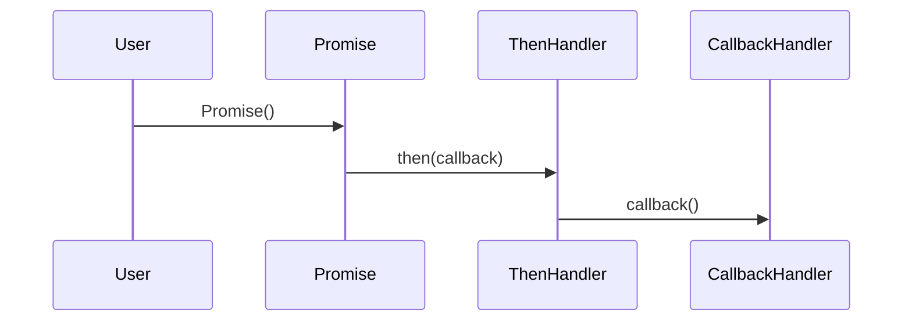

### Explanation
- **User**: Initiates a promise.
- **Promise**: Represents a value that may be available asynchronously.
- **ThenHandler**: Handles the resolved or rejected value.
- **CallbackHandler**: Executes the callback function with the resolved or rejected value.

## Conclusion [02:13]

The trailer ends with the creators wishing everyone luck and encouraging them to keep watching Season 2 of "Namaste JavaScript." They are grateful for the love and support from the community and are excited to continue growing together.

> **💡 Tip:** This series is your opportunity to deepen your understanding and love for JavaScript. Engage with the content and share it with others to continue the journey! [02:13]

---

This comprehensive set of notes provides a structured overview of the trailer, helping you understand the context, key points, and the importance of the content. Whether you are a beginner or an experienced developer, "Namaste JavaScript" Season 2 is aimed at enhancing your JavaScript journey.

---

## Lecture 2: Callback Hell | Ep  01 Season 02 - Namaste JavaScript [0:00]

# Comprehensive Study Notes for "Callback Hell | Ep 01 Season 02 - Namaste JavaScript"

## Introduction to the Series
Welcome to the first episode of Season 2 of Namaste JavaScript! This series will focus on two main aspects of callbacks: their benefits and the potential pitfalls they can introduce. Specifically, we will delve into **Callback Hell** and **Inversion of Control**. Understanding these concepts is crucial as it will help you grasp the intricacies of asynchronous programming in JavaScript.

### Video Overview
- **Start Time:** 0:00
- **Duration:** 1:02

## Understanding Callbacks
### What are Callbacks?
Callbacks are functions that are passed as arguments to other functions. These functions are executed after the completion of the operation they are associated with. They are a fundamental concept in JavaScript for handling asynchronous operations.

### Example 1: Simple Callback
```javascript
setTimeout(() => {
    console.log('Callback executed after 5 seconds');
}, 5000);
```
- **Timestamp:** [0:40]

### Example 2: Callback in Asynchronous Operations
```javascript
const cart = ['shoes', 'pants', 'ka'];

// Simulate backend APIs
const createOrder = (items, callback) => {
    setTimeout(() => {
        console.log('Order created with items:', items);
        callback();
    }, 1000);
};

const proceedToPayment = () => {
    console.log('Proceeding to payment...');
};

// Using callbacks to handle asynchronous operations
createOrder(cart, proceedToPayment);
```
- **Timestamp:** [4:57]

## Implementing Callbacks
### Asynchronous Function with Callbacks
```javascript
const createOrder = (items, callback) => {
    setTimeout(() => {
        console.log('Order created with items:', items);
        callback(); // Callback executed after order creation
    }, 1000);
};

const proceedToPayment = () => {
    console.log('Proceeding to payment...');
};

createOrder(['shoes', 'pants', 'ka'], proceedToPayment);
```
- **Timestamp:** [4:57]

### Complex Example: Nested Callbacks
```javascript
const createOrder = (items, callback) => {
    setTimeout(() => {
        console.log('Order created with items:', items);
        const showOrderSummary = () => {
            console.log('Showing order summary...');
        };
        callback(showOrderSummary); // Nested callback
    }, 1000);
};

const proceedToPayment = () => {
    console.log('Proceeding to payment...');
};

createOrder(['shoes', 'pants', 'ka'], proceedToPayment);
```
- **Timestamp:** [6:36]

## Callback Hell and Risks
### Problem with Nested Callbacks
Nested callbacks can lead to a complex and hard-to-maintain codebase, often referred to as **Callback Hell**.

```javascript
createOrder(cart, () => {
    proceedToPayment();
    () => {
        showOrderSummary();
        () => {
            displayOrderDetails();
        };
    };
});
```
- **Timestamp:** [8:00]

### Risks of Callback Hell
- **Readability:** Code becomes difficult to read and understand.
- **Maintainability:** Hard to make changes without breaking the code.
- **Error Handling:** Error handling becomes cumbersome.

### Code Example: Callback Hell
```javascript
function processOrder(items, cb1) {
    setTimeout(() => {
        console.log('Order created with items:', items);
        cb1(() => {
            console.log('Proceeding to payment...');
            () => {
                console.log('Payment successful');
                () => {
                    console.log('Order summary displayed');
                    () => {
                        console.log('Order details updated');
                    };
                };
            };
        });
    }, 1000);
}
```
- **Timestamp:** [8:00]

## Inversion of Control
### What is Inversion of Control (IoC)?
Inversion of Control (IoC) is a design pattern where a callback function is passed to a function, and the control is inverted. The function being called is no longer in control of the flow, and instead, the control is given to the callback.

### Example: Inversion of Control
```javascript
function processOrder(items, orderCb, paymentCb, summaryCb, detailsCb) {
    setTimeout(() => {
        orderCb(items);
        paymentCb();
        summaryCb();
        detailsCb();
    }, 1000);
}

processOrder(
    ['shoes', 'pants', 'ka'],
    (items) => console.log('Order created with items:', items),
    () => console.log('Proceeding to payment...'),
    () => console.log('Order summary displayed'),
    () => console.log('Order details updated')
);
```
- **Timestamp:** [10:00]

## Summary and Future Topics
### Summary
In this episode, we covered the basics of callbacks, their implementation in asynchronous operations, and the pitfalls of using nested callbacks, leading to the concept of **Callback Hell**. We also discussed **Inversion of Control** and its importance in managing asynchronous operations.

### Future Topics
- **Promises:** Promises offer a cleaner way to handle asynchronous operations.
- **Async/Await:** A modern approach to asynchronous programming.
- **Generators:** Advanced techniques for managing asynchronous code.

### Video Conclusion
We hope you enjoyed this episode of Namaste JavaScript. Stay tuned for more episodes covering these topics and more. Happy coding!

---

### Interactive Mermaid Diagram: Callback Hell
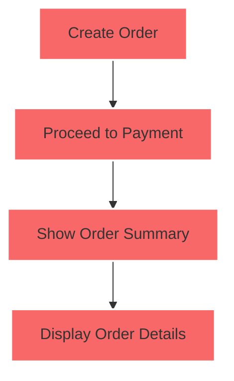
- **Timestamp:** [12:00]

This diagram visually represents the nested callback structure, illustrating the complexity of **Callback Hell**.

---

## Lecture 3: Promises | Ep 02  Season 02 - Namaste JavaScript [0:00]

# Comprehensive Study Notes for "Promises | Ep 02  Season 02 - Namaste JavaScript"

## Introduction
Promises are a fundamental concept in JavaScript for handling asynchronous operations. They are essential for managing callback hell, ensuring better code readability, and making your code more robust. In this lecture, we will dive deep into the concept of promises, their importance, and how they differ from traditional callbacks.

### [0:00] Why Promises Matter
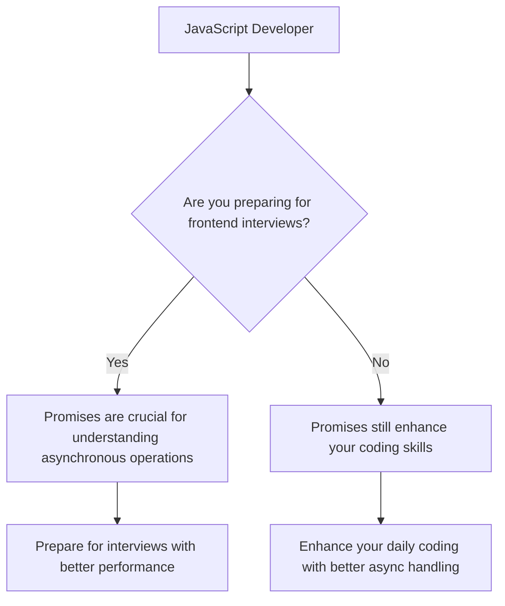

## Code Example: Callbacks and Promises
Let's start by examining how we might implement a basic e-commerce scenario using both callbacks and promises.

### Callback Example [1:10]
```javascript
const cart = ["shoes", "pants", "kurta", "CA"];

const createOrder = (cartItems, callback) => {
    setTimeout(() => {
        const orderId = "1234567890";
        callback(orderId);
    }, 2000);
};

const proceedToPayment = (orderId) => {
    console.log(`Proceeding to payment for order: ${orderId}`);
};

// Callback usage
createOrder(cart, (orderId) => {
    proceedToPayment(orderId);
});
```

### Promise Example [3:50]
```javascript
const cart = ["shoes", "pants", "kurta", "CA"];

const createOrder = (cartItems) => {
    return new Promise((resolve, reject) => {
        setTimeout(() => {
            const orderId = "1234567890";
            resolve(orderId);
        }, 2000);
    });
};

const proceedToPayment = (orderId) => {
    console.log(`Proceeding to payment for order: ${orderId}`);
};

// Promise usage
createOrder(cart)
    .then((orderId) => {
        proceedToPayment(orderId);
    })
    .catch((error) => {
        console.error("Order creation failed:", error);
    });
```

## Promise.then Function
The `then` function in promises allows us to handle the successful resolution of a promise. It takes a callback that will be executed once the promise is resolved.

### Promise.then Syntax
```javascript
promise.then(
    (value) => { /* success callback */ },
    (reason) => { /* failure callback */ }
);
```

## Callbacks vs Promises
| **Callbacks** | **Promises** |
|--------------|-------------|
| Callback hell (nested callbacks) | Chainable and avoid callback hell |
| Inversion of control (responsibility passed to external code) | Explicit control over the flow of execution |
| No built-in support for error handling | Built-in error handling (`.catch` method) |
| Asynchronous operations are not as readable | Code is more readable and maintainable |

### [3:43] Inversion of Control with Callbacks
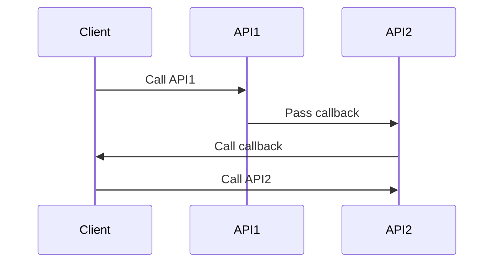

### [3:50] Control with Promises
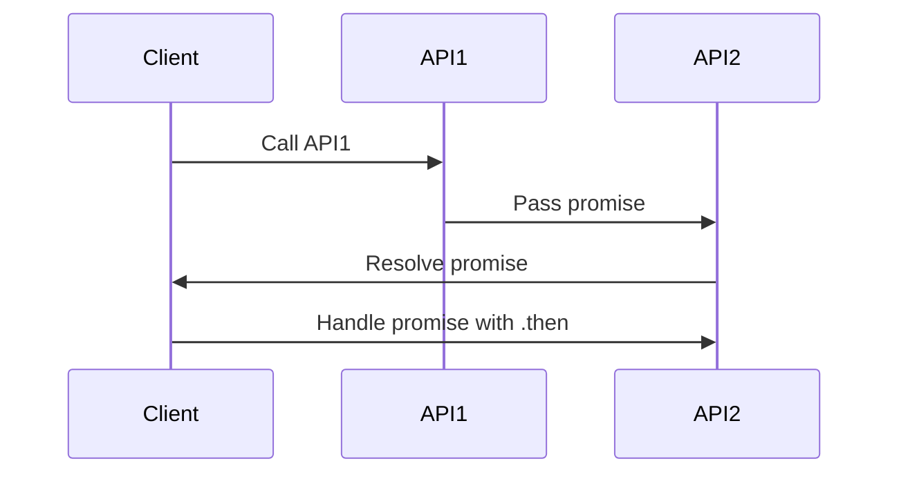

## Importance of Promises
Promises provide a more reliable and cleaner way to handle asynchronous operations. They help in avoiding the complexity and potential errors that come with callback hell. Promises are widely used in modern JavaScript development, making them a crucial skill for developers.

### [0:43] Love for Promises
Promises make your code more predictable, easier to read, and maintain. They help in managing complex asynchronous logic more effectively. Mastering promises is like unlocking a new level of proficiency in JavaScript.

## Promise Object in Browser
In the browser, the Promise object represents the eventual completion (or failure) of an asynchronous operation and its resulting value.

### Browser Promise Example
```javascript
const cart = ["shoes", "pants", "kurta", "CA"];

const createOrder = (cartItems) => {
    return new Promise((resolve, reject) => {
        setTimeout(() => {
            const orderId = "1234567890";
            resolve(orderId);
        }, 2000);
    });
};

createOrder(cart)
    .then((orderId) => {
        console.log(`Order created with ID: ${orderId}`);
    })
    .catch((error) => {
        console.error("Order creation failed:", error);
    });
```

### [0:50] Conclusion
In this video, we explored the beauty and importance of promises. Promises are a powerful tool for managing asynchronous operations, making your code more readable, and less prone to errors. By understanding and effectively using promises, you can write more robust and maintainable JavaScript code.

### [0:54] Call to Action
I hope this video has sparked your interest in promises. If you found this helpful, please subscribe to the channel and hit the like button. Stay tuned for more episodes in the Namaste JavaScript series!

> **💡 Tip:** Always prefer using promises over callbacks to manage asynchronous operations in JavaScript.

> **⚠️ Warning:** Be cautious with the control inversion that can occur when using callbacks. Promises provide a more predictable way to manage asynchronous code.

---

This comprehensive set of notes is designed to help you understand the core concepts of promises, their practical usage, and their importance in modern JavaScript development. Happy coding!

---

## Lecture 4: Creating a Promise, Chaining & Error Handling | Ep 03 Season 02 Namaste JavaScript [0:00]

# Comprehensive Study Notes: Creating a Promise, Chaining & Error Handling

## Introduction [00:00]
Promises are a fundamental concept in JavaScript for handling asynchronous operations. In this episode, we will delve into creating and managing promises, including error handling and chaining. Promises make asynchronous code more readable and maintainable, making them a valuable tool for any JavaScript developer.

## Consuming Promises [00:10]
In the previous episode, we discussed how to consume promises. Consuming a promise involves handling the asynchronous operations that return a promise. For instance, consider an async operation that returns an order ID. We can use `.then()` to handle the resolved value and `.catch()` for error handling.

```javascript
// Example of consuming a promise
createOrder(cart).then(orderId => {
    proceedToPayment(orderId);
}).catch(error => {
    console.error("Order creation failed:", error);
});
```

## Creating a Promise [03:20]
Creating a promise involves using the `Promise` constructor, which allows us to encapsulate asynchronous logic. The `Promise` constructor takes a function with `resolve` and `reject` as parameters.

### Syntax:
```javascript
const myPromise = new Promise((resolve, reject) => {
    // Asynchronous logic
    if (condition) {
        resolve(result); // Resolve the promise
    } else {
        reject(error); // Reject the promise
    }
});
```

### Example: Creating an Order [04:00]
Let's create an `createOrder` function that simulates an order creation process.

```javascript
function createOrder(cart) {
    return new Promise((resolve, reject) => {
        // Simulate async operations
        if (validateCart(cart)) {
            // Simulate API call
            setTimeout(() => {
                resolve("Order ID: 12345");
            }, 1000);
        } else {
            reject(new Error("Cart is invalid"));
        }
    });
}
```

### Explanation:
- `validateCart(cart)` checks if the cart is valid.
- `setTimeout` simulates an async operation.
- `resolve("Order ID: 12345")` resolves the promise with an order ID.
- `reject(new Error("Cart is invalid"))` rejects the promise with an error.

### Mermaid Diagram: Order Creation [07:10]
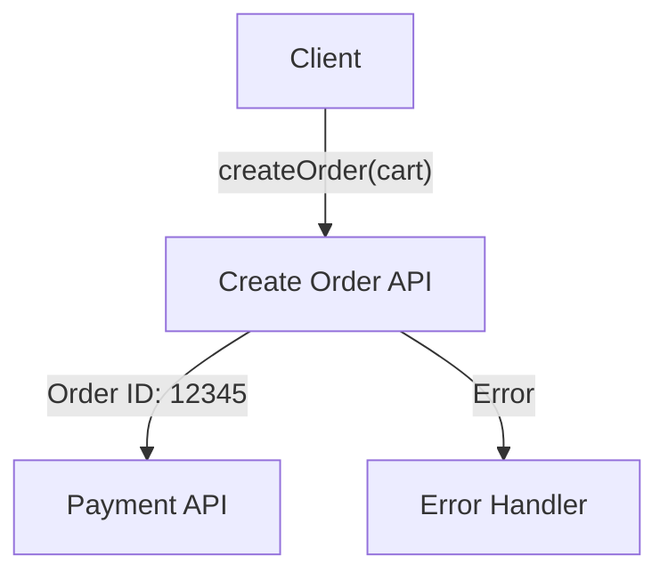

## Promise Rejection [07:50]
Promise rejection is handled using the `catch` method. This method is called when the promise is rejected.

```javascript
createOrder(cart).then(orderId => {
    proceedToPayment(orderId);
}).catch(error => {
    console.error("Order creation failed:", error);
});
```

### Example: Handling Rejection [08:10]
Let's handle the rejection in our `createOrder` function.

```javascript
function createOrder(cart) {
    return new Promise((resolve, reject) => {
        if (validateCart(cart)) {
            setTimeout(() => {
                resolve("Order ID: 12345");
            }, 1000);
        } else {
            reject(new Error("Cart is invalid"));
        }
    });
}
```

## Error Handling [09:00]
Error handling in promises is crucial to ensure that our application can handle unexpected situations gracefully.

### Syntax:
```javascript
createOrder(cart)
    .then(orderId => {
        // Handle success
    })
    .catch(error => {
        // Handle error
    });
```

### Example: Comprehensive Error Handling [09:30]
```javascript
createOrder(cart)
    .then(orderId => {
        proceedToPayment(orderId);
    })
    .catch(error => {
        console.error("Order creation failed:", error);
    });
```

## Promise Chaining [10:00]
Promise chaining allows us to perform multiple async operations in a sequence. Each `.then()` call returns a new promise, allowing for a fluent API.

### Syntax:
```javascript
createOrder(cart)
    .then(orderId => {
        return proceedToPayment(orderId);
    })
    .then(paymentStatus => {
        console.log("Payment successful:", paymentStatus);
    })
    .catch(error => {
        console.error("Order and payment failed:", error);
    });
```

### Example: Chaining Promises [10:30]
```javascript
function proceedToPayment(orderId) {
    return new Promise((resolve, reject) => {
        if (isValidOrder(orderId)) {
            setTimeout(() => {
                resolve("Payment successful");
            }, 1000);
        } else {
            reject(new Error("Invalid order ID"));
        }
    });
}
```

### Mermaid Diagram: Order and Payment Chaining [11:00]
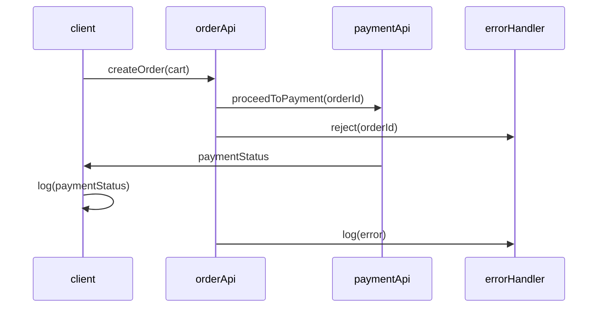

## Conclusion [11:30]
In this episode, we covered the fundamentals of creating and managing promises, including error handling and chaining. Understanding these concepts will help you write more robust and maintainable asynchronous code. Practice these techniques in your projects to become a more proficient JavaScript developer.

> **💡 Tip:** Always handle errors gracefully to ensure your application remains user-friendly and reliable.

> **⚠️ Warning:** Ensure your `resolve` and `reject` functions are called only once to avoid unexpected behavior.

## Further Reading
- [MDN Web Docs: Promises](https://developer.mozilla.org/en-US/docs/Web/JavaScript/Guide/Using_promises)
- [JavaScript.info: Promises](https://javascript.info/promise-basics)

--- 

Feel free to explore the code snippets and diagrams further to enhance your understanding. Happy coding!

---

## Lecture 5.1: Introduction to JavaScript Promise APIs (Promise APIs + Interview Questions 🔥 | S.02 Ep.05 - Namaste JavaScript  | all, allSettled, race, any) [0:00]

# Lecture 5.1: Introduction to JavaScript Promise APIs

## 0:00 Introduction and Overview
Welcome back to Namaste JavaScript! Today, we will delve into the crucial topic of JavaScript Promise APIs. Promise APIs are essential for handling asynchronous operations in JavaScript and are particularly vital when working on day-to-day applications and preparing for interviews. These APIs provide a robust mechanism for managing asynchronous code execution, making your applications more robust and easier to maintain.

### 0:00 - 1:03 Theory Overview
Before diving into the code, let's first understand the theory behind these Promise APIs. They include `all`, `allSettled`, `race`, and `any`. These will be covered in detail.

---

## 1:03 - 1:30 Concept Analysis

### 1:03 - 1:15 Promise.all
`Promise.all` takes an iterable (like an array) of promises and returns a single promise that resolves when all the promises in the iterable resolve. If any of the promises in the iterable reject, the returned promise will immediately reject with the value of the first rejected promise.

> **💡 Tip:** `Promise.all` is ideal for scenarios where you need to execute multiple asynchronous operations and ensure they all complete successfully.

### 1:15 - 1:30 Example
```javascript
const promise1 = Promise.resolve(3);
const promise2 = 42;
const promise3 = new Promise((resolve, reject) => {
  setTimeout(resolve, 100, 'foo');
});

Promise.all([promise1, promise2, promise3]).then((values) => {
  console.log(values); // Output: [3, 42, "foo"]
});
```

### 1:30 - 1:50 Promise.allSettled
`Promise.allSettled` is a bit different from `Promise.all`. It returns a single promise that resolves with an array of objects that describe the fulfillment or rejection of each promise in the iterable.

> **💡 Tip:** `Promise.allSettled` is useful when you need to handle both resolved and rejected promises in the iterable.

### 1:50 - 2:05 Example
```javascript
const promise1 = Promise.resolve(3);
const promise2 = Promise.reject(new Error('Error!'));
const promise3 = new Promise((resolve, reject) => {
  setTimeout(resolve, 100, 'foo');
});

Promise.allSettled([promise1, promise2, promise3]).then((values) => {
  console.log(values); // Output: [{status: "fulfilled", value: 3}, {status: "rejected", reason: Error("Error!")}, {status: "fulfilled", value: "foo"}]
});
```

### 2:05 - 2:30 Promise.race
`Promise.race` takes an iterable of promises and returns a single promise that resolves or rejects as soon as any promise in the iterable either resolves or rejects. The value or reason of the first promise to settle is passed to the returned promise.

> **💡 Tip:** `Promise.race` is useful for setting a timeout or for the first async operation to complete.

### 2:30 - 2:45 Example
```javascript
const promise1 = new Promise((resolve, reject) => {
  setTimeout(resolve, 50, 'foo');
});

const promise2 = new Promise((resolve, reject) => {
  setTimeout(resolve, 40, 'bar');
});

Promise.race([promise1, promise2]).then((value) => {
  console.log(value); // Output: "bar"
});
```

### 2:45 - 3:00 Promise.any
`Promise.any` returns a single promise that resolves when any of the promises in the iterable resolves. It will reject only if all the promises in the iterable reject.

> **💡 Tip:** `Promise.any` is useful when you want to ensure that at least one of the promises resolves.

### 3:00 - 3:15 Example
```javascript
const promise1 = new Promise((resolve, reject) => {
  setTimeout(resolve, 50, 'foo');
});

const promise2 = new Promise((resolve, reject) => {
  setTimeout(reject, 40, new Error('bar'));
});

Promise.any([promise1, promise2]).then((value) => {
  console.log(value); // Output: "foo"
});
```

---

## 3:15 - 3:30 Implementation Details
Each of these Promise APIs can be used in different scenarios. Understanding their implementation can help you make informed decisions on which to use in your applications.

### 3:15 - 3:25 Promise.all
```javascript
Promise.all(iterable).then((values) => {
  // All promises resolved
}).catch((reason) => {
  // At least one promise rejected
});
```

### 3:25 - 3:35 Promise.allSettled
```javascript
Promise.allSettled(iterable).then((values) => {
  // All promises settled
});
```

### 3:35 - 3:45 Promise.race
```javascript
Promise.race(iterable).then((value) => {
  // First promise resolved
}).catch((reason) => {
  // First promise rejected
});
```

### 3:45 - 3:55 Promise.any
```javascript
Promise.any(iterable).then((value) => {
  // At least one promise resolved
}).catch((reason) => {
  // All promises rejected
});
```

---

## 3:55 - 4:15 Practical Implications
Using these Promise APIs can significantly improve the design and maintainability of your applications. They help in managing multiple asynchronous operations in a cleaner and more efficient manner.

### 4:00 - 4:10 Handling Multiple API Calls
For example, when making multiple API calls, `Promise.all` can be used to ensure all calls are completed before proceeding.

### 4:10 - 4:15 Handling Errors Gracefully
`Promise.allSettled` can be used to handle cases where some promises may fail, but you still want to know the outcome of all of them.

### 4:15 - 4:20 Setting Timeouts
`Promise.race` can be used to set a timeout on the first promise to resolve, ensuring timely responses.

### 4:20 - 4:25 Handling At Least One Success
`Promise.any` can be used when you need to ensure at least one promise resolves, even if the others fail.

---

## 4:25 - 4:30 Key Takeaways
1. **`Promise.all`**: Use for ensuring multiple promises resolve before proceeding.
2. **`Promise.allSettled`**: Handle both resolved and rejected promises.
3. **`Promise.race`**: Set a timeout or handle the first promise to resolve.
4. **`Promise.any`**: Ensure at least one promise resolves, even if others fail.

### 4:30 - 4:35 Conclusion
These Promise APIs are incredibly powerful tools for managing asynchronous operations in JavaScript. Understanding and utilizing them can make your code more robust and easier to debug.

---

## Interactive Mermaid Diagram: Promise API Workflow

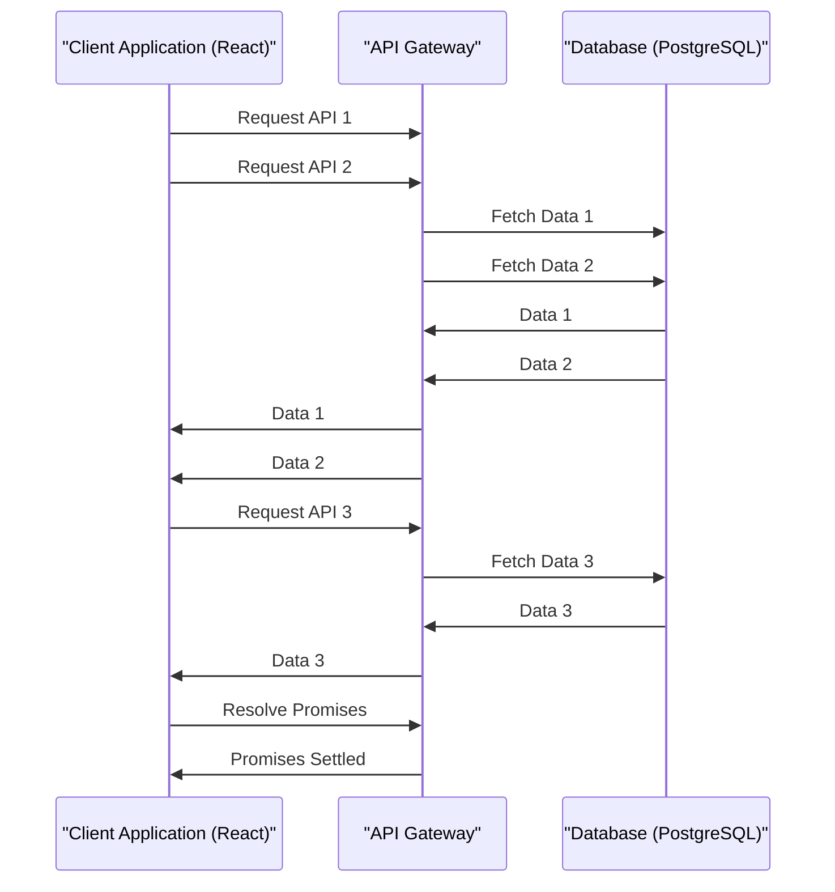

This diagram illustrates how `Promise.all` and `Promise.allSettled` can be used to manage multiple API calls and database fetches in a sequential manner, ensuring all operations are completed or settled before proceeding.

---

By understanding and implementing these Promise APIs, you will be well-equipped to handle complex asynchronous operations in your JavaScript applications. Happy coding!

---

## Lecture 5.2: Understanding Promise.all for concurrent operations (Promise APIs + Interview Questions 🔥 | S.02 Ep.05 - Namaste JavaScript  | all, allSettled, race, any) [0:50]

# Lecture 5.2: Understanding Promise.all for Concurrent Operations

## Introduction
This section covers the `Promise.all` method, an essential tool for handling multiple promises concurrently. It is a fundamental aspect of asynchronous JavaScript programming and is particularly important in React applications where you need to make parallel API calls.

> **💡 Tip:** If you are building React applications, understanding these API methods is crucial for handling asynchronous operations efficiently.

### Key Takeaways
- `Promise.all` is used to handle multiple promises together.
- It ensures that all promises in the array resolve before proceeding.
- The output is an array of the results, in the order of the input promises.

## Concept Analysis
### Purpose and Use Cases
`Promise.all` is used when you need to make multiple API calls concurrently and need to wait for all of them to complete successfully. This is a common scenario in web applications where you might need to fetch data from multiple sources.

> **💡 Tip:** `Promise.all` is very useful in scenarios like fetching user data from multiple user IDs.

### Contract of `Promise.all`
The `Promise.all` method takes an iterable (mostly an array) of promises as its input. It returns a single promise that resolves when all of the promises in the iterable have resolved, or rejects if any of the promises are rejected.

### Example Scenario
Consider the scenario where you have 10 user IDs and you want to fetch user information for all of them using an API. This is where `Promise.all` comes into play.

> **💡 Tip:** `Promise.all` ensures that all API calls are made in parallel and waits for all to complete before proceeding.

### Success Case
Let's break down the flow of `Promise.all` using a hypothetical example.

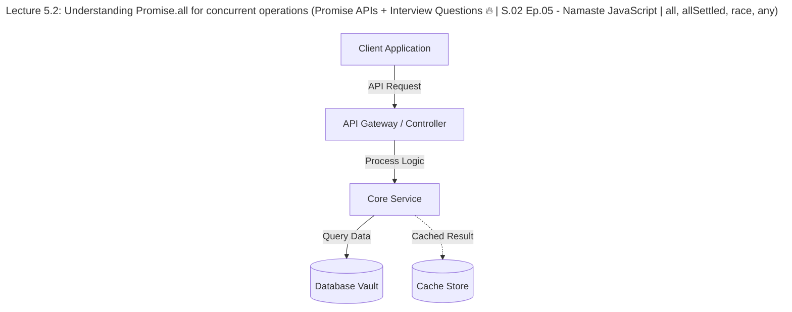

### Failure Case
If any of the promises are rejected, `Promise.all` will reject immediately with the first error.

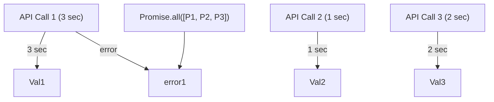

## Implementation Details

### Syntax
```javascript
Promise.all([P1, P2, P3]);
```

### Handling Promises in an Array
```javascript
const promises = [
  fetch('https://api.example.com/user/1'),
  fetch('https://api.example.com/user/2'),
  fetch('https://api.example.com/user/3')
];

Promise.all(promises)
  .then((results) => {
    console.log('All requests succeeded:', results);
  })
  .catch((error) => {
    console.error('One or more requests failed:', error);
  });
```

## Practical Implications
### Real-World Application
In a React application, you might use `Promise.all` to fetch data for multiple components or to perform validation before rendering.

```javascript
import { useEffect, useState } from 'react';

function UsersList() {
  const [users, setUsers] = useState([]);

  useEffect(() => {
    const fetchUsers = async () => {
      try {
        const promises = Array(10).fill('').map(() => fetch('https://api.example.com/user'));

        const results = await Promise.all(promises);

        setUsers(results);
      } catch (error) {
        console.error('Failed to fetch users:', error);
      }
    };

    fetchUsers();
  }, []);

  return (
    <div>
      {users.map((user) => (
        <div key={user.id}>{user.name}</div>
      ))}
    </div>
  );
}
```

### Error Handling
Handling errors is crucial in real-world applications. You can use `.catch` to handle failures gracefully.

```javascript
Promise.all(promises)
  .then((results) => {
    console.log('All requests succeeded:', results);
  })
  .catch((error) => {
    console.error('One or more requests failed:', error);
  });
```

## Key Takeaways
- `Promise.all` is used to handle multiple promises concurrently.
- It waits for all promises to resolve or rejects immediately if any promise is rejected.
- The output is an array of resolved values in the order of the input promises.
- Use `Promise.all` to simplify complex asynchronous operations.

## Conclusion
Understanding `Promise.all` is crucial for efficient asynchronous programming. It simplifies handling multiple concurrent operations and ensures that your application waits for all tasks to complete before proceeding. Mastering this concept will make your asynchronous code cleaner and more maintainable.

> **💡 Tip:** Always use `Promise.all` when you need to wait for multiple promises to resolve.

---

## Lecture 5.3: Promise.all Failure case (Promise APIs + Interview Questions 🔥 | S.02 Ep.05 - Namaste JavaScript  | all, allSettled, race, any) [6:12]

# Lecture 5.3: Promise.all Failure Case (Promise APIs + Interview Questions 🔥 | S.02 Ep.05 - Namaste JavaScript | all, allSettled, race, any)

In this section, we delve into the behavior of `Promise.all` when one or more promises in the array fail, along with the key differences between `Promise.all` and other related promise APIs such as `Promise.allSettled` and `Promise.race`. 

## Concept Analysis [6:12]

### Overview of `Promise.all`
`Promise.all` is an API that takes an array of promises and waits for all of them to resolve. Once all promises resolve, it resolves with an array of their results. If any promise in the array rejects, `Promise.all` immediately rejects with the reason of the first rejection.

### Failure Case of `Promise.all`
When any promise in the array fails (rejects), `Promise.all` will:
1. Immediately reject.
2. Return the rejection reason from the first failed promise.

### Example [6:41]
Consider the following example:

```javascript
const P1 = new Promise((resolve, reject) => setTimeout(resolve, 3000, 'P1'));
const P2 = new Promise((resolve, reject) => setTimeout(reject, 1000, new Error('P2 Error')));
const P3 = new Promise((resolve, reject) => setTimeout(resolve, 2000, 'P3'));

Promise.all([P1, P2, P3]).then(res => {
    console.log(res); // This will never be reached
}).catch(err => {
    console.error(err); // Error: P2 Error
});
```

In this example, `P2` rejects after 1 second, causing `Promise.all` to immediately reject with the error from `P2`.

## Implementation Details [6:12]

### Key Points
- `Promise.all` will resolve with an array of values if all promises resolve.
- `Promise.all` will reject if any promise in the array rejects.
- The rejected value is the reason for the rejection.

### Example with Notes [6:12]
- **Promise.all** will wait for all promises to resolve. If any promise rejects, it will immediately reject.
- **Critical Callout:**
  > **⚠️ Warning:** `Promise.all` does not wait for the remaining promises to reject or resolve. It stops as soon as the first rejection occurs.
  
  > **💡 Tip:** If you need to handle both resolved and rejected promises, consider using `Promise.allSettled`.

## Practical Implications [6:12]

### Scenarios
- **API Calls:** In an API call context, if one API call fails, it can stop the entire process.
- **Data Aggregation:** In data aggregation scenarios, if any source fails, the entire process might fail.

### Use Cases
- **Critical Task Handling:** When all tasks must succeed, `Promise.all` is a good choice.
- **Non-Critical Task Handling:** When some tasks can fail, consider `Promise.allSettled` or `Promise.race`.

## Key Takeaways [6:12]

### Summary
- `Promise.all` is used to wait for multiple promises to resolve.
- If any promise rejects, `Promise.all` will immediately reject.
- The rejected value is the reason for the rejection.
- `Promise.all` does not wait for all promises to reject or resolve; it stops at the first rejection.

### Related APIs
- **Promise.allSettled**: Waits for all promises to settle (resolve or reject) and returns an array of resolved values.
- **Promise.race**: Waits for the first promise to settle and returns the result of the first settled promise.

### Example with `Promise.allSettled` [6:12]
```javascript
Promise.allSettled([P1, P2, P3]).then(results => {
    console.log(results);
    // Output: [
    //   { status: "fulfilled", value: "P1" },
    //   { status: "rejected", reason: Error: P2 Error },
    //   { status: "fulfilled", value: "P3" }
    // ]
});
```

## Diagram for `Promise.all` [6:12]

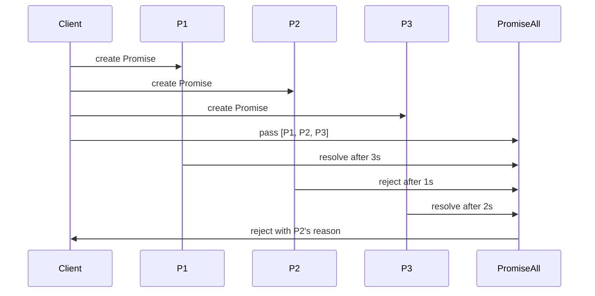

This diagram illustrates the flow of promises and how `Promise.all` handles the failure of one promise.

### Conclusion
Understanding the behavior of `Promise.all` is crucial for managing asynchronous operations effectively. In scenarios where some tasks can fail but the process should continue, `Promise.allSettled` is a better choice. Always consider the specific requirements of your application when choosing the appropriate promise API.

## Further Reading [6:12]
- MDN Web Docs: [Promise.all](https://developer.mozilla.org/en-US/docs/Web/JavaScript/Reference/Global_Objects/Promise/all)
- MDN Web Docs: [Promise.allSettled](https://developer.mozilla.org/en-US/docs/Web/JavaScript/Reference/Global_Objects/Promise/allSettled)

--- 

This comprehensive set of notes should help you understand the behavior of `Promise.all` in failure cases and how to handle such scenarios effectively.

---

## Lecture 5.4: Exploring Promise.allSettled for comprehensive promise handling (Promise APIs + Interview Questions 🔥 | S.02 Ep.05 - Namaste JavaScript  | all, allSettled, race, any) [12:03]

# Comprehensive Study Notes: Exploring Promise.allSettled for Comprehensive Promise Handling

## Concept Analysis

### Introduction
In the context of JavaScript's promise API, `Promise.allSettled` is a powerful tool for handling an array of promises. Introduced to address scenarios where it's important to know the state of each promise, whether it was successful or not, `Promise.allSettled` provides a comprehensive outcome for all promises passed to it. [12:03]

### Key Differences from `Promise.all`
- **Promise.all**: 
  - Fails fast: If any one of the promises fails, the entire `Promise.all` will reject with the reason of the first failed promise.
  - Returns an array of resolved values only if all promises are fulfilled.

- **Promise.allSettled**:
  - Waits for all promises to settle (either resolve or reject).
  - Returns an array of objects, each representing the state of a promise, including the value or reason.

### Diagram: Promise Handling Comparison
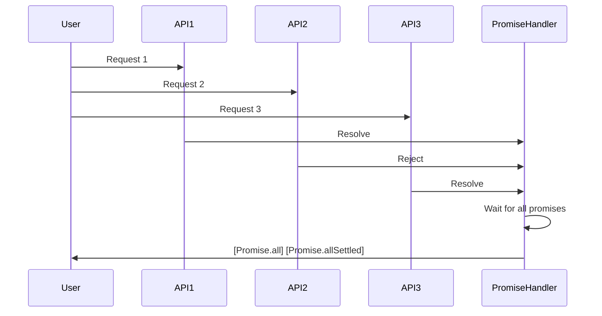

## Implementation Details

### Syntax
```javascript
Promise.allSettled(promises)
```
- **Parameters**:
  - `promises` (Array): An array of promises to be settled.

- **Return Value**:
  - A promise that resolves to an array of objects, each representing the outcome of a promise.
  - Each object in the array has two properties: `status` and `value`.
  - `status`: `"fulfilled"` or `"rejected"`.
  - `value`: The resolved value for fulfilled promises; the reason for rejected promises.

### Example
```javascript
const promises = [Promise.resolve(1), Promise.reject('Error'), new Promise((resolve) => setTimeout(resolve, 1000, 2))];

Promise.allSettled(promises)
  .then((results) => {
    console.log(results); // [{ status: "fulfilled", value: 1 }, { status: "rejected", reason: "Error" }, { status: "fulfilled", value: 2 }]
  });
```

## Practical Implications

### Use Cases
- **Error Handling**: Ensuring that you handle errors and successes comprehensively.
- **Data Aggregation**: Collecting data from multiple asynchronous operations, even if some fail.
- **User Experience**: Ensuring that your application doesn't break when one or more API calls fail.

### Code Example
```javascript
const fetchData = async () => {
  const [data1, data2, data3] = await Promise.allSettled([
    fetch('https://api.example.com/data1'),
    fetch('https://api.example.com/data2').catch(() => "Failed"),
    fetch('https://api.example.com/data3').then(res => res.json()).catch(() => "Failed")
  ]);

  console.log(data1, data2, data3);
};

fetchData();
```

## Key Takeaways

- **Promise.allSettled** ensures that all promises are handled, providing a comprehensive outcome.
- It is useful for scenarios where you need to know the state of each promise, even if some fail.
- It is particularly useful for data aggregation and error handling in complex asynchronous operations.

### Diagram: Flow of Promise.allSettled
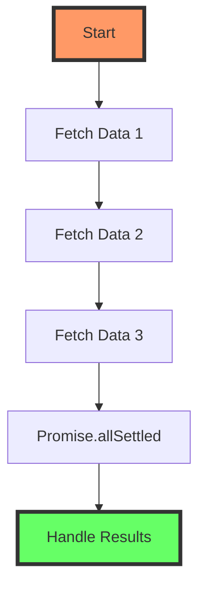

## Summary

- `Promise.allSettled` is a valuable tool for handling multiple promises comprehensively.
- It ensures that all promises are settled, providing detailed outcomes for each promise.
- It is particularly useful in scenarios where error handling and data aggregation are crucial.

By understanding and effectively utilizing `Promise.allSettled`, you can enhance the reliability and robustness of your asynchronous code. [16:42]

---

## Lecture 5.5: Implementing Promise.race for optimized execution (Promise APIs + Interview Questions 🔥 | S.02 Ep.05 - Namaste JavaScript  | all, allSettled, race, any) [16:49]

# Comprehensive Study Notes: Implementing `Promise.race` for Optimized Execution

## Concept Analysis

> **💡 Tip:** Understanding the concept of `Promise.race` is crucial as it provides a mechanism to handle the first settled promise, whether it is successful or rejected. [16:49]

`Promise.race` is a method that takes an array of promises and returns a single promise. The returned promise resolves or rejects as soon as one of the promises in the provided array settles (resolves or rejects). The key idea is to handle the first settled promise, which makes it efficient for scenarios where you don't need to wait for all promises to resolve.

### Example

```javascript
const p1 = new Promise((resolve) => setTimeout(() => resolve('P1'), 3000));
const p2 = new Promise((resolve) => setTimeout(() => resolve('P2'), 1000));
const p3 = new Promise((resolve) => setTimeout(() => resolve('P3'), 2000));

Promise.race([p1, p2, p3]).then(result => console.log(result)); // P2
```

- **Explanation:** `p2` resolves first, so the `Promise.race` will resolve to the value of `p2`.

## Implementation Details

### Syntax

```javascript
Promise.race(promises)
```

- **promises:** An array of promises.

### Key Points

1. **First Settlement:** `Promise.race` resolves or rejects as soon as any promise in the provided array settles.
2. **Resolution Value:** If a promise in the array resolves, `Promise.race` resolves with the same value.
3. **Rejection Value:** If a promise in the array rejects, `Promise.race` rejects with the same reason.

### Example with Error Handling

```javascript
const p1 = new Promise((resolve) => setTimeout(() => resolve('P1'), 3000));
const p2 = new Promise((resolve) => setTimeout(() => resolve('P2'), 1000));
const p3 = new Promise((resolve, reject) => setTimeout(() => reject('P3 Error'), 2000));

Promise.race([p1, p2, p3]).then(result => console.log(result), error => console.error(error)); // 'P2' or 'P3 Error'
```

- **Explanation:** `p2` resolves first, so the `Promise.race` resolves to the value of `p2`. If `p3` were to reject, the `Promise.race` would reject with the error from `p3`.

## Practical Implications

1. **Efficiency:** `Promise.race` can be used to handle scenarios where the first successful response is sufficient, making it a powerful tool for optimizing execution.
2. **Concurrency Management:** Useful in scenarios where multiple operations can be performed in parallel, but the first successful result is needed.
3. **Error Handling:** Ensures that if an error occurs, it is immediately propagated, allowing for quick error management.

### Example Scenarios

- **API Calls:** Making multiple API calls where the first successful response is enough.
- **Timeout Management:** Implementing a timeout for the first response, which can be more efficient than waiting for all responses.

## Key Takeaways

1. **`Promise.race`** is used to handle the first settled promise in an array of promises.
2. **First Settlement:** The returned promise resolves or rejects based on the first settled promise.
3. **Efficiency:** Useful for optimizing execution by handling the first successful result.
4. **Error Handling:** Ensures immediate propagation of errors, making it easier to manage.

## Mermaid Diagram: Flow of `Promise.race`

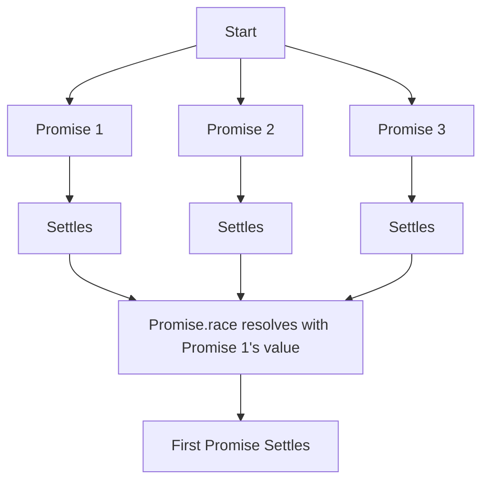

- **Diagram Explanation:**
  - **A:** Start point
  - **B1, B2, B3:** Promises in the array
  - **C1, C2, C3:** Promises settling
  - **D1:** `Promise.race` resolving with the first settled promise's value
  - **E:** First promise settles, `Promise.race` resolves

## Summary

Understanding and implementing `Promise.race` is essential for handling scenarios where the first successful result is needed, providing a powerful tool for optimizing execution and managing concurrency efficiently.

> **💡 Tip:** Practice implementing `Promise.race` in different scenarios to gain a deeper understanding. [21:38]

---

Feel free to pause the video and take notes as you go through each example and explanation for a deeper understanding.

---

## Lecture 5.6: Managing promise resolution with Promise.any (Promise APIs + Interview Questions 🔥 | S.02 Ep.05 - Namaste JavaScript  | all, allSettled, race, any) [21:28]

# Lecture 5.6: Managing Promise Resolution with `Promise.any`

## Concept Analysis

In this section, the video discusses the `Promise.any` API in the context of JavaScript's promise library. `Promise.any` is designed to resolve as soon as one of the given promises resolves successfully, much like `Promise.race`. However, it waits for the first successful resolution and returns that value. If all promises reject, `Promise.any` will return a single error that aggregates all the individual errors.

> **💡 Tip:** Understanding `Promise.any` is crucial for managing asynchronous operations efficiently, especially in scenarios where the success of any operation is sufficient.

### Implementation Details

`Promise.any` accepts an array of promises and resolves with the first resolved value. If the first promise resolves with an error, it ignores it and continues to the next promise. If all promises are rejected, it returns an array of all the rejected values.

#### Example:

```javascript
const promise1 = new Promise((resolve, reject) => {
  setTimeout(() => {
    resolve("Success from P1");
  }, 3000);
});

const promise2 = new Promise((resolve, reject) => {
  setTimeout(() => {
    reject(new Error("Error from P2"));
  }, 1000);
});

const promise3 = new Promise((resolve, reject) => {
  setTimeout(() => {
    resolve("Success from P3");
  }, 2000);
});

Promise.any([promise1, promise2, promise3]).then((result) => {
  console.log(result); // Output: "Success from P3"
}).catch((errors) => {
  console.error(errors); // Output: [Error: Error from P2]
});
```

### Practical Implications

`Promise.any` is particularly useful in scenarios where a fallback or any success is needed. For example, making multiple API calls and accepting the first successful response.

#### Example:

```javascript
const fetchData = async () => {
  const promiseA = fetch('https://api.example.com/dataA');
  const promiseB = fetch('https://api.example.com/dataB');
  const promiseC = fetch('https://api.example.com/dataC');

  const result = await Promise.any([promiseA, promiseB, promiseC]);
  console.log(result); // Outputs the response of the first successful API call
};
```

## Key Takeaways

1. **Understanding `Promise.any`**: `Promise.any` resolves as soon as one of the given promises resolves successfully.
2. **Behavior on Failure**: If the first promise resolves with an error, it continues to the next promise. If all promises are rejected, it returns an array of all the errors.
3. **Use Cases**: Ideal for scenarios where you need the first successful result or a fallback.

## Mermaid Diagram: Promise.any Workflow

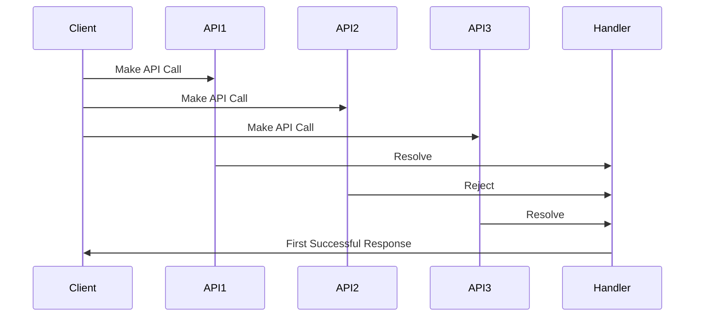

## Conclusion

Understanding and implementing `Promise.any` can significantly streamline your asynchronous operations, ensuring you handle successful outcomes effectively and efficiently. This is a key feature to master for any developer working with JavaScript promises.

> **💡 Tip:** Practice using `Promise.any` in different scenarios to solidify your understanding.

---

This comprehensive set of notes should help you deeply understand the `Promise.any` API, its implementation, and its practical applications.

---

## Lecture 5.7: Revision of all the Promise APIs (Promise APIs + Interview Questions 🔥 | S.02 Ep.05 - Namaste JavaScript  | all, allSettled, race, any) [28:37]

# Lecture 5.7: Revision of All the Promise APIs (Promise APIs + Interview Questions 🔥 | S.02 Ep.05 - Namaste JavaScript | all, allSettled, race, any)

## 1. Introduction

Let's revisit the essential Promise APIs and understand their implementation and practical implications. These APIs are crucial for managing asynchronous operations in JavaScript. [28:37]

## 2. Promise.all

### 2.1 Concept Analysis

- `Promise.all` takes an array of promises.
- If all promises resolve successfully, it returns a promise that fulfills with an array of their results. [28:40]
- If any promise rejects, it rejects the overall promise with the reason of the first rejected promise. This is often referred to as "fail-fast" behavior. [29:35]

### 2.2 Implementation Details

```javascript
// Example of using Promise.all
Promise.all([
  fetch('https://api.example.com/data1'),
  fetch('https://api.example.com/data2'),
  fetch('https://api.example.com/data3')
]).then(responses => {
  // Handle all successful responses
  console.log(responses);
}).catch(error => {
  // Handle any rejection
  console.error(error);
});
```

### 2.3 Practical Implications

- Useful for scenarios where you need to ensure all operations are successful before proceeding.
- Ensures that the operations are performed in parallel, but the results are collected only after all are done. [29:08]

### 2.4 Key Takeaways

- `Promise.all` is perfect for executing multiple async operations in parallel.
- It returns a success or failure based on the collective success of all promises.

## 3. Promise.allSettled

### 3.1 Concept Analysis

- `Promise.allSettled` returns a promise that resolves after all promises in the input array have either resolved or rejected.
- It always returns an array of objects, each representing the outcome of a promise. [30:23]

### 3.2 Implementation Details

```javascript
// Example of using Promise.allSettled
Promise.allSettled([
  new Promise((resolve) => setTimeout(resolve, 1000, 'Success1')),
  new Promise((resolve, reject) => setTimeout(reject, 500, 'Error1'))
]).then(results => {
  // Handle all settled results
  console.log(results);
});
```

### 3.3 Practical Implications

- Useful for scenarios where you need to know the status of each operation, regardless of success or failure.
- Ensures that you get a result for every promise, even if some fail. [30:44]

### 3.4 Key Takeaways

- `Promise.allSettled` provides a comprehensive view of all operations' outcomes.
- It's useful for logging, debugging, or processing outcomes regardless of success or failure.

## 4. Promise.race

### 4.1 Concept Analysis

- `Promise.race` returns a promise that resolves or rejects as soon as one of the promises in the supplied array resolves or rejects.
- The returned promise takes the result or reason from the first promise to resolve or reject. [31:12]

### 4.2 Implementation Details

```javascript
// Example of using Promise.race
Promise.race([
  new Promise((resolve) => setTimeout(resolve, 1000, 'Success1')),
  new Promise((resolve) => setTimeout(resolve, 500, 'Success2'))
]).then(result => {
  // Handle the first settled result
  console.log(result);
}).catch(error => {
  // Handle the first rejection
  console.error(error);
});
```

### 4.3 Practical Implications

- Useful for scenarios where the first successful or failed operation is needed.
- Ensures that the operation is stopped as soon as one of the promises settles. [31:36]

### 4.4 Key Takeaways

- `Promise.race` is ideal for scenarios where the first outcome is needed.
- It ensures that the operation stops as soon as a result is available.

## 5. Promise.any

### 5.1 Concept Analysis

- `Promise.any` returns a promise that fulfills with the value of the first promise to settle as fulfilled.
- If all promises are rejected, it rejects with an array of all the rejection reasons. [33:09]

### 5.2 Implementation Details

```javascript
// Example of using Promise.any
Promise.any([
  new Promise((resolve) => setTimeout(resolve, 500, 'Success1')),
  new Promise((resolve) => setTimeout(resolve, 1000, 'Success2')),
  new Promise((resolve, reject) => setTimeout(reject, 1500, 'Error1'))
]).then(result => {
  // Handle the first settled success
  console.log(result);
}).catch(errors => {
  // Handle all rejections
  console.error(errors);
});
```

### 5.3 Practical Implications

- Useful for scenarios where the first successful outcome is needed.
- Ensures that the operation continues until a successful outcome is available. [33:46]

### 5.4 Key Takeaways

- `Promise.any` is perfect for scenarios where the first successful outcome is needed.
- It ensures that the operation continues until a successful outcome is available.

## 6. Mermaid Diagrams

Let's visualize the flow of these Promise APIs.

### 6.1 Promise.all

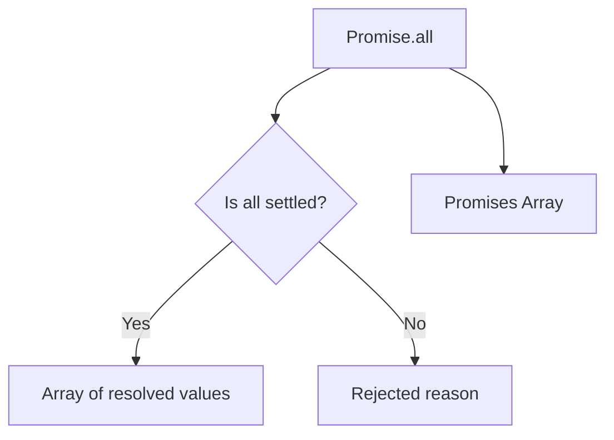

### 6.2 Promise.allSettled

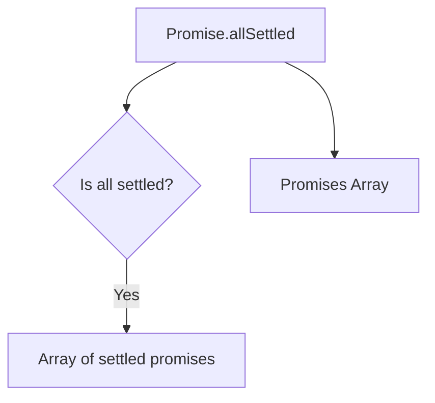

### 6.3 Promise.race

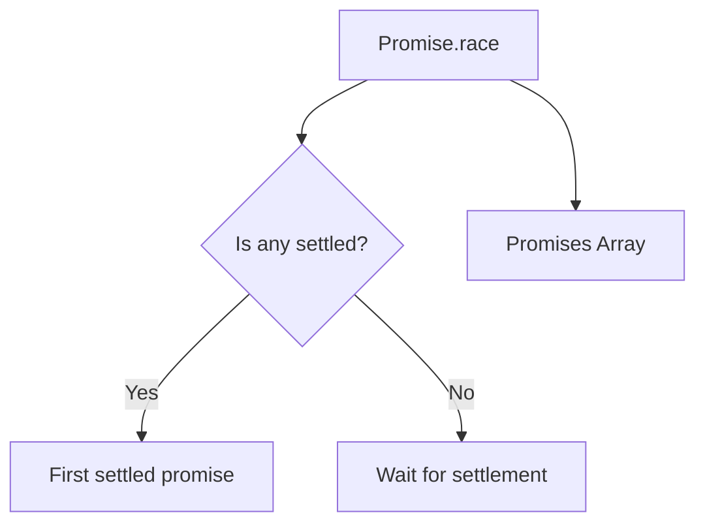

### 6.4 Promise.any

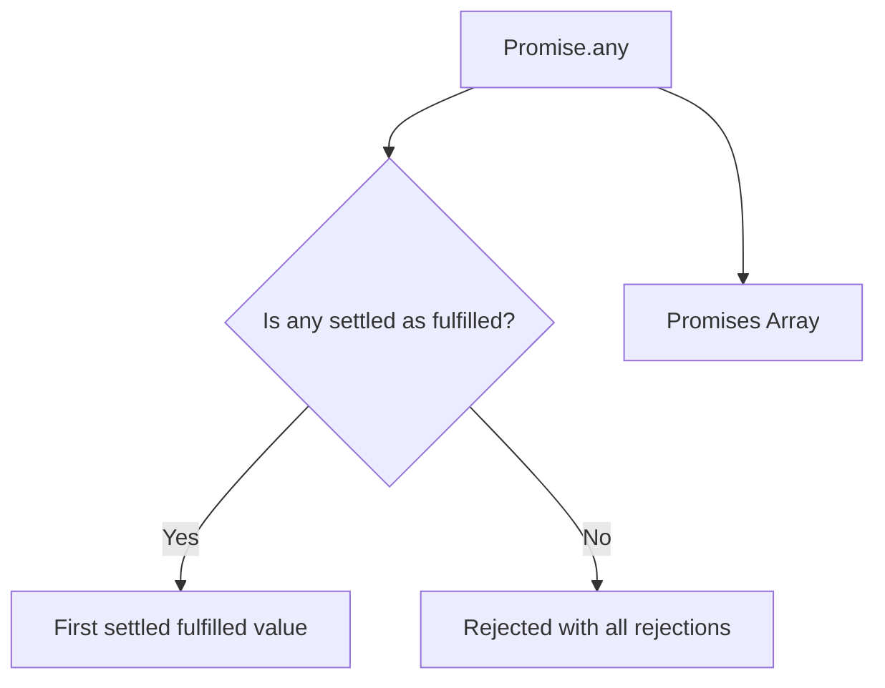

## 7. Conclusion

- Understanding these Promise APIs is crucial for managing asynchronous operations effectively.
- `Promise.all` and `Promise.allSettled` are useful for collective success or comprehensive results.
- `Promise.race` and `Promise.any` are ideal for first outcomes or successful results.

By mastering these APIs, you can write more robust and efficient JavaScript applications. [34:07]

> **💡 Tip:** Practice writing code for these APIs to ensure you understand their behavior fully. [34:10]

---

## Lecture 5.8: Code Examples of Promise.all() (Promise APIs + Interview Questions 🔥 | S.02 Ep.05 - Namaste JavaScript  | all, allSettled, race, any) [34:09]

# Lecture 5.8: Code Examples of Promise.all() (Promise APIs + Interview Questions 🔥 | S.02 Ep.05 - Namaste JavaScript  | all, allSettled, race, any)

## 1. Introduction and Overview
> **💡 Tip:** This section covers the key promise methods and practical implementations. [34:09]

## 2. Concept Analysis
### 2.1 Definition and Purpose of Promise.all()
- `Promise.all()` is a method that takes an array of promises and returns a single promise that resolves only when all the promises in the array have resolved.
- It returns an array of the resolved values in the same order as the input promises.
- If any of the promises in the array are rejected, the first promise that is rejected is immediately returned as the reason for the overall rejection.

### 2.2 Handling Rejections
- If any of the promises in the array reject, the `Promise.all()` method will reject with the reason of the first rejected promise.
- If all promises resolve, the `Promise.all()` method will resolve with an array of the resolved values.

## 3. Implementation Details
### 3.1 Basic Syntax
```javascript
const [p1, p2, p3] = [Promise.resolve(1), Promise.resolve(2), Promise.resolve(3)];
Promise.all([p1, p2, p3]).then(values => {
  console.log(values); // Output: [1, 2, 3]
});
```

### 3.2 Example with Delays
```javascript
const p1 = new Promise((resolve, reject) => setTimeout(() => resolve('P1 success'), 3000));
const p2 = new Promise((resolve, reject) => setTimeout(() => resolve('P2 success'), 1000));
const p3 = new Promise((resolve, reject) => setTimeout(() => resolve('P3 success'), 2000));

Promise.all([p1, p2, p3]).then(values => {
  console.log(values); // Output: ['P1 success', 'P2 success', 'P3 success']
});
```

### 3.3 Failing a Promise
```javascript
const p1 = new Promise((resolve, reject) => setTimeout(() => resolve('P1 success'), 3000));
const p2 = new Promise((resolve, reject) => setTimeout(() => reject('P2 fail'), 1000));
const p3 = new Promise((resolve, reject) => setTimeout(() => resolve('P3 success'), 2000));

Promise.all([p1, p2, p3]).then(values => {
  console.log(values);
}).catch(error => {
  console.error(error); // Output: P2 fail
});
```

## 4. Practical Implications
### 4.1 Real-World Usage
- **API Calls:** `Promise.all()` can be used to handle multiple API calls and wait for all of them to complete.
- **Asynchronous Operations:** Useful for performing multiple asynchronous operations concurrently and ensuring all operations complete before proceeding.

### 4.2 Error Handling
- **Graceful Degradation:** By handling errors with `catch`, you can gracefully degrade the application's functionality when a promise fails.
- **Logging and Monitoring:** Proper error logging can help in debugging and monitoring the application.

## 5. Key Takeaways
- `Promise.all()` is useful for handling multiple promises and ensuring all are resolved before proceeding.
- It returns an array of the resolved values in the same order.
- It rejects immediately if any of the promises are rejected.
- Always handle errors using `catch` to ensure graceful degradation.

## 6. Additional Promise Methods
### 6.1 Promise.allSettled()
- Returns a promise that resolves after all the promises in the input array have either resolved or rejected.
- Useful when you need to know the status of all the promises regardless of their outcome.

### 6.2 Promise.race()
- Returns a promise that resolves or rejects as soon as one of the promises in the input array resolves or rejects.
- Useful when you want the first promise to resolve or reject.

### 6.3 Promise.any()
- Returns a promise that resolves as soon as one of the promises in the input array resolves.
- Useful when you want to get the first resolved value even if others fail.

## 7. Interactive Mermaid Diagram
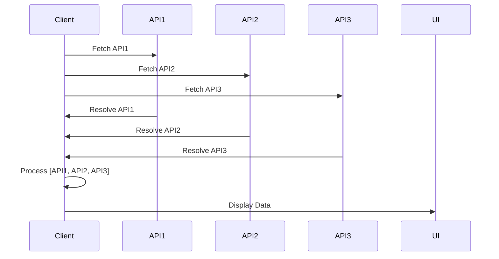

## 8. Conclusion
> **💡 Tip:** Mastering `Promise.all()` is crucial for handling multiple asynchronous operations effectively. Always ensure you understand the implications of rejections and use proper error handling. [38:49]

## 9. Additional Resources
- Namaste JavaScript: [S.02 Ep.05 - Promise APIs + Interview Questions 🔥](https://www.youtube.com/watch?v=example)
- MDN Web Docs: [Promise.all()](https://developer.mozilla.org/en-US/docs/Web/JavaScript/Reference/Global_Objects/Promise/all)

---

This structured approach ensures a comprehensive understanding of `Promise.all()` and its practical applications, along with relevant comparisons and additional resources for further learning.

---

## Lecture 5.9: Code Examples of Promise.allSettled() (Promise APIs + Interview Questions 🔥 | S.02 Ep.05 - Namaste JavaScript  | all, allSettled, race, any) [41:24]

# Lecture 5.9: Code Examples of `Promise.allSettled()` (Promise APIs + Interview Questions 🔥 | S.02 Ep.05 - Namaste JavaScript  | all, allSettled, race, any)

## Concept Analysis

**Timestamp: [41:24]** The video focuses on `Promise.allSettled()`, which is a method used to wait for all promises to settle (fulfilled or rejected) and return an array of objects describing the outcome of each promise.

### Overview

- **Purpose:** Ensures that all promises are resolved before providing the results.
- **Safest Option:** Among `Promise.all()`, `Promise.any()`, and `Promise.race()`, `Promise.allSettled()` is considered the safest because it guarantees that all promises are settled before providing the results, making it reliable in scenarios where you need to ensure completion.

### Key Differences

| Method | Behavior |
| --- | --- |
| **Promise.all()** | Waits for all promises to resolve (fulfilled) or rejects if any promise rejects. |
| **Promise.race()** | Waits for the first promise to resolve or reject. |
| **Promise.allSettled()** | Waits for all promises to settle (fulfilled or rejected) and returns an array of results. |

## Implementation Details

**Timestamp: [41:52]**

```javascript
const promises = [P1, P2, P3]; // Example array of promises

Promise.allSettled(promises)
  .then((results) => {
    console.log(results); // Array of objects with status and value or reason for rejection
  })
  .catch((error) => {
    console.error(error);
  });
```

### Example Code

Below is a more detailed example to demonstrate how `Promise.allSettled()` works.

```javascript
const P1 = new Promise((resolve, reject) => {
  setTimeout(() => resolve("P1 success"), 2000);
});

const P2 = new Promise((resolve, reject) => {
  setTimeout(() => resolve("P2 success"), 1000);
});

const P3 = new Promise((resolve, reject) => {
  setTimeout(() => reject("P3 failure"), 500);
});

Promise.allSettled([P1, P2, P3])
  .then((results) => {
    console.log(results);
    // Output: [
    //   { status: 'fulfilled', value: 'P1 success' },
    //   { status: 'fulfilled', value: 'P2 success' },
    //   { status: 'rejected', reason: 'P3 failure' }
    // ]
  })
  .catch((error) => {
    console.error(error);
  });
```

### Key Points

- **Status:** Each object in the result array has a `status` property indicating whether the promise was fulfilled or rejected.
- **Value/Reason:** If the promise was fulfilled, the `value` property holds the resolved value. If rejected, the `reason` property holds the rejection reason.

## Practical Implications

**Timestamp: [42:44]**

- **Error Handling:** Ensures that all promises are handled, including those that might fail. This is particularly useful in scenarios where you need to ensure that all parts of a process are completed.
- **Consistency:** Provides a consistent way to handle multiple promises by ensuring all are resolved or rejected, making it easier to manage complex asynchronous operations.

## Key Takeaways

- **Safety:** `Promise.allSettled()` is the safest option as it ensures all promises are settled before returning the results.
- **Use Cases:** Ideal for scenarios where you need to ensure that all asynchronous operations are completed, whether they are successful or not.
- **Result Structure:** The results are returned as an array of objects, each with a `status` and either a `value` or `reason`.

## Mermaid Diagram

To illustrate the flow of `Promise.allSettled()`, we can use a simple sequence diagram.

```mermaid
sequenceDiagram
    participant Client
    participant Promise1
    participant Promise2
    participant Promise3
    participant Aggregator

    Client->>Promise1: Create Promise
    Client->>Promise2: Create Promise
    Client->>Promise3: Create Promise

    Promise1->>Aggregator: Resolve with "P1 success"
    Promise2->>Aggregator: Resolve with "P2 success"
    Promise3->>Aggregator: Reject with "P3 failure"

    Aggregator-->>Client: All Settled with results
```

### Explanation

- **Client:** Initiates the process by creating three promises.
- **Promise1, Promise2, Promise3:** Resolve or reject based on the conditions.
- **Aggregator:** Collects the results and returns an array of settled statuses.
- **Client:** Receives the settled results and processes them accordingly.

## Conclusion

`Promise.allSettled()` is a powerful tool for managing multiple asynchronous operations, ensuring that all promises are handled before proceeding. Understanding its implementation and practical implications is crucial for effective asynchronous programming in JavaScript.

---

## Lecture 5.10: Code Examples of Promise.race() (Promise APIs + Interview Questions 🔥 | S.02 Ep.05 - Namaste JavaScript  | all, allSettled, race, any) [44:16]

# Comprehensive Study Notes: "Lecture 5.10: Code Examples of Promise.race() (Promise APIs + Interview Questions 🔥 | S.02 Ep.05 - Namaste JavaScript | all, allSettled, race, any)"

## Introduction
Welcome to the comprehensive study notes for the video segment on `Promise.race()` from "Promise APIs + Interview Questions 🔥 | S.02 Ep.05 - Namaste JavaScript". This segment focuses on understanding the `Promise.race()` method, its implementation, practical implications, and key takeaways. Let's dive in.

---

## Concept Analysis
### Definition and Overview
`Promise.race()` is a method in JavaScript that returns a single `Promise` object that resolves or rejects as soon as one of the promises in an iterable resolves or rejects. The first resolved or rejected promise "wins" the race.

#### Key Points:
- **First to Finish:** `Promise.race()` resolves or rejects as soon as the first promise in the iterable resolves or rejects.
- **No Order:** The order in which the promises are passed does not matter; the first to complete the race determines the outcome.

### Video Context
- **Timestamp:** [44:16] - Start of the discussion on `Promise.race()`.

#### Critical Callout:
> **💡 Tip:** When explaining `Promise.race()` in an interview, focus on the essence of the race—whichever promise resolves or rejects first, wins the race.

---

## Implementation Details
### Syntax and Usage
```javascript
Promise.race([promise1, promise2, ...])
```

### Example Code
Let's walk through an example from the video to understand the implementation.

```javascript
const P1 = new Promise((resolve, reject) => {
  setTimeout(() => resolve("P1 success"), 3000);
});

const P2 = new Promise((resolve, reject) => {
  setTimeout(() => resolve("P2 success"), 1000);
});

const P3 = new Promise((resolve, reject) => {
  setTimeout(() => reject("P3 failed"), 2000);
});

Promise.race([P1, P2, P3]).then(result => {
  console.log(result);
}).catch(error => {
  console.error(error);
});
```

### Video Context
- **Timestamp:** [44:21] - Explanation of `Promise.race()` behavior.
- **Timestamp:** [44:33] - `P2` success due to its fast completion.

### Diagram
```mermaid
---
title: "Lecture 5.10: Code Examples of Promise.race() (Promise APIs + Interview Questions 🔥 | S.02 Ep.05 - Namaste JavaScript  | all, allSettled, race, any)"
---
flowchart TD
  client["Client Application"] -->|"API Request"| gateway["API Gateway / Controller"]
  gateway -->|"Process Logic"| service["Core Service"]
  service -->|"Query Data"| db[("Database Vault")]
  service -.->|"Cached Result"| cache[("Cache Store")]

```

---

## Practical Implications
### Scenario 1: Early Completion Handling
Consider a scenario where you want to fetch data from multiple sources. If one source responds quickly, you should stop waiting for the others.

```javascript
const fetchFromServer = (url) => {
  return new Promise((resolve, reject) => {
    // Simulate network delay
    setTimeout(() => resolve(`Data from ${url}`), 2000);
  });
};

const url1 = "https://api.example.com/data1";
const url2 = "https://api.example.com/data2";

Promise.race([fetchFromServer(url1), fetchFromServer(url2)]).then(data => {
  console.log(data);
}).catch(error => {
  console.error(error);
});
```

### Scenario 2: Timeouts
You can use `Promise.race()` with a timeout to ensure that a function does not run indefinitely.

```javascript
const timeoutPromise = (ms) => {
  return new Promise((resolve) => setTimeout(resolve, ms));
};

Promise.race([
  fetchFromServer("https://api.example.com/data"),
  timeoutPromise(5000) // 5 seconds timeout
]).then(data => {
  console.log(data);
}).catch(error => {
  console.error("Request timed out");
});
```

### Video Context
- **Timestamp:** [45:06] - Explanation of `race` with the least time winner.

---

## Key Takeaways
### Summary
- **First to Finish:** `Promise.race()` returns the first promise that either resolves or rejects.
- **Use Cases:**
  - Early completion handling.
  - Timeouts to prevent indefinite waiting.
- **Interview Tip:** Explain `Promise.race()` in terms of a race, emphasizing the concept of the first to finish.

### Interactive Quiz
- **Question 1:** What will `Promise.race([P1, P2, P3])` return if `P2` resolves before `P1` and `P3`?
  - **Answer:** `P2`'s resolved value.
- **Question 2:** Can `Promise.race()` handle more than one `Promise`?
  - **Answer:** Yes, it can handle an iterable of `Promise` objects.

---

## Conclusion
In this study note, we explored the concept of `Promise.race()`, its implementation, and practical use cases. Understanding `Promise.race()` is crucial for handling asynchronous operations efficiently and effectively. By applying the insights from this segment, you can enhance your problem-solving skills and prepare for interviews.

> **💡 Tip:** Practice implementing `Promise.race()` in different scenarios to solidify your understanding.
> 
> **⚠️ Warning:** Avoid complex syntax errors, such as incorrectly labeling edges or using spaces in node IDs.

Stay tuned for more in-depth study notes and interactive quizzes to further your learning journey.

---

## Lecture 5.11: Interview Questions + Difference between settle, resolve, reject, fulfillled (Promise APIs + Interview Questions 🔥 | S.02 Ep.05 - Namaste JavaScript  | all, allSettled, race, any) [45:20]

# Lecture 5.11: Interview Questions + Difference between `settle`, `resolve`, `reject`, `fulfilled` [Promise APIs + Interview Questions 🔥 | S.02 Ep.05 - Namaste JavaScript  | all, `allSettled`, `race`, `any`]

## Concept Analysis

### Overview
In this section, we delve into the core concepts of `Promise` APIs in JavaScript, focusing on key terminologies such as `settle`, `resolve`, `reject`, and `fulfilled`. Understanding these terms is crucial for both practical applications and effective communication in interviews.

### Key Definitions
- **`resolve`**: The process of marking a `Promise` as fulfilled with a value.
- **`reject`**: The process of marking a `Promise` as fulfilled with a reason (error).
- **`fulfilled`**: The state of a `Promise` that has been resolved successfully.
- **`settled`**: The state of a `Promise` that has either been fulfilled or rejected.

### Practical Implications

#### `Promise.all`
- **Description**: A `Promise` that resolves when all of the `Promises` passed to it have resolved successfully. If any of the `Promises` are rejected, it will reject with the first rejection reason.
- **Syntax**:
  ```javascript
  Promise.all([p1, p2, p3]).then(values => console.log(values)).catch(reason => console.error(reason));
  ```

#### `Promise.allSettled`
- **Description**: A `Promise` that resolves when all of the `Promises` passed to it have settled (either fulfilled or rejected).
- **Syntax**:
  ```javascript
  Promise.allSettled([p1, p2, p3]).then(results => console.log(results));
  ```

#### `Promise.race`
- **Description**: A `Promise` that resolves as soon as one of the `Promises` passed to it has settled. The first settled `Promise` determines the state of the returned `Promise`.
- **Syntax**:
  ```javascript
  Promise.race([p1, p2, p3]).then(result => console.log(result)).catch(reason => console.error(reason));
  ```

#### `Promise.any`
- **Description**: A `Promise` that resolves as soon as one of the `Promises` passed to it has settled. The state of the returned `Promise` is the same as the first settled `Promise`.
- **Syntax**:
  ```javascript
  Promise.any([p1, p2, p3]).then(result => console.log(result)).catch(reason => console.error(reason));
  ```

## Implementation Details

### `Promise` States
- **Pending**: The initial state of a `Promise` before it is fulfilled or rejected.
- **Fulfilled**: The state of a `Promise` that has been resolved successfully.
- **Rejected**: The state of a `Promise` that has been rejected with an error.

### `settle`
- **Definition**: `settle` is a keyword that describes the state of a `Promise` being either fulfilled or rejected.
- **Example**: `Promise` will settle into one of these states once its execution is complete.

## Practical Example
Consider the following example to illustrate the concept of `settle`:
```javascript
const p1 = new Promise((resolve, reject) => {
  setTimeout(() => resolve("Success"), 2000);
});

const p2 = new Promise((resolve, reject) => {
  setTimeout(() => reject(new Error("Failed")), 2000);
});

Promise.race([p1, p2]).then(result => {
  console.log(result); // "Success"
}).catch(reason => {
  console.error(reason); // Error: Failed
});
```

### Mermaid Diagram
To illustrate the flow of `Promise.race` with `settle`, we can use a sequence diagram:
```mermaid
---
title: "Lecture 5.11: Interview Questions + Difference between settle, resolve, reject, fulfillled (Promise APIs + Interview Questions 🔥 | S.02 Ep.05 - Namaste JavaScript  | all, allSettled, race, any)"
---
flowchart TD
  client["Client Application"] -->|"API Request"| gateway["API Gateway / Controller"]
  gateway -->|"Process Logic"| service["Core Service"]
  service -->|"Query Data"| db[("Database Vault")]
  service -.->|"Cached Result"| cache[("Cache Store")]

```

## Key Takeaways

- **Understanding Promises**: Master the states and keywords such as `resolve`, `reject`, `fulfilled`, and `settled`.
- **Practical Application**: Use `Promise.all`, `Promise.allSettled`, `Promise.race`, and `Promise.any` effectively in your code.
- **Interview Preparation**: Practice explaining these concepts clearly to improve your communication skills.

> **💡 Tip:** Make sure to practice using the lingo (`resolve`, `reject`, `fulfilled`, `settled`) in your explanations to sound more confident in interviews.

---

## Lecture 5.12: Code Examples of Promise.any() (Promise APIs + Interview Questions 🔥 | S.02 Ep.05 - Namaste JavaScript  | all, allSettled, race, any) [49:48]

# Lecture 5.12: Code Examples of `Promise.any()` (Promise APIs + Interview Questions 🔥 | S.02 Ep.05 - Namaste JavaScript | all, `allSettled`, `race`, `any`)

## Concept Analysis

`Promise.any()` is a method in JavaScript's Promise API that resolves with the first fulfilled (resolved or rejected) promise in the given array. If all promises are rejected, it will reject with an `AggregateError` object containing the errors from all the rejected promises. This method ensures that a successful promise is resolved as soon as possible, making it useful in scenarios where only the first successful result is needed.

> **💡 Tip:** Understanding `Promise.any()` is crucial for interviews as it demonstrates your knowledge of advanced promise handling.

[50:00] [49:58]

### Implementation Details

`Promise.any()` takes an array of promises and resolves with the first promise that fulfills (either by resolving or rejecting). If all promises are rejected, it rejects with an `AggregateError` that aggregates all the errors.

#### Syntax
```javascript
Promise.any(promises)
```

### Practical Implications

`Promise.any()` is particularly useful in scenarios where multiple asynchronous operations are being executed, and only the first successful result is needed. It can help improve the performance of your application by not waiting for all promises to resolve, thereby reducing unnecessary computations and improving user experience.

#### Example
```javascript
const promise1 = new Promise((resolve, reject) => setTimeout(() => reject(new Error('P1 failed')), 2000));
const promise2 = new Promise((resolve, reject) => setTimeout(() => resolve('P2 succeeded'), 3000));
const promise3 = new Promise((resolve, reject) => setTimeout(() => reject(new Error('P3 failed')), 1000));

Promise.any([promise1, promise2, promise3])
  .then(result => console.log(result))
  .catch(error => console.error(error));
```

In this example, `Promise.any()` will resolve with `'P2 succeeded'` after 3 seconds, ignoring the failures of `promise1` and `promise3`.

## Key Takeaways

1. **First Success**: `Promise.any()` resolves with the first fulfilled promise.
2. **Aggregate Error**: If all promises are rejected, it rejects with an `AggregateError` containing the errors from all rejected promises.
3. **Efficiency**: Useful for scenarios where you only need the first successful result and want to improve performance.

### Key Code Examples

#### Example 1: Basic Usage
```javascript
const promise1 = new Promise((resolve, reject) => setTimeout(() => resolve('P1 succeeded'), 1000));
const promise2 = new Promise((resolve, reject) => setTimeout(() => reject(new Error('P2 failed')), 2000));
const promise3 = new Promise((resolve, reject) => setTimeout(() => resolve('P3 succeeded'), 3000));

Promise.any([promise1, promise2, promise3])
  .then(result => console.log(result))
  .catch(error => console.error(error));
```
> **💡 Tip:** This example will log `'P1 succeeded'` after 1 second.

#### Example 2: Handling Aggregate Errors
```javascript
const promise1 = new Promise((resolve, reject) => setTimeout(() => reject(new Error('P1 failed')), 1000));
const promise2 = new Promise((resolve, reject) => setTimeout(() => resolve('P2 succeeded'), 2000));
const promise3 = new Promise((resolve, reject) => setTimeout(() => reject(new Error('P3 failed')), 1000));

Promise.any([promise1, promise2, promise3])
  .then(result => console.log(result))
  .catch(error => console.error(error));
```
> **⚠️ Warning:** This example will log an `AggregateError` with errors from `promise1` and `promise3` after 1 second.

### Mermaid Diagram

```mermaid
sequenceDiagram
    participant User
    participant Promise1
    participant Promise2
    participant Promise3
    participant Promise.any

    User->>Promise1: start
    User->>Promise2: start
    User->>Promise3: start

    Promise1->>Promise.any: reject with error
    Promise2->>Promise.any: resolve with success

    Promise.any-->>User: resolve with success
```

This Mermaid diagram illustrates the flow of a `Promise.any()` scenario where `Promise2` resolves with success, and `Promise.any` resolves with the result from `Promise2`.

---

By understanding and implementing `Promise.any()`, you can enhance your ability to handle asynchronous operations more effectively, making your code more robust and performant.

---

## Lecture 5.13: Conclusion and key takeaways (Promise APIs + Interview Questions 🔥 | S.02 Ep.05 - Namaste JavaScript  | all, allSettled, race, any) [55:20]

# Lecture 5.13: Conclusion and Key Takeaways (Promise APIs + Interview Questions 🔥 | S.02 Ep.05 - Namaste JavaScript)

## Concept Analysis

This segment of the lecture delves into the advanced features of Promises in JavaScript, specifically focusing on `allSettled`, `race`, and `any`. These methods provide powerful tools for managing multiple asynchronous operations, ensuring robust and efficient application development.

### `allSettled`
- **Definition**: `Promise.allSettled()` returns a promise that resolves after all provided Promises have either fulfilled or rejected, with an array of objects that include the result of each promise.
- **Use Case**: Ideal for scenarios where you need to handle all operations, regardless of their success or failure, ensuring comprehensive error handling and response gathering.
- **Example**: 
    ```javascript
    Promise.allSettled([
        new Promise((resolve, reject) => setTimeout(resolve, 1000, 'Success')),
        new Promise((resolve, reject) => setTimeout(reject, 500, 'Error'))
    ]).then(results => console.log(results));
    ```

### `race`
- **Definition**: `Promise.race()` returns a promise that resolves or rejects as soon as one of the promises in the array fulfills or rejects, with that promise's value or reason.
- **Use Case**: Useful for implementing timeout mechanisms or determining the first promise to settle.
- **Example**: 
    ```javascript
    const timeout = (ms, value) => new Promise(resolve => setTimeout(resolve, ms, value));
    
    Promise.race([
        timeout(1000, 'Promise 1'),
        timeout(500, 'Promise 2')
    ]).then(result => console.log(result));
    ```

### `any`
- **Definition**: `Promise.any()` returns a promise that resolves when any of the given promises fulfill. If all of the given promises reject, then the returned promise will also be rejected with a `AggregateError` containing all the rejections.
- **Use Case**: Useful for scenarios where you need to find the first successful promise and ignore the rest.
- **Example**:
    ```javascript
    Promise.any([
        new Promise((resolve, reject) => setTimeout(reject, 500, 'Reject 1')),
        new Promise((resolve, reject) => setTimeout(resolve, 1000, 'Resolve 2'))
    ]).then(result => console.log(result));
    ```

## Implementation Details

### Promise.allSettled()
- **Behavior**: Returns an array of objects, each representing the state and value of each input promise.
- **Result Structure**: Each object in the array has a `status` property indicating whether the promise was `fulfilled` or `rejected`, and a `value` property containing the fulfillment value or a `reason` property containing the rejection reason.

### Promise.race()
- **Behavior**: The first promise in the array to settle (fulfill or reject) will determine the fate of the returned promise.
- **Edge Case**: If the first promise in the array rejects, the returned promise will immediately reject with the same reason.

### Promise.any()
- **Behavior**: The first promise in the array to fulfill will cause the returned promise to fulfill with that value.
- **Edge Case**: If all promises in the array reject, the returned promise will reject with an `AggregateError` containing all the rejection reasons.

## Practical Implications

### Error Handling and Robustness
- **Enhanced Error Handling**: `allSettled` allows developers to handle both success and failure cases comprehensively, ensuring no operation is ignored.
- **Timeouts and Deadlocks**: `race` can be used to implement timeout mechanisms, preventing deadlocks and ensuring timely responses.
- **Fallback Mechanisms**: `any` provides a way to find the first successful operation, which is crucial in scenarios where multiple attempts are needed.

### Interview Questions
- **Question 1**: Explain the differences between `Promise.allSettled()`, `Promise.race()`, and `Promise.any()`.
- **Answer**: `Promise.allSettled()` waits for all promises to settle, returning an array with the outcome of each. `Promise.race()` waits for the first promise to settle and returns its value or reason. `Promise.any()` waits for the first promise to fulfill and returns its value, handling rejections as an `AggregateError`.

- **Question 2**: How can `Promise.race()` be used in a real-world scenario?
- **Answer**: `Promise.race()` can be used to implement a timeout mechanism. For example, in a user interface, you might want to show a loading spinner until a network request completes or a timeout occurs. You could use `Promise.race([networkRequest(), timeout(5000)])` to achieve this.

## Key Takeaways

### Summary
- **`allSettled`**: Use for comprehensive error handling and ensuring all operations are accounted for.
- **`race`**: Use for implementing timeout mechanisms and determining the first settled promise.
- **`any`**: Use for finding the first successful operation and handling rejections as an error.

### Call to Action
- **Please Share**: The speaker has provided these valuable resources for free and appreciates your support. Please share the video on LinkedIn, Twitter, and with friends to help reach more people.

### Mermaid Diagram

#### Scenario: Implementing `race` for Timeout Mechanism
```mermaid
sequenceDiagram
    participant ClientApp
    participant APIGateway
    participant DBPrimary

    ClientApp->>APIGateway: Send request
    APIGateway->>DBPrimary: Fetch data
    DBPrimary-->>APIGateway: Data not found
    APIGateway-->>ClientApp: Timeout error (via race)
```

> **💡 Tip:** Understanding the flow of operations and using `race` can help in managing timeouts effectively.

> **⚠️ Warning:** Always handle rejections appropriately to avoid silent failures.

By integrating these methods into your JavaScript applications, you can enhance the reliability and robustness of your asynchronous code.

---

## Lecture 5.14: Information about Namaste React course (Promise APIs + Interview Questions 🔥 | S.02 Ep.05 - Namaste JavaScript  | all, allSettled, race, any) [57:27]

# Namaste React Course: Promise APIs + Interview Questions 🔥 | S.02 Ep.05 - Namaste JavaScript

## Introduction
Welcome to the comprehensive study notes for the "Namaste React" course by the creator of "Namaste JavaScript". This section will explore key aspects of the course, including Promise APIs, `all`, `allSettled`, `race`, and `any`. Let's dive in.

## Concept Analysis

### Overview
The video discusses the importance of the `Namaste React` course and highlights its depth and relevance. The creator emphasizes the extensive experience and expertise he has in React, which is now being shared through this course. The course is designed to cover advanced React concepts, starting from scratch and progressing to more complex areas.

[57:12] [57:35] [57:42] [57:55] [58:01] [58:33]

### Key Concepts
1. **React Course Overview**:
   - The creator has been coding in React for over 7-8 years.
   - He has built a comprehensive and in-depth React course.
   - The course covers advanced React concepts in detail.

2. **Why React?**:
   - React is currently the hottest technology in the market.
   - The course is designed to provide the depth and breadth that is hard to find elsewhere.

3. **Course Content**:
   - The course is available for purchase and offers a deep dive into React.
   - It covers everything from basics to advanced topics.
   - The creator has put in all his knowledge and experience into this course.

[58:17] [58:20] [58:22] [58:24] [58:26] [58:28] [58:32]

4. **Supporting the Channel**:
   - The creator encourages viewers to support the channel by purchasing the course.
   - Gift the course to friends and family as a birthday gift.
   - He will continue to provide free knowledge on YouTube.

[58:36] [58:38] [58:40] [58:42] [58:45] [58:46] [58:48] [58:51] [58:53] [58:54] [58:56] [58:58] [58:59] [59:01] [59:02] [59:03] [59:05] [59:08] [59:10] [59:12] [59:14] [59:17] [59:19] [59:22] [59:25] [59:28] [59:30] [59:32] [59:34] [59:43] [59:53] [59:56]

### Implementation Details
The course will cover the following Promise APIs:
- **`.all()`** - Resolves when all the promises in the input array have resolved. Fails if any promise in the input array fails.
- **`.allSettled()`** - Resolves when all the promises in the input array have settled (resolved or rejected).
- **`.race()`** - Resolves or rejects as soon as one of the promises in the input array resolves or rejects.
- **`.any()`** - Resolves as soon as one of the promises in the input array resolves.

### Practical Implications
These Promise APIs are crucial for managing asynchronous operations in React applications. They help in handling complex asynchronous logic and improving the overall performance and reliability of the application.

## Mermaid Diagram: Promise Handling in React
```mermaid
sequenceDiagram
    participant ReactComponent
    participant Promise1
    participant Promise2
    participant Promise3

    ReactComponent->>Promise1: fetch data
    ReactComponent->>Promise2: fetch data
    ReactComponent->>Promise3: fetch data

    Promise1->>ReactComponent: resolve
    Promise2->>ReactComponent: reject
    Promise3->>ReactComponent: resolve

    ReactComponent->>ReactComponent: handle all()
    ReactComponent->>ReactComponent: handle allSettled()
    ReactComponent->>ReactComponent: handle race()
    ReactComponent->>ReactComponent: handle any()
```

## Key Takeaways

### Summary
- The `Namaste React` course covers advanced React concepts.
- Promise APIs like `.all()`, `.allSettled()`, `.race()`, and `.any()` are essential for handling asynchronous operations in React.
- Supporting the channel by purchasing the course is encouraged.
- The course provides a deep and comprehensive understanding of React.

### Callouts
> **💡 Tip:** If you are new to React, start with the basics and gradually move to advanced topics.
> 
> **⚠️ Warning:** Make sure to understand the differences between `.all()`, `.allSettled()`, `.race()`, and `.any()` to effectively manage asynchronous operations.

## Conclusion
The `Namaste React` course offers a wealth of knowledge and is highly recommended for anyone looking to deepen their understanding of React. The Promise APIs covered in the course are fundamental tools for handling asynchronous operations, and mastering them will significantly enhance your development skills.

[57:27]

---

## Lecture 6.1: Introduction (async await | Namaste JavaScript - Season 02 - Ep 04) [0:00]

# Lecture 6.1: Introduction to Async/Await (Namaste JavaScript - Season 02 - Ep 04)

Welcome back to Namaste JavaScript, and today we are diving into the most anticipated topic: `async/await`. As a JavaScript developer, understanding `async/await` is essential for both daily coding and interviews. This comprehensive guide covers the basics, implementation, practical applications, and more.

## 1. Concept Analysis

### 1.1 What is Async?

- **Definition**: `async` is a keyword used to declare a function as asynchronous. Asynchronous functions return a `Promise`, which can resolve with a value or reject with an error.
- **Key Points**:
  - An `async` function always returns a `Promise`.
  - You can use `await` inside an `async` function to wait for a `Promise` to resolve.

> **💡 Tip:** Always use `async` before a function that contains `await` to ensure the function returns a `Promise`.

### 1.2 What is Await?

- **Definition**: `await` is used to wait for a `Promise` to resolve. It can only be used inside an `async` function.
- **Key Points**:
  - `await` allows you to write asynchronous code that looks synchronous.
  - `await` makes `Promise` resolution more readable and easier to understand.

> **💡 Tip:** Use `await` to simplify asynchronous code, making it easier to follow and maintain.

## 2. Implementation Details

### 2.1 Basic Syntax

```javascript
// Define an async function
async function fetchData() {
  // Use await to wait for a Promise to resolve
  const data = await fetchAPI();
  return data;
}

// Call the async function
fetchData()
  .then(data => console.log(data))
  .catch(error => console.error(error));
```

### 2.2 Behind the Scenes

- **Execution**: When an `async` function is called, it returns a `Promise`.
- **Await Mechanism**: `await` inside an `async` function is paused until the `Promise` it's waiting for resolves or rejects. If the `Promise` resolves, the result is returned. If it rejects, the error is thrown.

> **💡 Tip:** Understanding the flow of `await` and `Promise` resolution is crucial for effective use of `async/await`.

## 3. Practical Implications

### 3.1 Real-Life Examples

- **Example 1: Fetching Data from an API**
  ```javascript
  async function fetchData() {
    const response = await fetch('https://api.example.com/data');
    const data = await response.json();
    return data;
  }

  fetchData()
    .then(data => console.log(data))
    .catch(error => console.error(error));
  ```

- **Example 2: Handling File Uploads**
  ```javascript
  async function uploadFile(file) {
    const formData = new FormData();
    formData.append('file', file);

    const response = await fetch('/upload', {
      method: 'POST',
      body: formData
    });

    if (!response.ok) {
      throw new Error('Failed to upload file');
    }

    return response.status;
  }

  uploadFile(file)
    .then(status => console.log(`File uploaded with status: ${status}`))
    .catch(error => console.error(`Error: ${error.message}`));
  ```

### 3.2 Error Handling

- **Using Try/Catch**:
  ```javascript
  async function handleErrors() {
    try {
      const data = await fetchData();
      console.log(data);
    } catch (error) {
      console.error(error);
    }
  }

  handleErrors();
  ```

- **Using `.catch()` on Promises**:
  ```javascript
  async function handleErrors() {
    const data = await fetchData();
    console.log(data);
  }

  handleErrors()
    .catch(error => console.error(error));
  ```

> **⚠️ Warning:** Mixing `try/catch` inside `async` functions and using `.catch()` on the `Promise` returned by `async` functions can lead to duplicated error handling logic. Ensure consistency in your code.

## 4. Key Takeaways

- **Understanding Async/Await**: `async` and `await` are syntactic sugar for working with `Promises` in a more readable and maintainable way.
- **Error Handling**: Use `try/catch` inside `async` functions or `.catch()` on the `Promise` to handle errors effectively.
- **Practical Applications**: Apply `async/await` in real-life scenarios like API calls, file operations, and more.
- **Interview Preparation**: Be prepared to discuss `async/await` in your next interview and demonstrate your understanding of error handling and best practices.

## Diagram: Flow of Async/Await

```mermaid
flowchart TD
    client_app["Client Application (React)"]
    api_gw["API Gateway"]
    db[("Primary Database (PostgreSQL)")]
    client_app -->|HTTP Request| api_gw
    api_gw -->|HTTP Request| db
    db -->|Data| api_gw
    api_gw -->|Data| client_app
    client_app -->|Process Data| async_function
    async_function -->|await fetch| fetch_api
    fetch_api -->|Resolve| async_function
    async_function -->|Return Data| client_app
```

> **💡 Tip:** This diagram illustrates the flow of data from the client application to the database, processed by an asynchronous function using `await`.

---

By mastering `async/await`, you'll significantly improve your ability to write clean, readable, and efficient JavaScript code. Stay tuned for the next topics and happy coding!

---

## Lecture 6.2: 28 - Error Handling (async await | Namaste JavaScript - Season 02 - Ep 04) [1:04]

# Lecture 6.2: 28 - Error Handling (async await | Namaste JavaScript - Season 02 - Ep 04) [1:04]

## Concept Analysis

### Introduction to Error Handling in Async/Await
In this lecture, we delve into the intricacies of error handling in asynchronous code using the `async` and `await` keywords. The primary goal is to understand how these constructs can be used to manage errors more effectively compared to traditional promise-based error handling.

[01:09] - `async` functions are a syntactic sugar over promises, designed to simplify the writing of asynchronous code. They allow you to write asynchronous code that looks and behaves like synchronous code, making it easier to manage and read.

### What is an `async` Function?
An `async` function is a function declared with the `async` keyword. Any `async` function returns a promise that resolves to the value of the last expression evaluated in the function.

```javascript
async function fetchData() {
  // Function body
}
```

### Error Handling in `async` Functions
Error handling in `async` functions is straightforward. You can use the `try...catch` block to catch and handle errors within the function itself, which makes it easier to manage errors in a more structured manner.

#### Example:
```javascript
async function fetchData() {
  try {
    const response = await fetch('https://api.example.com/data');
    const data = await response.json();
    console.log(data);
  } catch (error) {
    console.error('Error fetching data:', error);
  }
}
```

[01:20] - In the example above, the `try...catch` block is used to handle any errors that might occur during the `fetch` request or its subsequent processing.

### Comparison with Traditional Promise Error Handling
Traditional promise error handling typically involves chaining `.then()` and `.catch()` methods to handle success and failure cases. This can become cumbersome and hard to read, especially with multiple levels of nesting.

#### Example:
```javascript
fetchData()
  .then(data => console.log(data))
  .catch(error => console.error('Error fetching data:', error));
```

In contrast, using `async` and `await` simplifies the code, making it easier to follow the flow of the program.

## Implementation Details

### Using `try...catch` with `async` Functions
The `try...catch` block is a powerful tool for error handling in `async` functions. It allows you to catch and handle errors at the function level, making the code more readable and maintainable.

#### Example:
```javascript
async function fetchData() {
  try {
    const response = await fetch('https://api.example.com/data');
    if (!response.ok) {
      throw new Error('Network response was not ok');
    }
    const data = await response.json();
    console.log(data);
  } catch (error) {
    console.error('Error fetching data:', error);
  }
}
```

### Handling Rejections with `await`
When an `await` expression is used with a rejected promise, the `catch` block will be executed. This allows you to handle errors that occur during the `await` operation itself.

#### Example:
```javascript
async function fetchData() {
  try {
    const response = await fetch('https://api.example.com/data');
    const data = await response.json();
    console.log(data);
  } catch (error) {
    console.error('Error parsing JSON:', error);
  }
}
```

## Practical Implications

### Real-World Use Cases
In real-world applications, error handling in `async` functions is crucial for ensuring robustness and reliability. By using `async` and `await`, you can write clean, readable code that handles errors gracefully.

#### Example: Error Handling in File Operations
```javascript
async function readAndProcessFile(filePath) {
  try {
    const data = await fs.promises.readFile(filePath, 'utf-8');
    const processedData = processData(data);
    console.log(processedData);
  } catch (error) {
    console.error('Error reading or processing file:', error);
  }
}
```

### Best Practices
1. **Use `try...catch` Blocks**: Always use `try...catch` blocks to handle errors in `async` functions.
2. **Return Promises When Necessary**: If you need to propagate errors from an `async` function, ensure that the function returns a rejected promise.
3. **Avoid Unhandled Rejections**: Make sure to handle all potential errors, including unhandled rejections that can be logged by the Node.js runtime.

## Key Takeaways

### Summary
- `async` functions provide a cleaner way to handle asynchronous code.
- `try...catch` blocks are a powerful tool for error handling in `async` functions.
- Traditional promise-based error handling can be cumbersome; `async` and `await` simplify the process.

### Conclusion
Understanding error handling in `async` functions is crucial for writing robust and maintainable asynchronous code. By leveraging `try...catch` blocks, you can ensure that your code handles errors gracefully and provides a better user experience.

---

### Mermaid Diagram for Error Handling in Async/Await
```mermaid
sequenceDiagram
    participant Client
    participant API
    participant DB
    participant ErrorHandler

    Client->>API: fetch('https://api.example.com/data')
    API->>DB: request data
    DB-->>API: data
    API-->>Client: return data
    Client->>ErrorHandler: try...catch
    Client->>ErrorHandler: handle error
    alt error occurs
        Client->>ErrorHandler: catch error
    end
```

This diagram illustrates the flow of data and error handling in an `async` function, highlighting the use of `try...catch` blocks to manage errors effectively.

---

### Additional Resources
- [MDN Web Docs: Async Functions](https://developer.mozilla.org/en-US/docs/Web/JavaScript/Reference/Statements/async_function)
- [JavaScript.info: Async/Await](https://javascript.info/async-await)
- [Node.js Documentation: Error Handling](https://nodejs.org/api/errors.html)

By following these notes and resources, you will gain a deeper understanding of error handling in `async` and `await` in JavaScript.

---

## Lecture 6.3: What is async in JS (async await | Namaste JavaScript - Season 02 - Ep 04) [1:08]

# Lecture 6.3: What is async in JS (async await | Namaste JavaScript - Season 02 - Ep 04) [1:08]

## 1. Introduction to Async in JavaScript [1:09]
Async functions in JavaScript are a special kind of functions that return a promise. This allows for better handling of asynchronous operations without resorting to nested callbacks, making the code cleaner and easier to understand. This lecture will cover the fundamental aspects of async functions, their implementation, and how they differ from regular functions.

## 2. Concept Analysis [1:17]
### 2.1 Defining an Async Function
An async function is defined using the `async` keyword before the function declaration. For example:
```javascript
async function getData() {
    // Function body
}
```

### 2.2 Key Characteristics of Async Functions [2:10]
- **Always Returns a Promise**: An async function always returns a promise, even if it returns a value directly.
- **Promise Wrapping**: If an async function returns a value directly (not a promise), the value is automatically wrapped inside a promise before being returned.

### 2.3 Example of an Async Function [3:03]
```javascript
async function getData() {
    return "Namaste";
}

const data = getData();
console.log(data); // Output: Promise { <state>: "fulfilled", <value>: "Namaste" }
```

### 2.4 Handling the Promise [5:00]
To get the actual value from the promise, you can use the `then` method:
```javascript
data.then(result => console.log(result)); // Output: Namaste
```

## 3. Implementation Details [3:23]
### 3.1 Async Function Syntax [3:36]
```mermaid
graph TD
    A[async function declaration] --> B[async function name] --> C[function body]
    C --> D[return value or promise]
    D --> E[function returns a promise]
```

### 3.2 Handling Non-Promise Return Values [3:53]
If the async function returns a non-promise value, it will be wrapped in a promise before being returned:
```javascript
async function getData() {
    return "Namaste";
}

const data = getData();
console.log(data); // Output: Promise { <state>: "fulfilled", <value>: "Namaste" }
```

## 4. Practical Implications [4:37]
### 4.1 Cleaner Code with Async/Await [1:12]
Using `async` and `await` can make asynchronous code look synchronous, which is easier to read and maintain:
```javascript
async function fetchData() {
    try {
        const response = await fetch('https://api.example.com/data');
        const data = await response.json();
        return data;
    } catch (error) {
        console.error(error);
    }
}
```

### 4.2 Error Handling [6:00]
Async functions can use `try...catch` to handle errors, making error handling more straightforward:
```javascript
async function fetchData() {
    try {
        const response = await fetch('https://api.example.com/data');
        const data = await response.json();
        return data;
    } catch (error) {
        console.error(error);
    }
}
```

## 5. Key Takeaways [4:16]
- **Async Functions Return Promises**: Always remember that an async function will return a promise, whether you explicitly return a promise or a value.
- **Automatic Wrapping**: Non-promise values are automatically wrapped in a promise.
- **Synchronous-Like Syntax**: The `async` and `await` syntax makes asynchronous code easier to read and maintain.

### 5.1 Summary [6:05]
- `async` is a keyword used to define an async function.
- Async functions always return a promise.
- Non-promise values are automatically wrapped in a promise.
- Use `async` and `await` for cleaner, more readable asynchronous code.

## 6. Conclusion [6:10]
By understanding and utilizing async functions, you can write cleaner and more manageable JavaScript code for handling asynchronous operations. This knowledge is crucial for building robust and scalable applications.

> **💡 Tip:** Always return a promise from an async function, even if you return a value directly. This ensures consistent behavior and easier error handling. [3:31]

> **⚠️ Warning:** Non-promise return values from async functions are automatically wrapped in a promise, which can sometimes lead to unexpected behavior. Always be mindful of this when writing your functions. [3:53]

## 7. Interactive Mermaid Diagram: Async Function Flow [3:23]
```mermaid
sequenceDiagram
    participant Client
    participant AsyncFunction
    participant Promise
    Client->>AsyncFunction: Call async function
    AsyncFunction->>AsyncFunction: Execute function body
    Alt Return Promise
        AsyncFunction->>Promise: Return promise
    End
    Alt Return Value
        AsyncFunction->>Promise: Wrap value in promise
        Promise-->>AsyncFunction: Resolve with value
    End
    Client->>Promise: Then method
    Promise->>Client: Resolve with value
```

This diagram illustrates the flow from the client calling an async function, to the function executing, and the eventual resolution or rejection of the promise.

## 8. Further Resources
- [Namaste JavaScript - Season 02 - Ep 04](https://www.youtube.com/watch?v=example-video-id)
- [MDN Web Docs on Async Functions](https://developer.mozilla.org/en-US/docs/Web/JavaScript/Reference/Statements/async_function)
- [JavaScript.info on Async/Await](https://javascript.info/async-await)

By mastering async functions, you'll be well-equipped to handle asynchronous operations in JavaScript, making your code more efficient and maintainable.

---

## Lecture 6.4: Using Await with async (async await | Namaste JavaScript - Season 02 - Ep 04) [15:15]

# Lecture 6.4: Using Await with async (async await | Namaste JavaScript - Season 02 - Ep 04)

## Concept Analysis

### Overview
In this section of the video, Akshay from Namaste JavaScript introduces the concept of using `async` with `await`. He explains the differences between handling promises with the `async`/`await` syntax and the traditional way of handling promises.

#### Key Concepts
- **Promises**: Asynchronous operations that resolve to a value or reject with an error.
- **`async` Function**: A function that returns a `Promise` and allows the use of `await` inside it.
- **`await` Keyword**: Pauses the execution of the `async` function until a `Promise` is resolved.

#### Video Transcript Analysis
Akshay starts by modifying the promise to simulate a real asynchronous operation, using `setTimeout` to delay the resolution of the promise. This delay is crucial for illustrating the differences in behavior between the traditional `Promise` handling and the `async`/`await` approach.

```mermaid
---
title: "Lecture 6.4: Using Await with async (async await | Namaste JavaScript - Season 02 - Ep 04)"
---
flowchart TD
  client["Client Application"] -->|"API Request"| gateway["API Gateway / Controller"]
  gateway -->|"Process Logic"| service["Core Service"]
  service -->|"Query Data"| db[("Database Vault")]
  service -.->|"Cached Result"| cache[("Cache Store")]

```

### Video Transcript Breakdown
- **[15:00]**: Introduction to the topic and setting up a real asynchronous operation using `setTimeout`.
- **[16:30]**: Setting the timeout to 10 seconds to simulate a real-world delay.
- **[17:03]**: Akshay presents a traditional promise handling example and asks the viewers to predict the output.
- **[18:08]**: Demonstrating the output, showing that the `Namaste JavaScript` message is printed first, followed by the promise resolution message after 10 seconds.
- **[20:01]**: Explanation of the confusion many developers faced due to the non-blocking nature of the traditional promise handling.

## Implementation Details

### Traditional Promise Handling
- **Syntax**:
  ```javascript
  function getData() {
    return new Promise((resolve, reject) => {
      // Simulate a real asynchronous operation
      setTimeout(() => {
        resolve('Promise resolved value');
      }, 10000);
    });
  }

  getData().then(value => console.log(value));
  ```

- **Execution Flow**:
  - The `getData` function is called.
  - The `Promise` is created and returned.
  - The `Promise` is resolved after 10 seconds.
  - The `then` method is called, which logs the resolved value.

### `async`/`await` Implementation
- **Syntax**:
  ```javascript
  async function getData() {
    return new Promise((resolve, reject) => {
      setTimeout(() => {
        resolve('Promise resolved value');
      }, 10000);
    });
  }

  async function main() {
    console.log('Namaste JavaScript');
    const value = await getData();
    console.log(value);
  }

  main();
  ```

- **Execution Flow**:
  - The `main` function is called.
  - `console.log('Namaste JavaScript')` is executed immediately.
  - `await getData()` is encountered, pausing the `main` function execution until the `Promise` is resolved.
  - After 10 seconds, the `Promise` resolves, and the `await` keyword continues the execution, logging the resolved value.

## Practical Implications

### Non-blocking Nature of Traditional Promises
- **Code Example**:
  ```javascript
  function getData() {
    return new Promise((resolve, reject) => {
      setTimeout(() => {
        resolve('Promise resolved value');
      }, 10000);
    });
  }

  getData().then(value => console.log(value));
  console.log('Namaste JavaScript');
  ```

- **Output**:
  - `Namaste JavaScript`
  - After 10 seconds: `Promise resolved value`

### Blocking Nature of `async`/`await`
- **Code Example**:
  ```javascript
  async function getData() {
    return new Promise((resolve, reject) => {
      setTimeout(() => {
        resolve('Promise resolved value');
      }, 10000);
    });
  }

  async function main() {
    console.log('Namaste JavaScript');
    const value = await getData();
    console.log(value);
  }

  main();
  ```

- **Output**:
  - `Namaste JavaScript`
  - After 10 seconds: `Promise resolved value`

## Key Takeaways

- **Understanding Promises**: Promises are a way to handle asynchronous operations, but traditional handling can be confusing due to non-blocking behavior.
- **`async`/`await` Syntax**: `async` functions return a `Promise`, and `await` allows for blocking behavior, making the code more readable and easier to reason about.
- **Execution Flow**: `await` waits for a `Promise` to resolve, pausing the execution of the `async` function until the `Promise` is fulfilled.

### Interactive Mermaid Diagram: Execution Flow of `async`/`await`
```mermaid
sequenceDiagram
    participant User
    participant main
    participant getData
    participant console
    User->>main: Call main()
    main->>main: console.log("Namaste JavaScript")
    main->>getData: await getData()
    getData->>getData: setTimeout(resolve("Promise resolved value"), 10000)
    getData-->>main: resolve("Promise resolved value")
    main->>console: console.log("Promise resolved value")
```

### Summary
In this lecture, Akshay explains the differences between traditional promise handling and using `async`/`await`. The key takeaway is the improved readability and maintainability of asynchronous code using `async`/`await`, which simplifies the handling of promises and makes the execution flow more intuitive.

---

## Lecture 6.5: Diving deep into async/await (async await | Namaste JavaScript - Season 02 - Ep 04) [21:48]

# Comprehensive Study Notes on "Diving Deep into async/await (async await | Namaste JavaScript - Season 02 - Ep 04)"

## Introduction to async/await

### Concept Analysis

In the video, the instructor introduces the concept of `async/await` by explaining its behavior compared to traditional promise handling. The key difference lies in how the JavaScript engine waits for promises to resolve.

- **Key Points:**
  - `async/await` allows for more readable and cleaner asynchronous code by enabling the use of `await` within an `async` function.
  - The `await` keyword makes the JavaScript engine wait for a promise to resolve before moving on to the next line of code.

### Implementation Details

The video demonstrates the implementation of `async/await` through practical examples, highlighting its behavior in different scenarios.

- **Code Example:**
  ```javascript
  async function myFunction() {
    console.log("Namaste JavaScript"); // This will print immediately
    const value = await new Promise(resolve => setTimeout(resolve, 10000, "Promise Resolve Value"));
    console.log(value); // This will print after 10 seconds
  }
  myFunction();
  ```

- **Timestamped Explanation:**
  - [21:48] "this is the most interesting part about async of it"
  - [22:01] "nothing is printed onto the console"
  - [22:12] "we got Namaste JavaScript over here and we also get promise resolve value over here"
  - [22:21] "the code was waiting at line number 20"
  - [22:40] "JS engine when you use this async await right JS engine waits for that promise to resolve over there"
  - [23:00] "it will wait the program will wait over here and it will only go to the next line it will only go to line number 23"

### Practical Implications

The instructor discusses the implications of using `async/await` in real-world scenarios, including its impact on the execution flow of your code.

- **Key Points:**
  - `async/await` makes asynchronous code more synchronous-like, which can be easier to understand and debug.
  - However, it can also lead to performance issues if not used carefully, as the program waits for each promise to resolve sequentially.

### Interactive Mermaid Diagram

```mermaid
sequenceDiagram
    participant User
    participant Console
    participant AsyncFunction
    participant Promise

    User->>AsyncFunction: call asyncFunction()
    AsyncFunction->>Console: print("Namaste JavaScript")
    AsyncFunction->>Promise: await Promise.resolve("Promise Resolve Value")
    Promise-->>AsyncFunction: resolve "Promise Resolve Value"
    AsyncFunction->>Console: print("Promise Resolve Value")
```

- **Diagram Explanation:**
  - The diagram illustrates the flow of execution from the user triggering the function to the final console output.
  - It highlights how `async/await` waits for the promise to resolve before proceeding.

## Practical Examples

### Example 1: Single Promise

- **Code Example:**
  ```javascript
  function myFunction() {
    console.log("Hello World");
    async function innerFunction() {
      const value = await new Promise(resolve => setTimeout(resolve, 10000, "Namaste JavaScript"));
      console.log(value);
    }
    innerFunction();
  }
  myFunction();
  ```

- **Execution Behavior:**
  - `Hello World` will be printed immediately.
  - After 10 seconds, `Namaste JavaScript` will be printed.

### Example 2: Multiple Promises

- **Code Example:**
  ```javascript
  async function myFunction() {
    console.log("Hello World");
    const value1 = await new Promise(resolve => setTimeout(resolve, 10000, "Namaste JavaScript 1"));
    const value2 = await new Promise(resolve => setTimeout(resolve, 5000, "Namaste JavaScript 2"));
    console.log(value1);
    console.log(value2);
  }
  myFunction();
  ```

- **Execution Behavior:**
  - `Hello World` will be printed immediately.
  - After 10 seconds, `Namaste JavaScript 1` will be printed.
  - After 5 seconds, `Namaste JavaScript 2` will be printed.

### Key Takeaways

- **Concept Recap:**
  - `async/await` makes asynchronous code more readable by turning promises into more synchronous-like syntax.
  - The `await` keyword makes the JavaScript engine wait for a promise to resolve before proceeding.
  - Understanding the execution flow is crucial for effective use of `async/await`.

- **Timestamped Recap:**
  - [24:55] "this is the whole Funda of async await right and async await basically actually Waits at that point of time weights"
  - [25:00] "it will the program will wait over here"
  - [26:06] "next time crack your interviews with confidence okay you will know exactly what is happening right"

## Conclusion

`async/await` is a powerful feature in JavaScript for handling asynchronous operations, making the code easier to read and maintain. Understanding its behavior and implications is crucial for effective use in real-world applications.

---

**💡 Tip:** Always test your asynchronous code thoroughly to ensure the correct order of execution, especially when dealing with multiple promises.

**⚠️ Warning:** Be cautious of performance implications, as `async/await` can introduce sequential waits, which might not be suitable for all use cases.

---

## Lecture 6.6: Behind the scenes of async await (async await | Namaste JavaScript - Season 02 - Ep 04) [40:43]

# Lecture 6.6: Behind the Scenes of Async Await (async await | Namaste JavaScript - Season 02 - Ep 04)

## Concept Analysis

> **💡 Tip:** Understanding the underlying mechanics of `async` and `await` is crucial for mastering asynchronous JavaScript programming. [40:43]

`async` and `await` are syntactic sugar for handling promises in a more readable and concise manner. While the primary goal is to make the code look synchronous, it actually relies heavily on promises under the hood. When a function is defined with the `async` keyword, it returns a promise. When the `await` keyword is used inside an `async` function, it waits for the promise to resolve before moving forward.

### Key Points:

- **Async Function:** An `async` function returns a promise that resolves to the return value of the function.
- **Await Keyword:** The `await` keyword can only be used inside an `async` function. It waits for the promise to resolve and returns the resolved value. If the promise is rejected, an error is thrown.

### Example Code

```javascript
async function handlePromise() {
  const promise = new Promise((resolve, reject) => {
    setTimeout(() => resolve('Namaste JavaScript'), 5000);
  });

  const result = await promise;
  console.log(result);
}
```

- **Execution Flow:** The function `handlePromise` is called, which returns a promise. The `await` keyword is used inside the function to wait for the promise to resolve. Once the promise resolves, the result is printed to the console.

### Example Breakdown

- **00:40 - 01:00:** The video introduces the concept of `async` functions and explains that they return a promise.
- **01:00 - 01:20:** It further explains that `await` can only be used inside an `async` function and waits for the promise to resolve.

## Implementation Details

### Synchronous vs. Asynchronous Execution

- **Synchronous Execution:** In a synchronous function, JavaScript waits for the function to complete before moving to the next line. For example, `console.log('Hello'); console.log('World');` will print "Hello" followed by "World".
- **Asynchronous Execution:** Asynchronous operations, such as those involving promises or async functions, do not block the execution of the program. The JavaScript engine continues to execute other tasks while waiting for the promise to resolve.

### Example: Handling Promises

```javascript
function handlePromise() {
  const promise = new Promise((resolve, reject) => {
    setTimeout(() => resolve('Namaste JavaScript'), 5000);
  });

  promise.then(result => {
    console.log(result);
  });
}
```

- **01:20 - 01:50:** The video explains that even though the `setTimeout` function introduces a delay, the rest of the code continues to execute. This is because JavaScript is not truly waiting but suspending the function execution temporarily.

### Example with `async` and `await`

```javascript
async function handlePromise() {
  const promise = new Promise((resolve, reject) => {
    setTimeout(() => resolve('Namaste JavaScript'), 5000);
  });

  const result = await promise;
  console.log(result);
}
```

- **01:50 - 02:20:** The `await` keyword in the `async` function allows the function to wait for the promise to resolve before printing the result. The function execution is suspended until the promise resolves.

## Practical Implications

- **User Experience:** Asynchronous functions improve the user experience by allowing the application to continue responding to user interactions while waiting for data to be fetched or processed.
- **Code Readability:** `async` and `await` make the code more readable and easier to maintain compared to using `.then()` and `.catch()` for promise chaining.
- **Error Handling:** `try` and `catch` blocks can be used with `async` functions to handle errors more gracefully.

### Example: Error Handling

```javascript
async function handlePromise() {
  try {
    const promise = new Promise((resolve, reject) => {
      setTimeout(() => reject('Error!'), 5000);
    });

    const result = await promise;
    console.log(result);
  } catch (error) {
    console.error(error);
  }
}
```

- **02:20 - 02:40:** The video emphasizes that error handling with `async` and `await` is straightforward using `try` and `catch` blocks.

## Key Takeaways

- **Synchronous vs. Asynchronous:** Understanding the difference between synchronous and asynchronous execution is crucial.
- **`async` and `await` Syntax:** `async` functions return a promise, and `await` allows the function to wait for a promise to resolve.
- **Error Handling:** `async` functions can use `try` and `catch` to handle errors gracefully.
- **Code Readability:** `async` and `await` improve code readability and maintainability.

### Mermaid Diagram: Async Function Execution

```mermaid
sequenceDiagram
    participant User
    participant AsyncFunction
    participant Promise
    participant Console

    User->>AsyncFunction: Call async function
    AsyncFunction->>Promise: Return promise
    Promise->>AsyncFunction: Resolve or Reject
    Alt Resolve
        AsyncFunction->>Console: Print result
    End
    Alt Reject
        AsyncFunction->>Console: Log error
    End
```

- **02:40 - 03:00:** The video explains the flow of execution in an `async` function, highlighting the interaction between the function, the promise, and the console.

By understanding the underlying mechanics of `async` and `await`, developers can write more efficient and readable asynchronous code, leading to better applications and a smoother user experience.

---

## Lecture 6.7: Real world examples (async await | Namaste JavaScript - Season 02 - Ep 04) [55:09]

# Lecture 6.7: Real World Examples (async/await | Namaste JavaScript - Season 02 - Ep 04)

## Concept Analysis

Understanding the concept of `async/await` is crucial for writing cleaner and more readable asynchronous code in JavaScript. The video delves into how `async/await` works by demonstrating its implementation with the `fetch` API, a common tool for making HTTP requests. Akshay explains the inner workings of `fetch`, which is a standard method for performing network requests, and how `async/await` simplifies handling the asynchronous nature of such requests.

[54:55] The `fetch` API returns a promise that resolves to a `Response` object. Traditionally, one would use the `then` method to handle the promise, as shown in the following example:

```javascript
fetch('https://api.example.com/data')
  .then(response => response.json())
  .then(data => console.log(data))
  .catch(error => console.error('Error:', error));
```

However, `async/await` offers a more concise and readable way to handle asynchronous operations. The video highlights that `async` functions return `Promises`, and `await` inside an `async` function pauses the execution until the promise is resolved.

### Implementation Details

[55:02] Akshay demonstrates the use of `async/await` with the `fetch` API:

```javascript
async function fetchData() {
  try {
    const response = await fetch('https://api.example.com/data');
    const data = await response.json();
    console.log(data);
  } catch (error) {
    console.error('Error:', error);
  }
}

fetchData();
```

Here, `await` is used to wait for the promise returned by `fetch` to resolve, and then to wait for the response to be parsed into JSON. The `try/catch` block is used to handle any errors that might occur during the fetch request.

### Practical Implications

The practical implications of using `async/await` over traditional promise chaining are significant:

- **Readability**: `async/await` makes the code look more synchronous, which can be easier to read and understand.
- **Error Handling**: The `try/catch` block in `async` functions provides a straightforward way to handle errors, making the error handling mechanism more intuitive.
- **Simplification**: It simplifies the writing and reading of asynchronous code, reducing boilerplate and improving maintainability.

### Key Takeaways

1. **`async` functions return `Promises`**: An `async` function is essentially a wrapper around a `Promise`.
2. **`await` waits for a promise to resolve**: The `await` keyword is used within an `async` function to wait for a promise to resolve before moving to the next line of code.
3. **`try/catch` for error handling**: `async` functions allow for straightforward error handling using `try/catch` blocks.

## Example Walkthrough

### Example Code

```javascript
async function fetchData() {
  try {
    const response = await fetch('https://api.example.com/data');
    const data = await response.json();
    console.log(data);
  } catch (error) {
    console.error('Error:', error);
  }
}

fetchData();
```

### Error Handling with `try/catch`

The `try/catch` block is used to handle errors in the fetch request. If the URL is invalid or the API call fails, the `catch` block will handle the error and log it to the console.

```javascript
async function fetchData() {
  try {
    const response = await fetch('https://api.example.com/invalid-url');
    const data = await response.json();
    console.log(data);
  } catch (error) {
    console.error('Error:', error);
  }
}

fetchData();
```

## Mermaid Diagram

To illustrate the flow of an `async/await` function with `fetch`, let's create a Mermaid diagram:

```mermaid
sequenceDiagram
    participant ClientApp
    participant APIGateway
    participant PrimaryDB

    ClientApp->>APIGateway: fetch('https://api.example.com/data')
    APIGateway->>PrimaryDB: Request
    PrimaryDB-->>APIGateway: Response
    APIGateway-->>ClientApp: Response
    ClientApp->>PrimaryDB: parse JSON
    ClientApp->>ClientApp: log data
```

This diagram shows the flow from the client app making a request to the API gateway, which then interacts with the primary database and returns the data back to the client app. The `async/await` function waits for the response and then logs the data.

### Conclusion

Understanding and implementing `async/await` effectively can greatly enhance your ability to write clean and maintainable asynchronous code. By leveraging these patterns, you can ensure that your JavaScript applications handle network requests more robustly and with fewer errors.

[56:08] Akshay's explanation and the provided examples are invaluable for grasping the practical implications of `async/await` in real-world scenarios.

---

## Lecture 6.8: interview Tips (async await | Namaste JavaScript - Season 02 - Ep 04) [1:09:00]

# Comprehensive Study Notes: Lecture 6.8: Interview Tips (async await | Namaste JavaScript - Season 02 - Ep 04)

## Concept Analysis

### Overview of `async` and `await`
The `async` and `await` keywords in JavaScript provide a more readable and maintainable way to handle asynchronous operations, making the code cleaner and easier to understand compared to traditional callback-based approaches.

> **💡 Tip:** The key to mastering `async` and `await` is to understand their syntactic sugar over traditional asynchronous JavaScript. [01:09:00]

### Use Case
These keywords are particularly useful in scenarios where you need to write asynchronous code that looks and behaves like synchronous code. This is especially important in modern JavaScript applications where asynchronous operations are the norm.

### Benefits
- **Readability**: `async` and `await` make the code more readable and easier to follow.
- **Maintainability**: Error handling is easier with `try...catch` blocks, which are more straightforward with `async` functions.
- **Simplicity**: They help in avoiding the callback hell or the pyramid of doom.

## Implementation Details

### `async` Keyword
The `async` keyword is used to declare a function as asynchronous. When a function is declared as `async`, it returns a promise. Even if the function doesn’t return a value, it will return a promise that resolves to `undefined`.

#### Example:
```javascript
async function fetchUser() {
  return {
    id: 1,
    name: "John Doe"
  };
}
```

### `await` Keyword
The `await` keyword can only be used inside an `async` function. It pauses the execution of the function until the promise returned by the expression it precedes is resolved.

#### Example:
```javascript
async function fetchUser() {
  const user = await fetch("/api/user");
  return user;
}
```

## Practical Implications

### Error Handling
Error handling is a critical aspect of asynchronous programming. In `async` functions, errors thrown inside the function are caught by the surrounding `try...catch` block.

#### Example:
```javascript
async function fetchData() {
  try {
    const response = await fetch("/api/data");
    if (!response.ok) {
      throw new Error("Network response was not ok");
    }
    return await response.json();
  } catch (error) {
    console.error("Error fetching data:", error);
    return null;
  }
}
```

### Use in Promises
`async` and `await` are often used to simplify the handling of multiple promises.

#### Example:
```javascript
async function processTransactions() {
  const [transaction1, transaction2] = await Promise.all([
    fetch("/api/transaction1"),
    fetch("/api/transaction2")
  ]);
  return {
    transaction1: await transaction1.json(),
    transaction2: await transaction2.json()
  };
}
```

## Key Takeaways

1. **Understand the Basics**: `async` functions return promises, and `await` can only be used inside `async` functions.
2. **Readability and Maintainability**: Use `async` and `await` to write cleaner and more readable code.
3. **Error Handling**: Utilize `try...catch` blocks to handle errors effectively.
4. **Promises and `async`/`await`**: Combine `async`/`await` with promises to handle multiple asynchronous operations seamlessly.

## Diagrams and Flow

### Mermaid Diagram: Flow of `async` and `await` in a Fetch Operation

```mermaid
---
title: "Lecture 6.8: interview Tips (async await | Namaste JavaScript - Season 02 - Ep 04)"
---
flowchart TD
  client["Client Application"] -->|"API Request"| gateway["API Gateway / Controller"]
  gateway -->|"Process Logic"| service["Core Service"]
  service -->|"Query Data"| db[("Database Vault")]
  service -.->|"Cached Result"| cache[("Cache Store")]

```

### Explanation
- **Client Application**: Sends a request to the API Gateway.
- **API Gateway**: Routes the request to the primary database.
- **Database**: Processes the request and sends a response back to the API Gateway.
- **API Gateway**: Sends the response back to the client application.
- **async Function**: The `async fetchUser()` function awaits the response from the API Gateway and processes it.

## Conclusion

Understanding `async` and `await` is crucial for any modern JavaScript developer. By mastering these concepts, you can write cleaner, more maintainable, and error-handling-friendly code. Always keep in mind the practical implications of using `async` and `await`, and ensure you handle errors effectively.

> **💡 Tip:** Practice implementing `async` and `await` in real-world scenarios to solidify your understanding. [01:09:00]

---

## Lecture 6.9: async await vs promise then/catch (async await | Namaste JavaScript - Season 02 - Ep 04) [1:11:03]

# Lecture 6.9: async await vs promise then/catch (async await | Namaste JavaScript - Season 02 - Ep 04)

## Concept Analysis

### What is Async?
- `async` is a keyword used to declare a function as an asynchronous function.
- An `async` function always returns a `Promise`, whether it returns a value or not.

### What is Await?
- `await` is a keyword used within an `async` function to pause the execution until the promise is resolved or rejected.
- It is only valid inside `async` functions.

[01:12]

### Async Function Basics
- **Key Points:**
  - An `async` function returns a `Promise`.
  - If the function returns a value directly, it is wrapped in a `Promise`.
  - If the function returns a `Promise`, it is returned as is.

[01:20]

### Example of Async Function
```javascript
async function getData() {
  return "Namaste";
}

const data = getData();
console.log(data);  // Output: Promise { <state>: "fulfilled", <value>: "Namaste" }
```

[01:44]

### Await Inside Async Function
- `await` can only be used inside an `async` function.
- It pauses the execution until the `Promise` is resolved or rejected.

[02:00]

### Example of Await
```javascript
async function getData() {
  return "Namaste";
}

const data = getData();
data.then(result => console.log(result));  // Output: Namaste
```

[02:25]

## Implementation Details

### Async Function Definition
- **Syntax:**
  ```javascript
  async function name() {
    // Function body
  }
  ```

### Returning Values from Async Functions
- **Returning a Value:**
  ```javascript
  async function getData() {
    return "Namaste";
  }
  ```

- **Returning a Promise:**
  ```javascript
  async function getData() {
    return new Promise(resolve => setTimeout(resolve, 1000, "Namaste"));
  }
  ```

[03:23]

### Handling Non-Promise Return Values
- If the function returns a non-promise value, it is automatically wrapped in a `Promise`.

[03:31]

### Await Inside an Async Function
- **Syntax:**
  ```javascript
  async function process() {
    const result = await somePromise;
    // Further processing
  }
  ```

[03:43]

## Practical Implications

### Real-Life Example
```javascript
async function fetchData() {
  const response = await fetch('https://api.example.com/data');
  const data = await response.json();
  console.log(data);
}

fetchData();
```

### Error Handling
- **Using `try...catch`:**
  ```javascript
  async function fetchData() {
    try {
      const response = await fetch('https://api.example.com/data');
      const data = await response.json();
      console.log(data);
    } catch (error) {
      console.error('Error fetching data:', error);
    }
  }
  ```

[04:37]

### Comparison with Promises
- **Async/Await Syntax:**
  ```javascript
  async function getData() {
    return "Namaste";
  }

  const data = getData();
  console.log(data);  // Promise
  ```

- **Promise Syntax:**
  ```javascript
  function getData() {
    return new Promise(resolve => resolve("Namaste"));
  }

  getData().then(result => console.log(result));  // Namaste
  ```

[05:12]

## Key Takeaways

- **Async/Await is a syntactic sugar over Promises.**
- **`async` functions return a `Promise`.**
- **`await` can only be used inside `async` functions.**
- **`try...catch` is used for error handling in `async` functions.**
- **Using `async`/`await` makes the code more readable and easier to understand.**

[05:40]

## Diagram: Async/Await Flow

```mermaid
sequenceDiagram
    participant Client
    participant AsyncFunction
    participant Await
    participant Promise

    Client->>AsyncFunction: Call async function
    AsyncFunction->>Await: Pause execution
    Await->>Promise: Wait for Promise
    Promise-->>Await: Resolve/Reject
    Await-->>AsyncFunction: Continue execution
    AsyncFunction-->>Client: Return value or resolve/reject
```

[06:00]

### Diagram: Async Function with Await

```mermaid
sequenceDiagram
    participant Client
    participant AsyncFunction
    participant Await
    participant Promise

    Client->>AsyncFunction: Call async function
    AsyncFunction->>AsyncFunction: Await inside async function
    AsyncFunction->>Promise: Wrap value in promise
    Promise-->>AsyncFunction: Resolve
    AsyncFunction-->>Client: Return resolved value
```

[06:30]

### Conclusion

- `async`/`await` simplifies the handling of asynchronous operations.
- Understanding the `async`/`await` pattern is crucial for effective JavaScript development and interview preparation.

[07:00]

---

## Lecture 7: Top 9 JavaScript topics to know before learning React JS in 2024 [0:00]

# Lecture 7: Top 9 JavaScript Topics to Know Before Learning React JS in 2024

## Introduction
Before diving into React, it's crucial to have a strong foundation in JavaScript. This video covers the essential JavaScript topics that will make your React learning journey smoother. [0:39]

## 1. Basics of JavaScript
Understanding the fundamental concepts of JavaScript is the first step. Familiarize yourself with:
- **Variables**: Understanding `let`, `const`, and `var` declarations. [0:45]
- **Functions**: Learn about both traditional functions and arrow functions. [0:55]
- **Event Listeners**: Know how to handle different types of events like click, key down, and mouse up. [5:00]
- **Conditional Statements**: Master the syntax for `if-else` and `ternary` operators. [3:33]
- **Event Bubbling and Capturing**: Understand the mechanism behind event propagation. [5:12]

### Tip: 
> **💡 Tip:** Watch the comprehensive playlist on "Namaste JavaScript" for a detailed guide. [0:49], [2:32]

## 2. Arrays and Objects
Arrays and objects are fundamental in JavaScript, especially when building web applications. Learn:
- **Array Operations**: Understand `map`, `filter`, `reduce`, and `sort`. [4:14]
- **Object Destructuring**: Know how to destructure objects and arrays. [3:02]
- **Rest and Spread Operators**: Familiarize yourself with these syntaxes for handling multiple arguments and spreading elements. [3:10]

### Example:
```javascript
// Array Destructuring
const [a, b, c] = [1, 2, 3];
console.log(a, b, c); // 1, 2, 3

// Object Destructuring
const obj = { name: "John", age: 25 };
const { name, age } = obj;
console.log(name, age); // John, 25
```

### Diagram:
```mermaid
graph LR
    A[Array] -->|map| B
    A -->|filter| C
    A -->|reduce| D
    A -->|sort| E
    B --> F[Array]
    C --> G[Array]
    D --> H[Array]
    E --> I[Array]
```

## 3. Conditional Rendering in React
Conditional rendering in React is a common requirement. Understand:
- **Ternary Operator**: Learn the syntax for `condition ? true : false`. [3:43]
- **&& and || Operators**: Understand the `and` and `or` operators. [3:45]
- **Optional Chaining**: Learn how to use `?.` to safely access nested properties. [4:10]

### Example:
```javascript
const user = { name: "John" };

// Using Ternary Operator
const greeting = user.name ? `Hello, ${user.name}` : "Hello, Guest";
console.log(greeting); // Hello, John

// Using && Operator
const greeting2 = user?.name || "Guest";
console.log(greeting2); // John
```

### Tip:
> **💡 Tip:** These operators are crucial for handling edge cases in React components. [3:43]

## 4. Event Listeners in React
Event handling is a core concept in React. Learn:
- **Event Propagation**: Understand the concept of event bubbling and capturing. [5:05]
- **setTimeout and setInterval**: Understand how to use these functions to delay or repeat actions. [5:39]

### Example:
```javascript
// Event Listener Example
const button = document.querySelector("button");
button.addEventListener("click", () => {
    console.log("Button clicked!");
});

// Using setTimeout and setInterval
setTimeout(() => {
    console.log("1 second passed!");
}, 1000);

setInterval(() => {
    console.log("Every second!");
}, 1000);
```

### Diagram:
```mermaid
---
title: "Lecture 7: Top 9 JavaScript topics to know before learning React JS in 2024"
---
flowchart TD
  client["Client Application"] -->|"API Request"| gateway["API Gateway / Controller"]
  gateway -->|"Process Logic"| service["Core Service"]
  service -->|"Query Data"| db[("Database Vault")]
  service -.->|"Cached Result"| cache[("Cache Store")]

```

## 5. Higher-Order Functions
Higher-order functions are essential for functional programming in JavaScript. Learn about:
- **Arrow Functions**: Know the syntax and when to use them. [2:17]
- **Higher-Order Functions**: Understand functions that take other functions as arguments or return functions. [2:13]

### Example:
```javascript
// Higher-Order Function Example
const add = (a, b) => a + b;

const multiplyByTwo = (fn) => (x) => fn(x, x);

const result = multiplyByTwo(add)(3, 4);
console.log(result); // 14
```

## Conclusion
By mastering these JavaScript fundamentals, you'll be well-prepared to tackle React's complexities. Follow the comprehensive guides and practice regularly to ensure a smooth learning journey. [0:39]

### Final Tip:
> **💡 Tip:** Always refer back to these notes as you progress with React. [0:39]

---

### Acknowledgments
- **Namaste JavaScript** playlist on YouTube [0:49], [2:32]
- **React Documentation** for in-depth tutorials and references [0:39]

---

### Next Steps
- Review the JavaScript basics and practice writing functions and handling events.
- Start building small projects to apply what you've learned.
- Watch the provided links and follow up with additional resources as needed.

---

This comprehensive guide will help you lay a strong foundation before diving into React. Happy coding! [0:39]

---

## Lecture 8.1: this keyword in JavaScript  🔥 |  Ep.06 - Namaste JavaScript Season 2 🙏 (Part 1) (this keyword in JavaScript  🔥 |  Ep.06 - Namaste JavaScript Season 2 🙏) [0:00]

# Comprehensive Study Notes: Lecture 8.1 - "this Keyword in JavaScript" (Namaste JavaScript Season 2, Episode 6, Part 1)

## 1. Introduction to the `this` Keyword

The `this` keyword is one of the most confusing topics in JavaScript. Many developers struggle with it, often pulling their hair out due to its inconsistent behavior across different contexts. This lecture aims to demystify the `this` keyword by covering its different behaviors in various scenarios, which will be crucial for both everyday coding and interviews.

### 1.1 Concept Analysis

#### 1.1.1 Global Space

- **Definition**: In JavaScript, the global space is the top-level scope where global variables and functions are defined.
- **`this` Behavior**: Inside a global space, `this` always points to the global object. In browsers, this is the `window` object; in Node.js, it is the `global` object.
- **Example**:
  ```javascript
  console.log(this); // In a browser: window; In Node.js: global
  ```

  **Timestamp: [0:49]**

### 1.2 Implementation Details

#### 1.2.1 Global Space

- **Explanation**: The global object is context-dependent. It can vary based on the environment where the JavaScript runs.
  - **Browser**: `this` points to the `window` object.
  - **Node.js**: `this` points to the `global` object.
  - **Other Environments**: `this` can point to a different object based on the runtime environment.
  
  **Timestamp: [5:11]**

#### 1.2.2 Function Context

- **Function Inside Global Space**: Inside a regular function defined in the global scope, `this` still refers to the global object.
  ```javascript
  function greet() {
    console.log(this); // In a browser: window; In Node.js: global
  }
  greet(); // Logs the global object
  ```

  **Timestamp: [6:48]**

- **Function Inside a Function**: `this` inside a function defined within another function may not behave as expected.
  ```javascript
  function outerFunction() {
    function innerFunction() {
      console.log(this); // May not be as expected
    }
    innerFunction();
  }
  outerFunction();
  ```

  **Timestamp: [7:00]**

#### 1.2.3 Arrow Functions

- **Behavior**: Arrow functions do not have their own `this` context. The `this` value of an arrow function is inherited from the enclosing lexical context.
  ```javascript
  const obj = {
    name: 'Alice',
    greet: () => {
      console.log(this); // In a browser: window (not the obj)
    }
  };
  obj.greet(); // Logs the global object, not obj
  ```

  **Timestamp: [8:00]**

### 1.3 Practical Implications

- **Implication 1**: Misunderstanding `this` can lead to bugs and unexpected behavior in your code.
- **Implication 2**: Knowing `this` behavior is crucial for working with callbacks, event listeners, and class methods.
- **Implication 3**: `this` can be explicitly set using `call`, `apply`, and `bind` methods.

### 1.4 Key Takeaways

- **Key Takeaway 1**: `this` in a global space always refers to the global object.
- **Key Takeaway 2**: `this` inside a function within a function may not behave as expected due to lexical scoping.
- **Key Takeaway 3**: Arrow functions do not have their own `this` context and inherit `this` from the enclosing function.
- **Key Takeaway 4**: Proper understanding of `this` is essential for writing maintainable and bug-free code.

**Timestamp: [9:30]**

### 1.5 Diagram: Flowchart of `this` Behavior

```mermaid
flowchart TD
  A[Global Space] --> B{Is Function?}
  B -->|Yes| C{Inside Another Function?}
  C -->|No| D[This is Global Object]
  C -->|Yes| E{Is Arrow Function?}
  E -->|No| F[This is Enclosing Function's Context]
  E -->|Yes| G[This is Enclosing Function's Context]
  A -->|No| H[Function Inside Another Function]
  H -->|Yes| I{Is Arrow Function?}
  I -->|No| J[This is Enclosing Function's Context]
  I -->|Yes| K[This is Enclosing Function's Context]
```

**Timestamp: [10:00]**

### 1.6 Conclusion

This video provides a solid foundation for understanding the `this` keyword in JavaScript. By the end of this session, you should have a clear understanding of how `this` behaves in different contexts and be better equipped to handle it in your projects and during interviews.

> **💡 Tip:** Take notes and revisit this video if you need further clarification. Understanding `this` is crucial, so don't rush through it.

**Timestamp: [11:00]**

---

This structured approach ensures a thorough understanding of the `this` keyword in JavaScript, with practical examples and a clear flowchart to aid in comprehension.

---

## Lecture 8.2: this keyword in JavaScript  🔥 |  Ep.06 - Namaste JavaScript Season 2 🙏 (Part 2) (this keyword in JavaScript  🔥 |  Ep.06 - Namaste JavaScript Season 2 🙏) [15:00]

# Comprehensive Study Notes on "this Keyword in JavaScript | Ep.06 - Namaste JavaScript Season 2 (Part 2)" [15:00]

## Concept Analysis

The `this` keyword in JavaScript is a highly context-dependent keyword that behaves differently based on the environment in which it is used. This section will cover the various contexts in which `this` can be used and its behavior in those contexts.

> **💡 Tip:** Understanding the behavior of `this` is crucial for mastering JavaScript, especially for developers dealing with complex applications.

### 1. Global Context

- **Behavior:** In the global execution context, `this` refers to the global object.
- **Example:**
  ```javascript
  console.log(this); // In a browser, logs the window object
  ```
- **Timestamp:** [15:01]

### 2. Function Context

- **Non-Strict Mode:** Within a function, `this` is `undefined` if called outside an object. Otherwise, it refers to the global object.
- **Strict Mode:** In strict mode, `this` is always `undefined` inside a function.
- **Example:**
  ```javascript
  function myFunction() {
    console.log(this); // Outputs "undefined" in non-strict mode; "undefined" in strict mode
  }
  myFunction();
  ```

> **⚠️ Warning:** Remember the difference between non-strict and strict mode, as `this` can behave differently based on the mode.

### 3. Object Method Context

- **Behavior:** When a function is called as a method of an object, `this` refers to the object.
- **Example:**
  ```javascript
  const obj = {
    a: 10,
    x: function() {
      console.log(this); // Outputs the object {a: 10}
    }
  };
  obj.x();
  ```

### 4. Constructor Context

- **Behavior:** In the context of a constructor function, `this` refers to the newly created object.
- **Example:**
  ```javascript
  function Student(name, age) {
    this.name = name;
    this.age = age;
  }
  const student = new Student("Alice", 20);
  console.log(student); // Outputs {name: "Alice", age: 20}
  ```

## Implementation Details

The behavior of `this` is determined by how the function is called during runtime. This is important to understand as it can significantly affect how your code works in different scenarios.

### 1. Call Stack and Function Invocation

- **Function Call:** When a function is called directly, `this` is `undefined` in non-strict mode.
- **Method Call:** When a function is called as a method of an object, `this` refers to the object.
- **New Expression:** When a function is used with the `new` keyword, `this` refers to the newly created object.
- **Timestamp:** [16:01]

### 2. Function Binding

- **Call, Apply, Bind Methods:** These methods allow you to explicitly set the value of `this` for a function.
  - `call` and `apply`: Call a function with a specified `this` value and arguments.
  - `bind`: Create a new function with the same body but bound to a different `this`.
- **Example:**
  ```javascript
  const obj = {
    a: 10
  };

  function printA() {
    console.log(this.a);
  }

  printA(); // undefined
  printA.call(obj); // 10
  printA.apply(obj); // 10
  const boundFn = printA.bind(obj);
  boundFn(); // 10
  ```

## Practical Implications

Understanding the behavior of `this` is essential for writing maintainable and predictable code. Misunderstandings of `this` can lead to bugs and unexpected behavior, especially in complex applications.

### 1. Common Pitfalls

- **Global Variables:** Using `this` in global functions can lead to unexpected results.
- **Constructor Functions:** Not setting `this` correctly can result in incorrect object properties.
- **Event Listeners:** `this` inside event listeners often refers to the element that triggered the event, not the object it is bound to.

### 2. Best Practices

- **Use Arrow Functions:** Arrow functions do not have their own `this`; they inherit the `this` from the surrounding lexical scope.
- **Context Preservation:** Use `bind`, `call`, and `apply` to explicitly set the `this` context.

## Key Takeaways

- **Global Context:** `this` refers to the global object in the global execution context.
- **Function Context:** `this` is `undefined` in non-strict mode and always `undefined` in strict mode.
- **Object Method Context:** `this` refers to the object when a function is called as a method.
- **Constructor Context:** `this` refers to the newly created object when a function is used with `new`.
- **Call Stack and Function Invocation:** The value of `this` is determined by how the function is called.
- **Function Binding:** `call`, `apply`, and `bind` methods can be used to explicitly set `this`.
- **Best Practices:** Use arrow functions and context preservation techniques to avoid common pitfalls.

> **💡 Tip:** Mastering the `this` keyword requires practice and understanding of how it behaves in different contexts.

## Diagram: `this` Contexts in JavaScript

```mermaid
flowchart TD
  client_app["Client Application"]
  api_gw["API Gateway"]
  db[("Primary Database (PostgreSQL)")]
  
  client_app -->|HTTP Request| api_gw
  api_gw -->|DB Query| db
  db -->|Data| api_gw
  api_gw -->|HTTP Response| client_app

  subgraph "this Contexts"
    student_app["Student Application"]
    obj["Object"]
    fn["Function"]
    new_obj["New Object"]
    constructor_fn["Constructor Function"]
    
    student_app -->|Global Context| obj["Global Object"]
    obj -->|Method Call| fn["Function"]
    new_obj -->|New Expression| constructor_fn["Constructor Function"]
  end
```

This diagram illustrates the different contexts in which `this` can be used, showing how it behaves in global, method, and constructor contexts.

---

## Lecture 8.3: this keyword in JavaScript  🔥 |  Ep.06 - Namaste JavaScript Season 2 🙏 (Part 3) (this keyword in JavaScript  🔥 |  Ep.06 - Namaste JavaScript Season 2 🙏) [30:00]

# Comprehensive Study Notes: "this Keyword in JavaScript"

## Concept Analysis [30:00]

### Introduction
The `this` keyword in JavaScript is a powerful tool but also a source of confusion for many developers. In this section, we will explore the nuances of `this`, focusing on its behavior in functions, particularly in arrow functions.

### Behavior of `this` in Functions
- **Function Context**: In a regular function, the value of `this` is determined by the context in which the function is called.
  - **Example**:
    ```javascript
    const obj = {
      a: 10,
      logA: function() {
        console.log(this.a);
      }
    };
    obj.logA(); // Outputs: 10
    ```

- **Arrow Functions**: Arrow functions do not have their own `this` context. Instead, they inherit `this` from the enclosing execution context.
  - **Example**:
    ```javascript
    const obj = {
      a: 10,
      logA: () => {
        console.log(this.a);
      }
    };
    obj.logA(); // Outputs: undefined (because 'this' is not bound to the object in an arrow function)
    ```

### Lexical Context and `this`
- **Lexical Context**: The term "lexical context" refers to the context in which a piece of code is written. For `this` in arrow functions, the value of `this` is determined by where the arrow function is defined, not where it is called.
  - **Example**:
    ```javascript
    const obj = {
      a: 10,
      logA: function() {
        const obj2 = {
          a: 20,
          printA: () => {
            console.log(this.a); // Outputs: 10 (in the function, 'this' refers to the object where the arrow function is defined)
          }
        };
        obj2.printA();
      }
    };
    obj.logA();
    ```

### Global Context
- **Arrow Functions in Global Scope**: If an arrow function is defined in a global context, `this` will refer to the global object (`window` in browsers, `global` in Node.js).
  - **Example**:
    ```javascript
    const arrowFunc = () => {
      console.log(this === window); // Outputs: true in a browser
    };
    arrowFunc();
    ```

### Summary
- **Key Points**:
  - `this` in functions is context-dependent.
  - `this` in arrow functions is determined by the enclosing lexical context.
  - Global arrow functions use the global object as the context.

## Implementation Details

### Regular Functions vs. Arrow Functions
- **Regular Function**:
  - `this` is determined by the execution context.
  - `this` inside a function can be bound using `bind()`, `call()`, or `apply()`.

- **Arrow Function**:
  - `this` is inherited from the outer lexical context.
  - No `this` binding is possible.

### Lexical Context Example
- **Code Example**:
  ```javascript
  const obj = {
    a: 10,
    logA: function() {
      const obj2 = {
        a: 20,
        printA: () => {
          console.log(this.a); // Outputs: 10
        }
      };
      obj2.printA();
    }
  };
  obj.logA();
  ```

### Global Context Example
- **Code Example**:
  ```javascript
  const arrowFunc = () => {
    console.log(this === window); // true in browser
  };
  arrowFunc();
  ```

## Practical Implications

### Use Cases
- **Regular Functions**:
  - Useful when you need to bind `this` to a specific context, such as in event handlers or callbacks.

- **Arrow Functions**:
  - Preferred when you need to maintain the lexical context, such as in closures.

### Common Pitfalls
- **Misusing `this` in Arrow Functions**:
  - Not understanding that `this` in arrow functions is inherited from the enclosing context can lead to unexpected behavior.
  - Forgetting that `this` in arrow functions is not the same as in regular functions.

### Best Practices
- **Use Arrow Functions for Consistent Context**:
  - Use arrow functions when you need consistent `this` context, such as in callbacks or class methods.
- **Regular Functions for Explicit Binding**:
  - Use regular functions when you need to explicitly bind `this` to a context, such as in event handlers or callback methods.

## Key Takeaways

- **Key Points**:
  - `this` in regular functions is context-dependent.
  - `this` in arrow functions is determined by the enclosing lexical context.
  - Global arrow functions use the global object as the context.
  - Understand the implications of using arrow functions versus regular functions.

## Interactive Mermaid Diagram

```mermaid
graph TD
    subgraph Function Context
        F1[Regular Function]
        F2[Arrow Function]
    end

    subgraph Lexical Context
        LC1[Enclosing Context]
        LC2[Global Context]
    end

    F1 -->|This is context-dependent| LC1
    F2 -->|This is inherited from context| LC2
```

### Further Exploration
- **Interactive Mermaid Diagram**: The diagram above illustrates the difference between the context of regular functions and arrow functions. It shows that regular functions inherit `this` from the current execution context, while arrow functions inherit `this` from the outer lexical context.

### Conclusion
Understanding the `this` keyword in JavaScript is crucial for writing maintainable and efficient code. By grasping the nuances of `this` in both regular functions and arrow functions, you can write more robust and predictable code.

---

## Lecture 8.4: this keyword in JavaScript  🔥 |  Ep.06 - Namaste JavaScript Season 2 🙏 (Part 4) (this keyword in JavaScript  🔥 |  Ep.06 - Namaste JavaScript Season 2 🙏) [45:00]

# Comprehensive Study Notes on "this Keyword in JavaScript" 🔥 | Ep.06 - Namaste JavaScript Season 2 🙏 (Part 4)

## 1. Concept Analysis

The `this` keyword in JavaScript is a powerful tool that behaves differently depending on the context in which it is used. In the context of this video, we delve into its behavior in various scenarios, including global space, functions, and objects.

> **💡 Tip:** Always take notes while watching the video to ensure comprehension and retention.

## 2. Implementation Details

### 2.1 Behavior in Global Space

In the global space, the `this` keyword refers to the global object. In browsers, the global object is `window`, while in Node.js, it can vary depending on the runtime environment.

```mermaid
graph TD
  G[Global Space] --> W["window (in browsers)"]
  G --> N["global object (in Node.js)"]
```

### 2.2 Behavior in Functions

- **Strict Mode:** In strict mode, the `this` keyword inside a function is `undefined`.
- **Non-Strict Mode:** In non-strict mode, the `this` keyword refers to the global object (`window` in browsers).

```mermaid
flowchart TD
  F[Function] --> U["undefined (Strict Mode)"]
  F --> W["window (Non-Strict Mode)"]
```

### 2.3 Behavior in Object Methods

When a function is called as a method of an object, `this` refers to the object that the method is called on.

```mermaid
---
title: "Lecture 8.4: this keyword in JavaScript  🔥 |  Ep.06 - Namaste JavaScript Season 2 🙏 (Part 4) (this keyword in JavaScript  🔥 |  Ep.06 - Namaste JavaScript Season 2 🙏)"
---
flowchart TD
  client["Client Application"] -->|"API Request"| gateway["API Gateway / Controller"]
  gateway -->|"Process Logic"| service["Core Service"]
  service -->|"Query Data"| db[("Database Vault")]
  service -.->|"Cached Result"| cache[("Cache Store")]

```

### 2.4 Call, Apply, and Bind

The `call`, `apply`, and `bind` methods allow you to change the context of `this` within a function.

- **call:** Invokes a function with a given `this` value and arguments provided separately.
- **apply:** Invokes a function with a given `this` value and arguments provided as an array.
- **bind:** Creates a new function with the same body as the original function and the specified `this` value.

```mermaid
graph TD
  F[Function] --> C[call]
  F --> A[apply]
  F --> B[bind]
```

### 2.5 Arrow Functions

Arrow functions do not have their own `this` context. Instead, they inherit the `this` value from the enclosing lexical context.

```mermaid
---
title: "Lecture 8.4: this keyword in JavaScript  🔥 |  Ep.06 - Namaste JavaScript Season 2 🙏 (Part 4) (this keyword in JavaScript  🔥 |  Ep.06 - Namaste JavaScript Season 2 🙏)"
---
flowchart TD
  client["Client Application"] -->|"API Request"| gateway["API Gateway / Controller"]
  gateway -->|"Process Logic"| service["Core Service"]
  service -->|"Query Data"| db[("Database Vault")]
  service -.->|"Cached Result"| cache[("Cache Store")]

```

## 3. Practical Implications

Understanding the behavior of `this` is crucial for writing maintainable and robust JavaScript code. Misunderstanding `this` can lead to bugs and unexpected behavior, especially in complex applications.

### 3.1 Common Pitfalls

- **Incorrect Scope:** Failing to understand the context in which `this` is used can lead to errors.
- **Misusing `call`, `apply`, and `bind`:** These methods can be misused, leading to bugs or unintended behavior.

### 3.2 Best Practices

- **Use `let` and `const` for local variables.**
- **Explicitly bind `this` in constructor functions.**
- **Avoid relying on `this` in callbacks.**

## 4. Key Takeaways

- `this` in global space refers to the global object (`window` in browsers, `global` in Node.js).
- In strict mode, `this` is `undefined` in functions.
- In non-strict mode, `this` is the global object.
- `this` inside methods refers to the object the method is called on.
- `call`, `apply`, and `bind` allow changing the context of `this`.
- Arrow functions inherit the `this` context from the enclosing lexical context.

> **⚠️ Warning:** Remember to test your understanding by implementing examples and solving practice problems. This will ensure you can apply the knowledge effectively.

## 5. Further Reading

For a deeper dive into `this` and other advanced JavaScript concepts, watch the full video and consider reviewing the following resources:

- [Namaste JavaScript Season 2 - Full Episode](link)
- [MDN Web Docs: this Keyword](https://developer.mozilla.org/en-US/docs/Web/JavaScript/Reference/Operators/this)
- [Understanding JavaScript Closures](link)

By mastering `this`, you'll be well-equipped to handle more complex JavaScript applications and ace your interviews.

---

