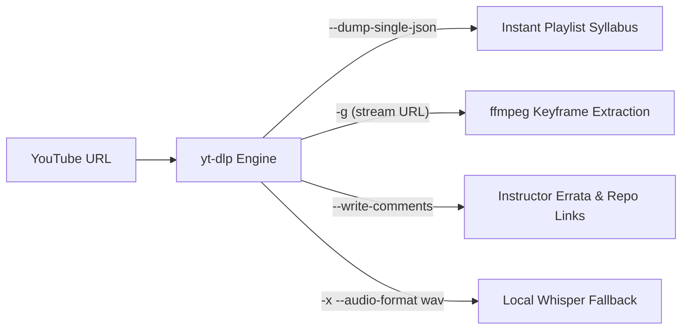
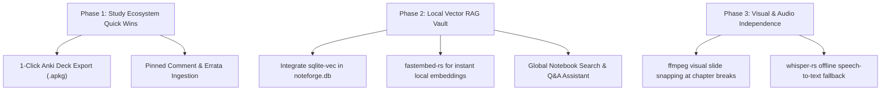

# NoteForge AI — Innovation Roadmap & Ecosystem Tools

> **Vision**: Transform NoteForge AI into the world's most capable, 100% local, privacy-first desktop study studio. Zero cloud subscriptions, zero token limits, autonomous playlist processing, and permanent SQLite study vaults.

---

## 1. Executive Summary & Core Moat

Modern AI note tools (NotebookLM, Mindgrasp, TurboLearn) charge \$15–\$30/month, lock your data in proprietary clouds, and fail or hit token limits on 20+ video university courses or bootcamp playlists.

### NoteForge's Competitive Moat
1. **100% Local & Free Forever**: Runs via local Ollama (`qwen2.5:7b`), local SQLite (`noteforge.db`), and native Rust/Tauri v2 binaries.
2. **Autonomous Multi-Hour Batch Processing**: Run 20+ lecture playlists overnight on modern laptop hardware (e.g. Intel Core Ultra with 16GB RAM) without API bills or rate limits.
3. **Adaptive Hybrid Slicing**: Automatically preserves short videos as 1-to-1 cohesive lectures (`Lecture 1`, `Lecture 2`) while dynamically decomposing multi-hour lectures into structured sub-notes (`Lecture 10.1`, `Lecture 10.2`).
4. **Reliable Visual Diagrams**: Deterministic Mermaid diagram compiler and AST repair engine ensuring every architecture flowchart and state diagram renders cleanly.

---

## 2. Competitive Landscape & Feature Matrix

| Feature | NoteForge AI | Google NotebookLM | Mindgrasp AI | TurboLearn (Turbo AI) | NoteGPT |
| :--- | :---: | :---: | :---: | :---: | :---: |
| **Pricing** | **Free & Open** | Free (Token Limited) | \$14.99/mo | \$19.99/mo | Freemium |
| **Data Privacy** | **100% Local Device** | Cloud | Cloud | Cloud | Cloud |
| **Playlist Batching** | **Autonomous 20+ vids** | Manual 1-by-1 | Restricted | Limited | Truncated |
| **Offline Vault** | **SQLite (`.db`)** | ❌ (Web only) | ❌ (Web only) | ❌ (Web only) | ❌ (Web only) |
| **Mermaid Flowcharts** | **Native Built-in** | ❌ | ❌ | Basic | Basic |
| **Flashcards & Quizzes**| **Built-in** | ❌ | Yes | Yes | Basic |
| **Visual Slide Extraction** | *Planned (Phase 3)* | ❌ | Partial | Partial | ❌ |
| **Local Vector RAG** | *Planned (Phase 2)* | Yes (Cloud) | Yes (Cloud) | Yes (Cloud) | Basic |

---

## 3. Advanced `yt-dlp` Capabilities & Use Cases

`yt-dlp` is far more than a downloader. It is a high-performance streaming router, metadata extractor, and media pipeline:



### 1. Zero-Download Visual Slide Snapping (`-g` + `ffmpeg`)
- **Problem**: Technical tutorials feature code, terminal outputs, and architectural diagrams on screen that audio transcripts never mention.
- **Solution**: Avoid downloading 5GB video files. Use `yt-dlp -g` to resolve the direct streaming URL and have `ffmpeg` snapshot visual slide changes at chapter intervals:
  ```bash
  ffmpeg -ss 00:15:00 -to 00:20:00 -i $(yt-dlp -g -f "bestvideo[height<=720]" "<URL>") \
    -vf "select='gt(scene,0.4)',scale=960:-1" -vsync vfr slide_%03d.png
  ```
- **Result**: Markdown study notes automatically include actual lecture slide images and architecture diagrams alongside generated text.

### 2. Pinned Comments & Instructor Errata Ingestion
- **Problem**: Instructors frequently pin comments to post corrections (*"At 14:20 `var` is function-scoped"*), GitHub repository links, or practice sandboxes.
- **Solution**: Extract top comments without downloading video content:
  ```bash
  yt-dlp --write-comments --dump-single-json --no-download "<URL>"
  ```
- **Result**: NoteForge renders a **"💡 Instructor Notes & Errata"** callout box at the top of the lecture note with verified repository links.

### 3. Local Whisper Audio Transcription Fallback
- **Problem**: Videos with closed captions disabled by the creator fail caption extraction.
- **Solution**: Strip the low-bitrate audio stream and pass to local Whisper:
  ```bash
  yt-dlp -x --audio-format wav --audio-quality 0 -o "temp_audio.wav" "<URL>"
  ```
- **Result**: 100% transcript coverage for any video on the internet, even with zero subtitles provided.

### 4. Instant Zero-Download Playlist Syllabus
- Dump the entire playlist structure, video titles, and exact durations in under 2 seconds:
  ```bash
  yt-dlp --dump-single-json --flat-playlist "<PLAYLIST_URL>"
  ```

---

## 4. High-Impact Libraries & Tools Roadmap

### Module A: Local Semantic Search & Global RAG
*Allow students to search across all 23 lectures (e.g. "Where did the instructor explain Closures?") and jump directly to the timestamped note section.*

1. **[`sqlite-vec`](https://github.com/asg017/sqlite-vec)** *(C/Rust SQLite Extension)*:
   - Written in C/Rust, loads directly into `noteforge.db`.
   - Adds native `vec0` virtual tables for vector similarity search using standard SQL queries (`ORDER BY distance LIMIT 5`).
   - Requires zero external database processes or microservices.
2. **[`fastembed-rs`](https://github.com/Anush008/fastembed-rs)** *(Rust crate)*:
   - High-throughput local embedding generation using ONNX Runtime in Rust.
   - Uses quantized models (`BGE-small` or `AllMiniLM-L6-v2`) taking only ~100MB RAM.
   - Embeds transcript segments locally in milliseconds on CPU.

---

### Module B: Local Speech-to-Text Fallback
*Ensure zero failures on uncaptioned videos.*

1. **[`whisper-rs`](https://github.com/tazz4843/whisper-rs)** *(Rust bindings for `whisper.cpp`)*:
   - Native Rust wrapper for `whisper.cpp` that runs directly inside Tauri's Rust backend.
   - Supports Intel OpenVINO / Core Ultra acceleration and 4-bit quantized models (`base.en`, `small.en`).
   - Completely removes any dependency on Python or external web APIs.

---

### Module C: Spaced Repetition & Study Ecosystem
*Bridge the gap between passive reading and active long-term retention.*

1. **[`ankipack`](https://github.com/ImGajeed76/ankipack)** *(TypeScript)* / **[`genanki-rs`](https://crates.io/crates/genanki-rs)** *(Rust)*:
   - Compiles NoteForge's generated flashcards into native `.apkg` files with formatting, tags, and media.
   - Students click **"Export to Anki"** and instantly import their flashcard decks into Anki for spaced repetition (FSRS / SM-2).
2. **[`Typst`](https://typst.app/)** *(Rust document compiler)*:
   - Compiles markdown study guides into publication-grade, LaTeX-quality PDFs with covers, syntax-highlighted code blocks, and clickable chapter links in $< 100\text{ms}$.

---

### Module D: Interactive Visualizations
*Transform complex lecture relationships into visual mind maps.*

1. **[`@xyflow/react` (React Flow)](https://reactflow.dev/)**:
   - Interactive zoomable canvas where each lecture is a node, sub-chapters branch out hierarchically, and clicking any node navigates directly to that note or timestamp.

---

## 5. Phased Implementation Roadmap



### Phase 1: Study Ecosystem Quick Wins (Immediate)
- [ ] Add **"Export to Anki (.apkg)"** button on notebook screen using `ankipack`.
- [ ] Ingest top/pinned YouTube comment via `yt-dlp` to highlight instructor errata and GitHub repository links.

### Phase 2: Local Vector RAG Vault
- [ ] Compile `sqlite-vec` into Tauri's SQLite database connection.
- [ ] Integrate `fastembed-rs` to index note paragraphs into `document_vectors`.
- [ ] Add a **"Chat with Notebook"** sidebar allowing users to ask questions grounded in their local notes.

### Phase 3: Visual & Audio Independence
- [ ] Stream scene changes via `ffmpeg` + `yt-dlp -g` to insert actual lecture slides into Markdown notes.
- [ ] Add `whisper-rs` fallback for uncaptioned videos.
